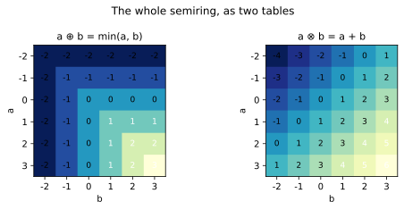
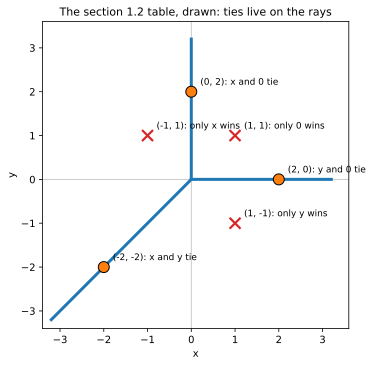
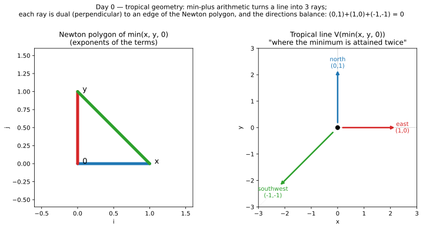
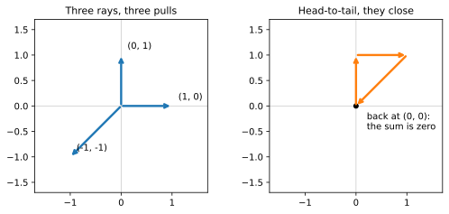

+++
title = "Addition Is Min, Multiplication Is Plus (and a Line Is Not a Line)"
description = "The tropical semiring, the tie definition of a curve, and the tropical line: three rays, a Newton polygon, and balancing."
weight = 1
[extra]
number = 1
lead = "Break arithmetic on purpose — and watch a line fall apart into three rays that balance."
+++


Welcome! In this book we are going to do something slightly rude to
arithmetic, and then watch geometry survive it — changed, simplified, and
frankly better-looking.

Ordinary geometry starts with equations like

```
x + y = 0
```

and draws you a line. We are going to keep the equation, change what the
symbols *mean*, and draw it again. The line will fall apart into three
rays stuck together at a point. Strangely, almost everything that mattered
about the line — its degree, its direction at infinity, its genus (zero,
in case you were worried) — will still be there, written in the rays.

That's tropical geometry: algebraic geometry after a very lossy, very
honest compression. Curves become graphs. Smooth things become
combinatorial things. And — this is the part that makes the whole book
possible — *you can compute all of it*, with short programs, and check
every claim as you go.

No algebraic geometry is assumed. If you know what a polynomial is and
you've seen a coordinate plane, you have the prerequisites. Let's break
arithmetic.

## 1.1 Two new operations, zero new numbers

Take the ordinary real numbers, plus one extra value, infinity (∞). Now
define two operations and give them grand names:

- **Tropical addition:** `a ⊕ b = min(a, b)` — "add" by taking the smaller.
- **Tropical multiplication:** `a ⊗ b = a + b` — "multiply" by adding, ordinarily.

That's it. That's the **tropical semiring**. Some quick experiments, the
way you'd poke a new programming language at a REPL:

```
3 ⊕ 7  = min(3, 7)  = 3
3 ⊗ 7  = 3 + 7      = 10
5 ⊕ 5  = 5
9 ⊕ ∞  = 9        (∞ is the identity for ⊕: min(∞, a) = a)
9 ⊗ 0  = 9        (0 is the identity for ⊗: 0 + a = a)
```



*The whole semiring at a glance, for small values of "whole." Left:
⊕ — read the idempotence straight off the diagonal, where `a ⊕ a = a`.
Right: ⊗, ordinary addition wearing a costume.*

Everything should feel *almost* normal, and then one thing should itch:
**`5 ⊕ 5 = 5`.** In ordinary arithmetic, adding a thing to itself makes
it bigger. Tropically, `a ⊕ a = a` for every `a`. This property is called
**idempotence**, and it's the first sign we're not in a field any more.
A close relative of the itch: there is **no tropical subtraction**. Given
`min(a, b)`, you can't recover what got thrown away. Information is
destroyed on purpose. Hold onto that — the whole subject lives in what
survives the destruction.

The operations do still cooperate, in exactly the way that makes
polynomials work:

```
a ⊗ (b ⊕ c)  =  a + min(b, c)  =  min(a + b, a + c)  =  (a ⊗ b) ⊕ (a ⊗ c)
```

Multiplication distributes over addition. So we can build **tropical
polynomials**: expressions made from variables and constants using only
⊕ and ⊗. And here is what one looks like when you unfold the definitions.
Take the tropical polynomial "`x ⊕ y ⊕ 0`". Unfolding:

```
x ⊕ y ⊕ 0  =  min(x, y, 0)
```

A tropical polynomial in two variables is always a minimum of terms, and
each term has the shape

```
c + i·x + j·y
```

for a constant `c` and non-negative integers `i, j` — the *exponents*.
(Why do exponents show up as multipliers? Because tropically, `x ⊗ x`
means `x + x`, which in ordinary notation is `2x`. Powers become multiples.
Multiplication became addition, so exponentiation became multiplication.
Everything moves down one rung of the ladder.)

> **A note on conventions.** Half the literature uses min-plus, as we do;
> the other half uses max-plus. They're mirror images (negate everything)
> and both are called "tropical." This book is min-plus throughout, and
> will wave a small flag whenever a source we're following uses the other
> side of the mirror.

## 1.2 A curve is where the minimum is attained twice

Now the definition the entire book hangs on — it's one sentence:

> **The tropical curve of a tropical polynomial is the set of points where
> the minimum is attained at least twice.**

Why *twice*? Think about what a single winning term means: at such a
point, one term is strictly smaller than all the others, and it stays the
winner in a whole little neighbourhood — nothing interesting happens
there; the polynomial is locally just one smooth sheet, `c + i·x + j·y`.
The interesting places are where the lead *changes hands*, where two
terms tie for smallest. Ordinary algebraic geometry finds curves where a
polynomial **equals zero**. Tropical geometry finds curves where a
polynomial **can't decide which term is smallest**. The tie locus is the
curve.

Let's compute our first one, by hand, completely.

**The tropical line:** `f(x, y) = min(x, y, 0)`, three terms: the value
`x`, the value `y`, and the value `0`. Pick some points and score them:

| Point | Terms (x, y, 0) | Min attained | On the curve? |
|---|---|---|---|
| (0, 2) | (0, 2, 0) | twice: `x`-term and `0` | **yes** |
| (2, 0) | (2, 0, 0) | twice: `y`-term and `0` | **yes** |
| (−2, −2) | (−2, −2, 0) | twice: `x`-term and `y` | **yes** |
| (1, 1) | (1, 1, 0) | once: only `0` | no |
| (−1, 1) | (−1, 1, 0) | once: only `x` | no |
| (1, −1) | (1, −1, 0) | once: only `y` | no |



*The table, drawn. Orange dots tie, and sit exactly on the rays; red
crosses have a single winner, and sit in the open regions between
them. Every point in the plane is one or the other — that dichotomy
is the curve.*

Now let's find *all* the ties, not just at our sample points.

- **Where do the `x`-term and the `0`-term tie, and win?** Need `x = 0`
  and `0 ≤ y` (so the `y`-term doesn't undercut them). That's the ray
  **straight up** from the origin: points `(0, t)`, `t ≥ 0`.
- **Where do `y` and `0` tie, and win?** Need `y = 0` and `0 ≤ x`. The
  ray **straight right**: `(t, 0)`, `t ≥ 0`.
- **Where do `x` and `y` tie, and win?** Need `x = y` and `x ≤ 0` (so the
  `0`-term doesn't win alone). The ray **down-left**: `(t, t)`, `t ≤ 0`.

And everywhere else, exactly one term wins outright, so there is no more
curve. The plane is divided into three regions — one where `0` wins
(the first quadrant's interior), one where `x` wins, one where `y` wins —
and the curve is exactly the border system between them.

**A line is a tripod.** Three rays from a single vertex at the origin,
pointing in the directions

```
(0, 1)    north
(1, 0)    east
(−1, −1)  southwest
```



*Figure 1.1 — Left: the Newton polygon (next section). Right: the tropical
line `V(min(x, y, 0))`. Three rays, one vertex, no line in sight.*

> **Try It 1.1.** For each point, evaluate all three terms and decide:
> on the curve or not? (a) (2, 2)  (b) (−3, 0)  (c) (0, −5)  (d) (−1, −1).
> Two of these are traps: they sit on the *lines containing* rays but not
> on the rays themselves. Answers at the end of the chapter.

## 1.3 The Newton polygon: the curve's shadow, drawn in advance

Look at the exponents of our three terms: `x` has exponent `(1, 0)`,
`y` has `(0, 1)`, and the constant `0` has `(0, 0)`. Plot those three
points and take their **convex hull** — stretch a rubber band around
them. You get a triangle. This is the **Newton polygon** of the
polynomial, and it knows the curve's shape before we compute anything:

> **Duality.** Each *edge* of the Newton polygon corresponds to one *ray*
> of the tropical curve. The ray is **perpendicular** to its edge and
> points like the edge's inward normal.

Check it against Figure 1.1:

- Bottom edge, `(0,0)–(1,0)`: horizontal edge, inward normal `(0, 1)` →
  the **north** ray. ✓
- Left edge, `(0,0)–(0,1)`: vertical edge, inward normal `(1, 0)` → the
  **east** ray. ✓
- Hypotenuse, `(1,0)–(0,1)`: direction `(−1, 1)`; perpendicular to it is
  `(−1, −1)` (dot product: `(−1)(−1) + (1)(−1) = 1 − 1 = 0` ✓), pointing
  inward → the **southwest** ray. ✓

Three edges, three rays. This is the first appearance of the book's
central bargain: **continuous geometry on one side, finite combinatorics
on the other, and a dictionary between them.** In Chapter 2 the polygon
will get *subdivided* by the coefficients, and that's when curves start
growing vertices, bounded edges, and eventually cycles. For now, notice
we could have drawn the right-hand picture from the left-hand one with a
ruler and the duality rule alone.

## 1.4 Balancing: why these graphs deserve to be called curves

One more condition, the most important one in the book. Add the three
ray directions:

```
(0, 1) + (1, 0) + (−1, −1) = (0, 0)
```

They **balance**. This is not a coincidence of our example; it is a
theorem-shaped fact about every tropical curve, at every vertex (in
general: `Σ wᵢ·vᵢ = 0`, where `wᵢ` are positive integer *weights* we'll
meet in Chapter 2 — here all weights are 1). The rays pull in their
directions with their weights, and the total pull is zero, like forces
in equilibrium, or currents at a node satisfying Kirchhoff's law.



*Left: the three ray directions as pulls from the vertex. Right: the
same three vectors head-to-tail. They close — that loop closing is
what `(0, 1) + (1, 0) + (−1, −1) = (0, 0)` looks like.*

Balancing is the discrete soul of the subject. A random tripod is just a
graph; a *balanced* graph is a curve — it's the condition that lets these
pictures carry intersection theory, genus, Jacobians, and curve-counting,
all of which are coming. Whenever this book draws you a graph and calls
it a curve, the receipt is a balancing sum that comes out to zero.

## 1.5 The whole chapter, as a program

Everything in this chapter is one runnable program: [ch01_tropical_line.py](./ch01_tropical_line.py). The assertions *are* the chapter's claims — run it, and if it prints its final line, the tropical line is what we said it is. (This section used to print the listing inline; a screenful of code you can download is just a download with extra scrolling.)

## 1.6 Try It

1. **(Warm-up, from §1.2's table.)** Redo Try It 1.1(c) slowly: at
   (0, −5), which term wins, and by how much? What goes wrong with the
   guess "x = 0 is the north ray"?
2. **Move the vertex.** Consider `g(x, y) = min(x, y, 1)`. Find where all
   three terms tie. Predict the three rays (directions *and* starting
   points) using duality before evaluating anything. Then check three
   points with the tie test: does the southwest ray pass through the
   origin?
3. **A teaser for Chapter 2.** Consider `min(2x, 2y, 0)`. Show that, *as a
   set of points*, its curve is identical to the tropical line's. And
   yet — it is not the same curve. What's missing from the picture that
   could tell them apart? (Chapter 2's first word is the answer.)

## Answers

- **Try It 1.1.** (a) (2, 2): terms (2, 2, 0) — `0` wins alone, **off**.
  (b) (−3, 0): terms (−3, 0, 0) — `x` wins alone, **off** (the east ray
  needs `x ≥ 0`). (c) (0, −5): terms (0, −5, 0) — `y` wins alone,
  **off** (the north ray needs `y ≥ 0`). (d) (−1, −1): terms (−1, −1, 0)
  — tie, **on** (southwest ray).
- **Try It 1.6.2.** All three tie when `x = y = 1`: the vertex moves to
  **(1, 1)**. Rays: north from (1, 1) along `x = 1, y ≥ 1`; east along
  `y = 1, x ≥ 1`; southwest along `x = y ≤ 1` — same directions as
  before (the Newton polygon didn't change, only the constants did),
  and yes, the southwest ray passes through (0, 0), since
  `min(0, 0, 1) = 0` is attained twice.
- **Try It 1.6.3.** `2x = 2y` iff `x = y`, `2x = 0` iff `x = 0`, etc. —
  every tie condition is the old one scaled, so the set is identical.
  The missing ingredient is **weight**: that curve is a line *counted
  twice*. Chapter 2 makes weights precise — and shows a conic that is
  secretly exactly this.

## What we learned

- Tropical arithmetic: **⊕ is min, ⊗ is plus**; the semiring is
  idempotent and has no subtraction, and polynomials still work.
- A **tropical curve** is where a tropical polynomial's minimum is
  attained **at least twice**.
- The tropical line is **three rays**, each **dual to an edge of the
  Newton polygon**, and their directions **balance**: they sum to zero.

## Next

Chapter 2 raises every exponent: the conic `min(2x, 2y, x+y, x, y, 0)`.
With flat coefficients it's a doubled line wearing a conic's clothes.
With *generic* coefficients, its Newton triangle subdivides, the tripod
sprouts three extra vertices — and we'll ask the question whose answer
is the genus: *where's the cycle?*

---

*Source & provenance: this chapter converts Day 0 (2026-10-10) of the
tropical geometry study — code `hidden_files/code/day00_tropical_line.py`,
figure `files/figures/day00-tropical-line.png`, study log Day 0 entry.
The chapter program (§1.5) was executed and passed on 2026-10-30; one assertion in
an early draft of the Try It answers was caught by that run (the
southwest ray of `min(x, y, 1)` does pass through the origin) and the
answer above is the corrected one. The three extra figures (the
operations tables, the six points drawn, the balancing arrows) were
added 2026-11-01: code `hidden_files/code/ch01_extra_figures.py`,
asserted the same way — classification, idempotence diagonal, and the
balancing sum are all checked in code before anything is drawn.*

## Chapter code

The full program behind this chapter, as a download: [ch01_tropical_line.py](./ch01_tropical_line.py) — the same file §1.5 points at. Its assertions are the chapter's claims; run it.
