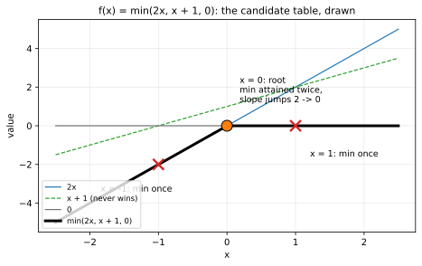
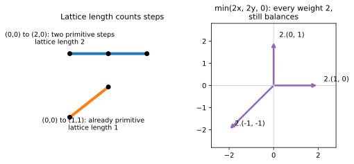
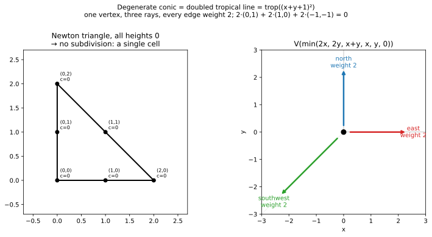
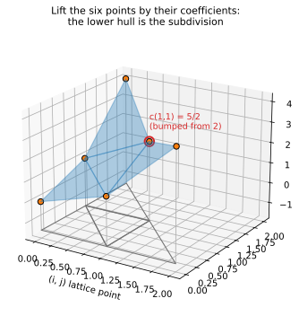
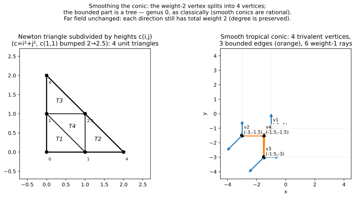

+++
title = "A Conic Is a Line That Got Caught Twice"
description = "Weights and multiplicity, the doubled line hiding inside a conic, subdivisions from coefficients, and why the smooth conic has genus 0."
weight = 2
[extra]
number = 2
lead = "A conic is a line that got caught twice: weights are memory, and coefficients subdivide the triangle."
+++


Chapter 1 ended with a cliffhanger: `min(2x, 2y, 0)` draws *exactly the
same set of points* as the tropical line, and yet it isn't the same
curve. This chapter names the missing ingredient — **weight** — and then
meets the first real family of curves: the conics. Along the way we'll
learn how coefficients reach into the Newton polygon and *subdivide* it,
why one conic is a line in disguise and another is a tree pretending to
be a circle, and where the cycle we keep hoping for is hiding. (Not here.
We checked. Twice.)

First, a one-variable warm-up, because it's the fastest way to see
weights being born.

## 2.1 Roots, in one variable: the missing root didn't vanish, it collided

In one variable, a tropical "curve" is a set of points on a line: the
**roots** of `f(x) = min(2x, x + 1, 0)`, where the min is attained at
least twice. There are three terms, so there are three candidate tie
points. Evaluate all three terms at each:

| Candidate | Why it's a candidate | Values (2x, x+1, 0) | Root? |
|---|---|---|---|
| x = 1 | `2x = x + 1` | (2, 2, 0) | no — min 0 attained *once* |
| x = 0 | `2x = 0` | (0, 1, 0) | **yes** |
| x = −1 | `x + 1 = 0` | (−2, 0, 0) | no — min −2 attained *once* |



*The table, drawn. The black envelope is the polynomial; the dashed
line, `x + 1`, never touches it — that is the missing root, hiding.
The two red crosses are candidates where the minimum is attained
only once.*

Only **x = 0** is a root. But this is a degree-2 polynomial! The
classical fundamental theorem of algebra promises two roots, counted
with multiplicity. Is the tropical version just… lying?

No — it's counting differently. Look at the graph of the min function.
For `x → −∞` it follows the term `2x`, slope 2. For `x → +∞` it follows
the term `0`, slope 0. At the root x = 0 the slope **jumps from 2 to
0** — a jump of size 2. That jump *is* the multiplicity:

> A tropical root's **multiplicity** is the size of the slope jump at
> it — equivalently, the lattice length of the edge it is dual to in
> the Newton polygon (here the edge from exponent 0 to exponent 2).

So x = 0 is a root of multiplicity 2, and `2 = 2`: **the tropical
fundamental theorem of algebra holds — with multiplicity.** The second
root didn't vanish. It collided with the first, and the collision left
a number behind. That number is our first weight.

## 2.2 Weights: edges remember their duals' lengths

Now back to two variables. Every edge of a tropical curve is dual to an
edge of (a subdivision of) the Newton polygon, per Chapter 1. Edges of
the curve carry a positive integer weight:

> **Weight of a curve edge = lattice length of its dual polygon edge** —
> the number of primitive steps in it. An edge from (0,0) to (2,0) has
> lattice length 2. An edge from (0,0) to (1,1) has lattice length 1
> (it's already primitive).

And balancing, Chapter 1's `(0,1) + (1,0) + (−1,−1) = 0`, upgrades to
its real form:

> **Weighted balancing:** at every vertex, `Σᵢ wᵢ·vᵢ = 0`, where `vᵢ`
> are the primitive directions of the edges at the vertex and `wᵢ`
> their weights.

Chapter 1's line had all weights 1, so the weights were invisible. Now
solve the Chapter 1 cliffhanger: `min(2x, 2y, 0)` has exponents
(0,0), (2,0), (0,2) — a triangle with every edge of lattice length 2.
Same three ray directions, but **every weight is 2**:

```
2·(0,1) + 2·(1,0) + 2·(−1,−1) = (0, 0) ✓ (still balances, of course)
```

Same picture, different curve: the tripod, *counted twice*. Tropical
geometry refuses to forget multiplicity, and weights are how it
remembers. Keep them in your pocket — a famous counting theorem in
Part II is basically bookkeeping of exactly these numbers.



*Left: lattice length counts primitive steps — (0,0) to (2,0) passes
through a lattice point, so it has length 2; (0,0) to (1,1) is
already primitive. Right: the doubled tripod's pulls, each twice as
strong, still cancelling to zero.*

## 2.3 The degenerate conic: a doubled line

A **conic** is a degree-2 curve: all terms `c + ix + jy` with
`i + j ≤ 2` — six lattice points, the Newton triangle with corners
(0,0), (2,0), (0,2). Start with the laziest coefficients of all:
every `c = 0`.

```
f(x, y) = min(2x, 2y, x+y, x, y, 0)
```

No coefficient distinguishes any point of the triangle, so the polygon
doesn't subdivide: one cell, dual to one vertex. Three boundary edges,
each of lattice length 2, give three rays of weight 2. **The "conic" is
the doubled tropical line of §2.2.**

> **Postcard from classical geometry.** This is the tropical shadow of
> a *non-reduced* conic: classically, `(x + y + 1)² = 0` is "a line,
> doubled" — the equation remembers being squared even though the
> solution set is just a line. Tropicalisation preserves exactly that
> memory, as weights. The bare *set* forgets; the *weighted graph*
> doesn't. This is why tropical curves are weighted graphs and not
> just graphs, full stop.



*Figure 2.1 — All coefficients zero: no subdivision, one vertex, three
rays of weight 2.*

## 2.4 Coefficients lift, and the polygon subdivides

Now give the terms distinct coefficients — "generic" heights. Take

```
c(i, j) = i² + j²,   except c(1, 1) = 2.5 instead of 2.
```

Here's the mechanism, and it's worth learning properly because the
whole book runs on it:

1. **Lift** each lattice point `(i, j)` up to height `c(i, j)` in 3D.
2. Take the **lower convex hull** of the lifted points — imagine
   resting the cloud of points on a table, and looking at the faces
   you can see from below.
3. **Project** those lower faces back down. The Newton polygon comes
   back *cut into pieces*: a **regular subdivision**.

Why the bump at (1,1)? At height exactly 2, the four lifted points
(0,0,0), (1,0,1), (0,1,1), (1,1,2) all lie on the plane `z = x + y` —
a four-way tie, dual to one 4-valent vertex. Raising (1,1) slightly
breaks the tie and picks a diagonal, giving the clean trivalent
picture below. (Lowering it would pick the other diagonal. Either way:
a *choice* was hiding in the flat spot, and the coefficients make it.)

Our subdivision has **four unit triangles** (area ½ each — they exactly
tile the area-2 triangle):

| Face (lattice points) | Dual vertex |
|---|---|
| (0,0), (1,0), (0,1) | (−1, −1) |
| (1,0), (2,0), (1,1) | (−3, −1.5) |
| (0,1), (0,2), (1,1) | (−1.5, −3) |
| (1,0), (0,1), (1,1) | (−1.5, −1.5) |

Each face's vertex is where its three terms tie for the *global*
minimum — the chapter's program checks that, exactly, for all four.



*Why "subdivision" is the right word. Lift each lattice point to the
height of its coefficient — the centre bumped to c(1,1) = 5/2,
circled — and take the lower hull: its four facets, projected
straight down, are exactly the four triangles in the table above.
Without the bump, (1,1) would sit at height 2, coplanar with (0,0),
(1,0) and (0,1) on the plane `z = x + y`, and one facet would be a
quadrilateral instead — the four-way tie the text warns about.*

## 2.5 Anatomy of the smooth conic

Duality now produces a real graph, not a tripod:

- **4 vertices**, one per triangle.
- **3 bounded edges**, dual to the 3 subdivision edges shared by two
  triangles. All three are incident to the central face (1,0),(0,1),
  (1,1) — the bounded graph is a **star**, hence a tree.
- **6 rays**, dual to the 6 boundary edges, all of weight 1: two in
  each of the three Chapter-1 directions.
- **Balancing** holds at all 4 vertices (checked in the full program
  from the subdivision data).



*Figure 2.2 — Subdivided Newton triangle (left) and the smooth tropical
conic (right): 4 vertices, 3 bounded edges, 6 rays. No cycle.*

Notice the far field: two rays in each direction, total weight 2 per
direction — **exactly the degenerate conic's weights.** Smoothing
resolved the fat vertex into four thin ones, but from far away nothing
changed. Degree is a far-field invariant, and deformation can't touch
it. File that away; Part II's counting theorems are this observation,
weaponised.

## 2.6 Where's the cycle? (An honest non-appearance)

A classical smooth conic is a sphere; its tropical shadow should have
"sphere-ness" about it. The combinatorial version of that number is
the **genus** of the graph:

```
g = E − V + 1     (bounded edges − vertices + 1, for a connected graph)
```

For our conic: `g = 3 − 4 + 1 = 0`. The bounded part is a tree. **There
is no cycle.** And here's the theorem that explains why there *couldn't*
be one:

> For a smooth tropical plane curve of degree `d`,
> **g = the number of interior lattice points of the Newton triangle
> = (d−1)(d−2)/2.**

The degree-2 triangle's lattice points are all on its boundary — it
has **zero** interior points — so *every* smooth tropical conic has
genus 0, matching the classical fact that a smooth conic is rational
(a sphere, genus 0). The formula's first interesting value is at
`d = 3`: `(2·1)/2 = 1`. One interior point. One cycle. Next chapter.

> **Honest Box — a prediction that failed, on the record.** The study
> notes written the night before this computation predicted the smooth
> conic "acquires a cycle." It's preserved in the notes *as* a
> correction, because it's the instructive kind of wrong: the intuition
> "smoothing creates topology" is fine, but the interior-point count
> was checkable in advance and says genus 0 outright. House rule,
> restated: count first, *then* hope.

## 2.7 Closing Chapter 1's Honest Box: the rays, from the picture alone

Chapter 1 confessed that its balancing check used hand-derived ray
directions. The full Day 1 program closes that gap: it takes the
sampled tie-mask — just the bitmap of the curve — clusters the
far-field points by angle, fits each cluster's direction by PCA, snaps
to the nearest primitive integer vector, and re-checks balancing on
the *inferred* directions. Result, for both conics in this chapter:
snap error **0.00°** on every cluster, inferred directions balance to
(0, 0). The smooth conic's six inferred rays are two each of
(0,1), (1,0), (−1,−1) — the far-field claim of §2.5, recovered from
pixels. The picture now testifies on its own behalf.

## 2.8 The whole chapter, as a program

Everything in this chapter is one runnable program: [ch02_tropical_conic.py](./ch02_tropical_conic.py). The assertions *are* the chapter's claims — run it, and if it prints its final line, the conics are what we said they are. (This section used to print the listing inline; a screenful of code you can download is just a download with extra scrolling.)

## 2.9 Try It

1. **Triple line.** Predict, before computing: the rays and weights of
   `min(3x, 3y, 0)`, and check weighted balancing. What classical
   object is it the shadow of?
2. **Check a vertex by hand.** At the smooth conic's vertex (−3, −1.5),
   evaluate all six terms `c + ix + jy`. Which three tie, and what is
   the minimum value?
3. **Count ahead.** List the interior lattice points of the degree-4
   Newton triangle (`i, j ≥ 0`, `i + j ≤ 4`, strict interior). How
   many are there, and what genus does §2.6's formula predict for a
   smooth tropical quartic?

## Answers

- **1.** Same three directions, every weight **3** (boundary edges now
  have lattice length 3); `3·(0,1) + 3·(1,0) + 3·(−1,−1) = (0,0)`.
  Shadow of a *triple* line — a non-reduced "conic-plus" (a degree-3
  line counted three times).
- **2.** Values: (0,0) ↦ 0; (1,0) ↦ 1−3 = −2; (2,0) ↦ 4−6 = −2;
  (0,1) ↦ 1−1.5 = −0.5; (1,1) ↦ 2.5−3−1.5 = −2; (0,2) ↦ 4−3 = 1.
  The face (1,0), (2,0), (1,1) ties at **−2**, and nothing undercuts it.
- **3.** Interior points: (1,1), (1,2), (2,1) — **3 points**, genus
  **3**. (Keep this; a later chapter builds that quartic and finds
  three cycles, arranged in a way worth the wait.)

## What we learned

- Multiplicity is a **slope jump**; in two variables it becomes
  **weight = lattice length of the dual edge**, and balancing is
  `Σ wᵢvᵢ = 0`.
- Coefficients **lift** the Newton polygon's points; the lower hull
  projects to a **subdivision**; faces ↔ vertices, shared edges ↔
  bounded edges, boundary edges ↔ rays.
- A smooth conic's bounded graph is a **tree**: genus **0**, because
  the degree-2 triangle has **no interior lattice points**.
- Smoothing redistributes vertices but conserves the far field:
  **degree is read off at infinity**, in total ray weights.

## Next

Degree 3. The triangle grows one interior lattice point, (1,1) — and
its six surrounding triangles will dualise into something the conic
couldn't have: a **cycle**, the tropical shadow of a torus. Chapter 3
builds the tropical elliptic curve and teaches the bounded graph to
hold water.

---

*Source & provenance: Day 1 (2026-10-11) of the tropical geometry
study — code `hidden_files/code/day01_tropical_conic.py` (run log
`hidden_files/day01-run.log`), figures
`files/figures/day01-degenerate-conic.png` and
`day01-smooth-conic.png`, study log Day 1 entry. The chapter program (§2.8) was
executed and passed on 2026-10-30. The three extra figures (the roots
graph, the weights diagram, the lifting) were added 2026-11-01: code
`hidden_files/code/ch02_ch03_extra_figures.py`, asserted the same way —
the candidate table, the lattice lengths, and that the computed lower
hull is exactly the four faces tabulated in §2.4 are all checked in
code before anything is drawn.*

## Chapter code

The full program behind this chapter, as a download: [ch02_tropical_conic.py](./ch02_tropical_conic.py) — the same file §2.8 points at. Its assertions are the chapter's claims; run it.
