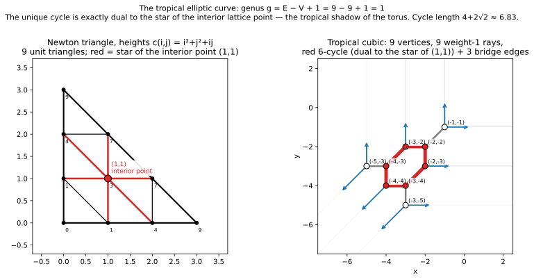
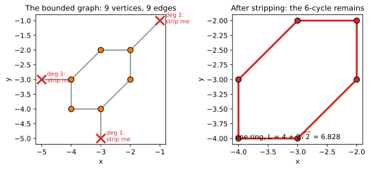
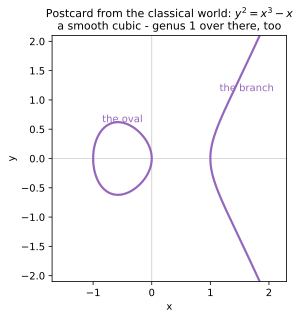

+++
title = "The Cubic Has a Donut Inside It"
description = "The tropical cubic: one interior lattice point, one 6-cycle, genus 1 — predicted from the Newton triangle before it is computed."
weight = 3
[extra]
number = 3
lead = "One interior lattice point, one cycle: the tropical elliptic curve, predicted before it is drawn."
+++


Every classical geometer knows the smooth cubic by its other name: an
**elliptic curve**, genus 1, topologically a torus — a donut. Chapter 2
proved, with a lattice-point count, that no conic could ever grow a
cycle. This chapter cashes the cheque Chapter 2 wrote: at degree 3 the
Newton triangle acquires exactly one interior lattice point, and the
tropical cubic grows exactly one cycle. We will predict the entire
curve — vertices, edges, rays, the cycle, even its length — from the
triangle alone, *before* computing, and then make the computation sign
for every line.

## 3.1 Predict first (the house rule, applied)

The degree-3 Newton triangle has corners (0,0), (3,0), (0,3) and ten
lattice points. Exactly one is interior:

```
(1, 1)      — since (d−1)(d−2)/2 = 1 for d = 3
```

Now choose heights designed to subdivide the triangle into unit
triangles (a **unimodular triangulation** — the tropical meaning of
"smooth"):

```
c(i, j) = i² + j² + i·j
```

(The cross term `i·j` is doing real work: it breaks the flat spots
that `i² + j²` alone leaves at this degree, giving a full 6-triangle
fan around (1,1).) Predictions, all from Chapter 2's dictionary:

1. **9 faces.** The triangle has area 9/2; unit triangles have area
   ½. So a unimodular triangulation has exactly **9 faces → 9
   vertices** on the curve.
2. **9 rays.** The boundary has 9 unit edges (3 per side), each dual
   to a weight-1 ray: **3 each** in directions (0,1), (1,0), (−1,−1).
   Total weight 3 per direction — degree 3, read at infinity.
3. **9 bounded edges.** Count edge-face incidences: `3·9 = 27 =
   2·(interior edges) + 9` (boundary), so interior edges — dual to
   bounded curve edges — number **9**.
4. **Genus 1.** `g = E − V + 1 = 9 − 9 + 1 = 1`. And by Chapter 2's
   theorem it *must* be 1: one interior point.
5. **The cycle is the star of (1,1).** A point inside the triangulation
   is surrounded by triangles — its **star**. Vertices of the curve
   dual to star faces are arranged in a ring, because the star is a
   fan. With 6 triangles around (1,1), expect a **6-cycle**; the other
   3 bounded edges are bridges — trees grafted onto the ring,
   connecting it to the three corner vertices.

If the computation disagrees with any of this, either the code or the
dictionary is wrong, and either way we learn something. Run it.

## 3.2 The computation signs

The full Day 2 program computes the subdivision from the lower hull
(it does *not* take the triangulation on faith), solves each face's
tie equations, and asserts its way down the prediction list. Result:

- **9 unit triangles**, exactly tiling the triangle. ✓
- **9 vertices**; three spot-checks solved by hand in advance —
  face {(0,0),(1,0),(0,1)} ↦ (−1,−1), {(1,0),(2,0),(1,1)} ↦ (−3,−2),
  {(1,0),(0,1),(1,1)} ↦ (−2,−2) — all match the computation exactly. ✓
- **Balancing** asserted at all 9 vertices. ✓
- **9 bounded edges, 9 rays** with direction multiset
  {3×(0,1), 3×(1,0), 3×(−1,−1)}, all weight 1. ✓
- All vertices, edge-midpoints and ray tips found on the sampled mask;
  all 9 rays **inferred back from the mask alone** (Chapter 2's
  bitmap method, re-centred on the curve), snap error 0.00°,
  balancing on inferred directions = (0, 0). ✓



*Figure 3.1 — Left: the Newton triangle, the star of the interior
point (1,1) shaded red. Right: the tropical cubic — red 6-cycle, grey
bridges, blue rays. The red on the left* is *the red on the right,
dualised.*

## 3.3 Finding the cycle: leaf-stripping

How do you *prove* the bounded graph's only cycle is the predicted
ring, rather than eyeballing the picture? Strip it:

> **Leaf-stripping.** Repeatedly delete vertices of degree 1 (with
> their edge). Trees are eaten completely — every tree has a leaf,
> and deleting leaves creates new leaves until nothing is left.
> Whatever survives, survives because every vertex on it has degree
> ≥ 2. For our graph, what survives is exactly the cycle.

Applied to the 9-vertex bounded graph: the three corner vertices
(faces (0,0),(1,0),(0,1); (2,0),(3,0),(2,1); (0,2),(1,2),(0,3)) are
degree-1 and get stripped, and stripping stops on **6 vertices,
2-regular** — a single 6-cycle. Then the duality check, which is the
chapter's real theorem:

- The 6 cycle vertices are *exactly* the faces containing (1,1) —
  the star. No more, no fewer.
- Every cycle edge is dual to a subdivision edge **incident to
  (1,1)**.
- The other 3 bounded edges are verified **bridges** (delete one and
  the graph disconnects — the computational definition of "tree part").

So the cycle isn't *near* the interior point, or *caused* by it in
some vague sense. **The cycle is the star, read in the dual picture:**
each interior lattice point contributes its star, and the star
dualises to a cycle. One interior point, one cycle. This is
Chapter 2's genus formula with its sleeves rolled up.



*Stripping, drawn. Left: the bounded graph, with its three degree-1
corner vertices crossed out — everything else has degree 2 or 3.
Right: one pass later nothing else can fall (every survivor has
degree exactly 2), and what remains is the ring, measured:
`L = 4 + 2√2`.*

Even the cycle's size is computable, edge by edge from the vertex
coordinates: four edges of length 1 and two of length √2, total

```
L = 4 + 2√2 ≈ 6.828
```

Remember that number. Much later in this book (Part VI) this cycle
acquires a *group law*, and `L` becomes the circumference of its
Jacobian — the tropical elliptic curve turns out to be, metrically,
a circle of length `4 + 2√2` wearing a graph as a name tag.

## 3.4 The classical postcard

Classically: a smooth plane cubic is a torus; its genus, computed by
adjunction, is `(3−1)(3−2)/2 = 1`. Tropically: the bounded graph's
first Betti number is 1. **Same number, same formula, two worlds.**
The tropical curve is often described as the *skeleton* the torus
leaves behind when the complex structure degenerates — the donut
deflated onto its core circle, with trees where the rest of the
surface used to hang. That's not just a metaphor in this book's later
chapters; Part VI does divisor theory on the graph itself and
recovers the elliptic curve's group law as *rotation of the cycle*.



*The postcard itself: `y² = x³ − x`, the classical smooth cubic in
the real plane — a closed oval plus an unbounded branch, two
components you can see, one torus you can't (the rest of it lives in
the complex points). Its genus is 1 by adjunction; the tropical
cubic's is 1 by counting a cycle. The deflated donut kept the number
that matters.*

## 3.5 The whole chapter, as a program

Everything in this chapter is one runnable program: [ch03_tropical_cubic.py](./ch03_tropical_cubic.py). The assertions *are* the chapter's claims — run it, and if it prints its final line, the cubic is what we said it is. (This section used to print the listing inline; a screenful of code you can download is just a download with extra scrolling.)

## 3.6 Try It

1. **Predict the quartic.** Using only the dictionary: for a smooth
   tropical quartic (degree 4, heights giving a unimodular
   triangulation), predict (a) the number of faces/vertices, (b) the
   number of rays, (c) the number of bounded edges — use
   `3F = 2E_int + E_boundary` — and (d) the genus. Check (d) against
   Chapter 2's interior-point count (Try It 2.9.3).
2. **Strip by hand.** Draw (on paper!) the bounded graph from the
   chapter program's bounded-edge list — faces 0–8, edges from shared
   sides — and leaf-strip it with a pencil. Which three vertices fall
   off? Confirm the survivors are exactly the faces containing (1,1).
3. **Break smoothness.** The face {(0,0),(1,0),(0,1)} is a unit
   triangle. Merge it with {(1,0),(0,1),(1,1)} into one quadrilateral
   face. What happens to the dual vertex's valence, and to
   weighted balancing there? (Qualitative answer is fine — this is
   what "non-smooth" means tropically, and Part II will meet worse.)

## Answers

- **1.** (a) Triangle area `4²/2 = 8`, unit triangles of area ½ →
  **16 faces = 16 vertices**. (b) Boundary unit edges: 4 per side →
  **12 rays**. (c) `3·16 = 48 = 2E_int + 12` → **E_int = 18 bounded
  edges**. (d) `g = 18 − 16 + 1 =` **3**, matching the 3 interior
  points (1,1), (1,2), (2,1). ✓ (Day 18 of the study built exactly
  this curve: its skeleton is three hexagons, pairwise sharing an
  edge — a Deep Dive in Part VII.)
- **2.** The corner faces 0, 1, 2 fall off — dual to the triangles at
  the Newton triangle's corners. The survivors are faces 3–8, each
  containing (1,1).
- **3.** The two vertices merge into one vertex where **four** edges
  meet (valence 4 instead of 3+3 across an edge). Balancing can still
  hold — it's a sum over *all* edges at the vertex — but the curve is
  no longer trivalent, i.e. no longer "smooth": tropically, a merged
  face is a singular point where two vertices collided, the same
  collision story as Chapter 2's warm-up, one dimension up.

## What we learned

- The dictionary is **predictive**: faces, rays, bounded edges and
  genus were all computed from the Newton triangle before the curve
  was drawn — and the curve complied.
- **Interior lattice points ↔ cycles**, concretely: a point's star
  dualises to a cycle; leaf-stripping isolates it; bridges are the
  trees grafted on.
- The tropical cubic's cycle has a **metric**: length `4 + 2√2`,
  the circumference its Jacobian will turn out to have.
- Genus is one number computed three compatible ways:
  `E − V + 1`, interior points, `(d−1)(d−2)/2`.

## Next — Part II: counting curves

We can draw curves. Now we *count* them. Classical algebraic geometry
asks: how many rational cubics pass through 8 general points? (Answer:
12 — and for centuries you needed heavy machinery to prove it.)
Chapter 4 counts them tropically, by taking floor diagrams apart and
putting them back together — and lands on 12, then 620 quartics, with
a program small enough to fit in a chapter.

---

*Source & provenance: Day 2 (2026-10-12) of the tropical geometry
study — code `hidden_files/code/day02_tropical_cubic.py` (run log
`hidden_files/day02-run.log`), figure
`files/figures/day02-tropical-cubic.png`, study log Day 2 entry. The
full Day 2 program was re-run end-to-end on 2026-10-30 while drafting
(all checks passed); the chapter program (§3.5) was executed separately
and passed the same day. The two extra figures (leaf-stripping, the
classical postcard) were added 2026-11-01: code
`hidden_files/code/ch02_ch03_extra_figures.py` — the strip is computed,
not drawn by hand: the survivors are asserted to be exactly the six
faces containing (1,1), 2-regular, with edge lengths
{1, 1, 1, 1, √2, √2} summing to 4 + 2√2, and the postcard's curve is
asserted smooth (discriminant 64 ≠ 0) before rendering.*

## Chapter code

The full program behind this chapter, as a download: [ch03_tropical_cubic.py](./ch03_tropical_cubic.py) — the same file §3.5 points at. Its assertions are the chapter's claims; run it.
