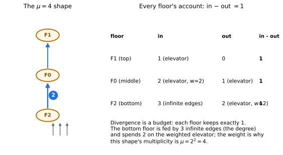
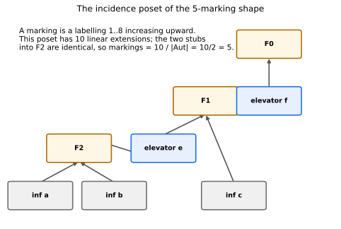
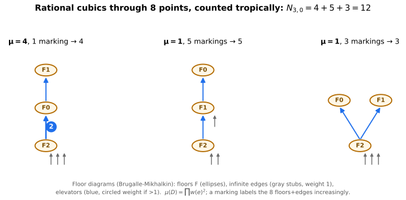
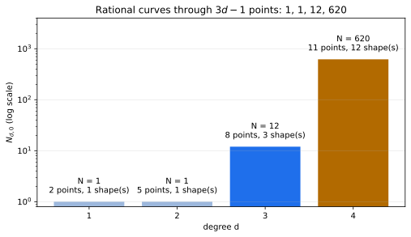

+++
title = "Twelve Cubics, Counted on the Floor"
description = "Mikhalkin's correspondence in floor-diagram form: divergence, multiplicity, and markings recompute the 12 rational cubics through 8 points — then 620 quartics."
weight = 4
[extra]
number = 4
part = "Part II — Counting curves by taking them apart"
lead = "A famous count — 12 rational cubics through 8 points — recomputed by taking little oriented graphs apart and putting them back together."
+++


We can draw curves. Now we *count* them.

Here is a classical question with a famous answer. A **rational** cubic
is a cubic curve of genus 0 — topologically a sphere, not the donut of
Chapter 3; think of a cubic with one node (a self-crossing), which is
what drops the genus by one. How many rational cubics pass through 8
general points in the plane?

The answer is **12**. It has been known since the nineteenth century,
and the classical proofs are not things you would want to meet in a
dark alley. This chapter recomputes the 12 tropically, using
**floor diagrams** (Brugallé–Mikhalkin): the curve is taken apart into
floors and elevators, the pieces are counted by a short program, and
the count falls out as

```
12 = 4 + 5 + 3
```

— three shapes, each contributing its multiplicity times its number of
markings. Then the same program, untouched, counts quartics and lands
on 620.

## 4.1 Predict first: why 8 points, and what should the count feel like?

The number of points is not arbitrary. For degree `d`, rational plane
curves are counted through

```
3d − 1   points
```

Check the small cases against things you already believe:

- `d = 1`: **2 points** determine a line — and exactly **1** line passes
  through them.
- `d = 2`: **5 points** determine a conic — exactly **1** conic, in
  general.

So the sequence of counts `N_{d,0}` starts `1, 1, …`. For cubics the
formula gives 8 points. Prediction, before any machinery: the count
should be a *specific small integer*, and if a tropical method is
worth anything it should reproduce `1, 1` at `d = 1, 2` on the way to
whatever `d = 3` gives. If it says 12, we will believe the method
*because* it got the boring cases right first — and because at `d = 4`
it must then face 620, a number nobody would guess.

**Mikhalkin's correspondence theorem** (in its floor-diagram form) is
the bridge: under the right hypotheses, counting algebraic curves
through points equals a weighted count of tropical objects — here,
floor diagrams. We use the theorem; we do not prove it. What we *do*
is implement its counting rule exactly, from the primary source, and
check the rule against every classical number within reach.

## 4.2 Floor diagrams: a curve, taken apart

Picture a building seen from the side. A degree-`d` floor diagram has
exactly **`d` floors**. Between floors run **elevators** — oriented,
weighted edges. Each floor is also fed by **infinite edges** coming
from **vertices at infinity** below it: think of them as the curve's
ends escaping to infinity, one stub per unit of degree.

Formally, a floor diagram of degree `d` and genus `g` is a connected,
acyclic, oriented graph with a weight `w(e) ≥ 1` on every edge, such
that:

- there are `d` **floors** and some **vertices at infinity**, each
  1-valent with its unique edge *outgoing* (into a floor);
- **finite edges** (elevators) run floor → floor; **infinite edges**
  run infinity → floor;
- the weights of the infinite edges sum to `d`;
- the first Betti number is the genus: `b₁ = g` — for rational curves,
  `g = 0`, the finite edges form a tree on the floors, so there are
  exactly `d − 1` elevators;
- and the rule that does all the work, **divergence**:

> **div(v) = (sum of incoming weights) − (sum of outgoing weights) = 1**
> at *every* floor.

Divergence is a budget. Every floor receives weight from below —
infinite edges and elevators arriving from lower floors — spends some
of it on elevators leaving upward, and keeps exactly 1. Summing the
budget over all floors forces the infinite weights to total `d`, which
is why the degree is visible in the diagram at all.

Work one example completely. The first of the three cubic shapes has
three floors stacked in a chain. The bottom floor is fed by 3 infinite
edges and sends one elevator of weight 2 upward; the middle floor
receives that 2 and sends 1 upward; the top floor receives 1 and sends
nothing:

| Floor | In | Out | in − out |
|---|---|---|---|
| top | 1 (elevator) | 0 | **1** |
| middle | 2 (elevator of weight 2) | 1 (elevator) | **1** |
| bottom | 3 (infinite edges) | 2 (elevator of weight 2) | **1** |



*The table, drawn — and the shape itself. Every floor keeps exactly 1.
Hold on to that weight-2 elevator: it is about to be squared.*

## 4.3 Two numbers per shape: multiplicity and markings

A shape contributes to the count in two factors.

**Multiplicity.** Each elevator of weight `w` contributes `w²`:

```
μ(D) = Π over finite edges e of w(e)²
```

Our worked example has one weight-2 elevator and one weight-1, so
`μ = 2² · 1² = 4`. (Why squares? That is Mikhalkin's multiplicity,
inherited from the algebraic side of the correspondence — each
weighted elevator is where several tropical curves glue, and the
gluing is counted with multiplicity `w²`. In this book it is a rule
of the correspondence, verified by its outputs.)

**Markings.** A diagram by itself is a shape; a *marked* diagram is a
shape whose pieces have been labelled by the points it passes
through. Precisely: a marking is a bijection from `{1, …, 3d − 1}` to
the set of **floors ∪ edges** (for `d = 3`: 3 floors + 3 infinite edges
+ 2 elevators = 8 pieces — the 8 points!), strictly increasing along
the diagram: if an elevator runs from floor `s` to floor `t`, its
label must lie between theirs (`s < e < t`), and an infinite edge's
label must be below its floor's. Markings are counted **up to
automorphism** of the diagram.

So markings are linear extensions of a poset, divided by a symmetry
factor — and both parts can bite. Take the second cubic shape: a chain
of three floors, all elevators of weight 1, with infinite edges split
2 + 1 between the bottom and middle floors. Its incidence poset:



*The poset has **10** linear extensions — but the two infinite stubs
into the bottom floor are identical, and swapping them is an
automorphism of the diagram. Markings `= 10 / |Aut| = 10 / 2 = 5`.
Forget the division and every count in this chapter comes out wrong;
the program asserts the divisibility every single time.*

## 4.4 The count: 4 + 5 + 3 = 12, then 620

There are exactly **three** floor-diagram shapes of degree 3 and genus
0 (the program enumerates them: divergence determines the infinite
edges once the elevators and their weights are chosen, so the search
is finite — and it re-runs with weights allowed up to `d + 1` to
confirm the weight bound loses nothing). The full table:

| Shape | μ | Markings | Contribution |
|---|---|---|---|
| Chain, one elevator of weight 2 (bottom floor fed by 3) | 4 | 1 | **4** |
| Chain, all weights 1 (infinite edges split 2 + 1) | 1 | 5 | **5** |
| Fork: bottom floor splits to two floors (fed by 3) | 1 | 3 | **3** |
| **Total** | | | **12** |



*Figure 4.1 — The whole computation, drawn. Left: the weighted chain
(μ = 4, a single marking — the heavy elevator leaves the labels no
freedom). Middle: the split chain of §4.3 (5 markings). Right: the
fork (3 markings). `4 + 5 + 3 = 12`.*

And then the program keeps going, because a method you trust at
`d = 3` should be pushed until it says something you *didn't* feed it:

| d | Points (3d − 1) | Shapes | N_{d,0} |
|---|---|---|---|
| 1 | 2 | 1 | **1** |
| 2 | 5 | 1 | **1** |
| 3 | 8 | 3 | **12** |
| 4 | 11 | 12 | **620** |



*The table, drawn. 620 rational quartics through 11 points is
Kontsevich's number, originally obtained by a famous recursion in
mirror symmetry. The floor-diagram program gets it by enumeration:
12 shapes, contributions from 15 up to 102, summing to exactly 620.*

> **Honest Box — the wrong first guess, and a typo in the source.**
> The study's first implementation of this chapter used a
> half-remembered divergence rule (out − in, and no infinite edges at
> all) and produced nonsense. The fix came from reading the primary
> source — Dedieu's lecture notes on Brugallé–Mikhalkin — and
> implementing its definitions as printed. Even then, care was
> needed: the notes' condition (1.2)(iii) as printed says the infinite
> weights sum to `−d`, which is impossible for positive weights; the
> proof of its own Lemma 1.5 uses `= d`, and `= d` is what the code
> implements. A second real bug — canonical representatives relabelled
> infinite and finite edges by inconsistent permutations, inventing
> invalid "shapes" — was caught because canonical representatives are
> asserted to satisfy the diagram axioms. Moral, as ever in this book:
> the assertions are the chapter.

## 4.5 The whole chapter, as a program

Everything in this chapter is one runnable program: [ch04_floor_diagrams.py](./ch04_floor_diagrams.py). The assertions *are* the chapter's claims — run it, and if it prints its final line, the counts are what we said they are. (This section used to print the listing inline; a screenful of code you can download is just a download with extra scrolling.)

## 4.6 Try It

1. **Check the fork.** The third shape (right panel of Figure 4.1) has
   the bottom floor fed by 3 infinite edges, sending one weight-1
   elevator to each of two top floors. Verify divergence = 1 at all
   three floors, and compute μ.
2. **Quintic points.** How many points does the count `N_{5,0}` run
   through? (The classical value, for when a faster program comes
   along: 87304.)
3. **A heavy diagram.** A (hypothetical) diagram has finite-edge
   weights 2 and 3, and 2 markings. What is its contribution?
4. **Why d − 1 elevators?** For genus 0, use the vertex/edge count:
   `d` floors + `d` vertices at infinity, `d` infinite edges + `F`
   finite ones, and a connected acyclic graph has `E = V − 1`. Solve
   for `F`.

## Answers

- **1.** Bottom floor: in 3, out 1 + 1 = 2, div **1** ✓. Each top
  floor: in 1, out 0, div **1** ✓. `μ = 1² · 1² = 1` — the fork's
  contribution is all in its 3 markings.
- **2.** `3 · 5 − 1 =` **14 points**.
- **3.** `μ = 2² · 3² = 36`; contribution `36 · 2 =` **72**.
- **4.** `V = 2d`, `E = d + F`; `d + F = 2d − 1` gives **`F = d − 1`**.
  Genus 0 *is* the tree condition — Chapter 6 will break it on
  purpose, with parallel edges.

## What we learned

- **Counting curves can be combinatorics.** Mikhalkin's correspondence
  turns "how many rational cubics through 8 points?" into a finite
  enumeration of oriented graphs with weights.
- **Divergence = 1 is the engine.** It determines the infinite edges
  from the elevators, keeps the search finite, and encodes the degree.
- **Every shape pays twice**: once in multiplicity (`Π w²` — weights
  are never decoration) and once in markings (linear extensions,
  divided by automorphisms — symmetries are never decoration either).
- The method **scales past its teaching example**: the same assertions
  that verify 12 also verify 620.

## Next

Chapter 5 asks curves to do more than pass through points: to *touch*
a fixed line, to order. Tangency turns into two kinds of infinite edge
— fixed (α) and moving (β) — and the counts 12 become 36 and 10, with
the same machinery and one subtle correction about how fixed edges are
labelled.

---

*Source & provenance: Day 3 (2026-10-13) of the tropical geometry
study — code `hidden_files/code/day03_floor_diagrams.py` (run log
`hidden_files/day03-run.log`), figure
`files/figures/day03-floor-diagrams-12-cubics.png`, study log Day 3
entry. Definitions implemented from T. Dedieu, "Two lectures on the
enumeration of curves by means of floor diagrams" (arXiv:2511.21123),
Lecture IX §1.1–1.3. The chapter program was re-run end-to-end on
2026-11-01 while finishing this chapter (all assertions passed,
including the per-shape d = 3 breakdown and the d = 4 total 620). The
three extra figures (divergence accounts, the incidence poset, the
counts growth chart) were added the same day: code
`hidden_files/code/ch04_extra_figures.py`, which imports the chapter
program and asserts each figure's numbers — divergence accounts,
multiplicities, markings (10 linear extensions / |Aut| 2 = 5), and the
full 1, 1, 12, 620 table — before rendering.*

## Chapter code

The full program behind this chapter, as a download: [ch04_floor_diagrams.py](./ch04_floor_diagrams.py) — the same file §4.5 points at. Its assertions are the chapter's claims; run it.
