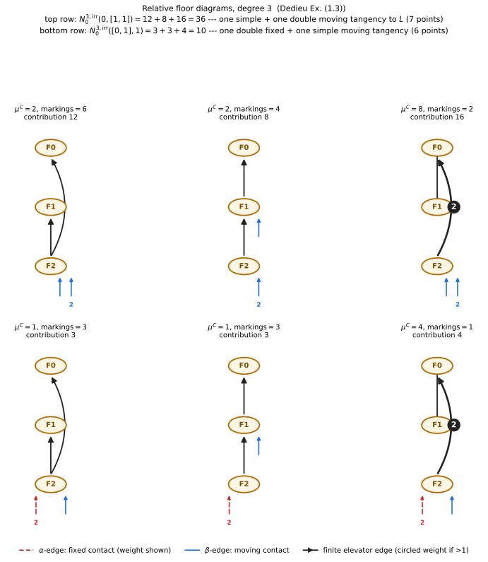
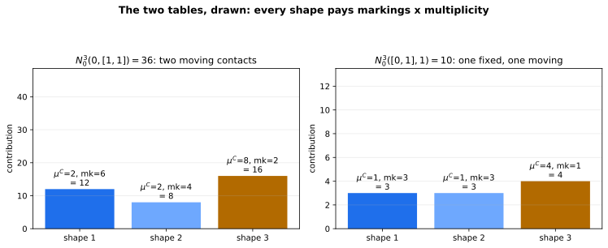

+++
title = "Tangency Is Just Floors Being Stubborn"
description = "Relative floor diagrams: fixed (α) vs moving (β) tangency to a line turns Chapter 4's 12 into 36 and 10, verified per shape against the source."
weight = 5
[extra]
number = 5
part = "Part II — Counting curves by taking them apart"
lead = "Ask a curve to touch a line instead of just passing through points — and where the touch must happen changes the count completely."
+++


Chapter 4 counted curves through points. But algebraic geometers also
ask curves to *touch* things: to meet a fixed line `L` not transversally
but with a prescribed **contact order** — a tangency. Ask a cubic to be
tangent to `L`, or to meet it in one double point and one simple point,
and the count changes completely: 12 becomes **36**, or **10**,
depending on *where* the contacts are required to happen.

That last distinction is the chapter's whole idea:

- A **fixed** contact (an `α` contact): the point of tangency on `L` is
  prescribed in advance. The curve must touch `L` *there*.
- A **moving** contact (a `β` contact): the curve must be tangent to
  `L` *somewhere*, but it gets to choose where.

Fixed is stricter, moving is freer, and floor diagrams keep the two
apart with two kinds of infinite edge. Everything else — the floors,
the divergence budget, the markings — is Chapter 4's machinery,
unchanged. Prediction, before we compute: the counts should still be
specific small integers, they should match the primary source *per
shape* and not just in total, and if we switch all the tangencies off
in the right way the machinery must hand us Chapter 4's 12 back.

## 5.1 Relative floor diagrams

Everything from Chapter 4 survives — `d` floors, divergence
`in − out = 1` at every floor (Dedieu (1.1)–(1.2)), acyclicity,
connectedness. What changes is the **type** `(α, β)` of the infinite
edges (Dedieu (1.4)–(1.5)):

- exactly `α_i + β_i` infinite edges of weight `i`, for each `i`;
- the `α` ones are the fixed contacts, the `β` ones the moving
  contacts;
- there are still exactly `d` floors (Lemma (1.5)(i)) — tangency
  conditions redistribute the infinite edges; they do not add floors.

The count `N_0^{3,irr}(α, β)` is the number of irreducible rational
cubics with `α_i` order-`i` contacts at fixed points of `L` and `β_i`
order-`i` contacts at moving points, through

```
2d + g − 1 + |β|   further general points
```

Note what is *not* in that formula: `|α|`. A fixed contact consumes a
condition by prescribing its point, so it does not add a point to pass
through; a moving contact does.

The multiplicity picks up a factor for the moving contacts
(Dedieu (1.1)):

```
μ^C(D) = I^β · Π over finite edges e of w(e)²,    I^β = Π_i i^{β_i}
```

A moving contact of order `i` pays a factor of `i`; a fixed contact
pays nothing extra — its cost was already paid by prescribing the
point.

## 5.2 The subtle part: how fixed edges are labelled

Markings work as in Chapter 4 — labels strictly increasing along the
incidence poset, counted up to automorphism — with one subtlety that
is worth a box, because the study got it wrong first and the source
had to correct it.

> **Honest Box — the fixed edges ARE labelled.** The study's first
> implementation treated the `α`-infinite edges as *unlabelled*,
> dividing by their permutations inside the automorphism count. The
> source says otherwise (Dedieu (1.6)): the `α` edges are labelled —
> with the non-positive labels `{−|α|+1, …, 0}` — and the labels
> within each weight class permute freely, contributing a factor
> `Π_k (α_k)!` to the marking count. In the two cases computed below
> that factor is 1, so the numbers were unaffected — but the code was
> fixed anyway, because a chapter that is only right on its examples
> is not right. The chapter program implements (1.6) as printed.

Precisely: labels `{1, …, 2d+g−1+|β|}` go on floors, finite edges and
`β` edges; the `α` edges carry the non-positive labels above.

## 5.3 The two counts: 36 and 10

**Case 1: `N_0^{3}(0, [1,1]) = 36`.** No fixed contacts; two moving
contacts, of orders 1 and 2 (`β_1 = β_2 = 1`, so `I^β = 2`). The
curves pass through `2·3 + 0 − 1 + 2 = 7` further general points.
Three shapes:

| Markings | μ^C | Contribution |
|---|---|---|
| 6 | 2 | **12** |
| 4 | 2 | **8** |
| 2 | 8 | **16** |
| | **Total** | **36** |

**Case 2: `N_0^{3}([0,1], 1) = 10`.** One *fixed* contact of order 2
(`α_2 = 1`) and one moving simple contact (`β_1 = 1`, so `I^β = 1`).
The curves pass through `2·3 + 0 − 1 + 1 = 6` further general points.
Three shapes:

| Markings | μ^C | Contribution |
|---|---|---|
| 3 | 1 | **3** |
| 3 | 1 | **3** |
| 1 | 4 | **4** |
| | **Total** | **10** |

Both totals — and both per-shape breakdowns — match Dedieu's Example
(1.3) *per shape*, not just in sum (`2×8 + 4×2 + 6×2` and `1×4 + 3 + 3`
in the source's ordering). Matching a total could be luck or two
errors cancelling; matching every summand is the correspondence rule
implemented correctly.



*Figure 5.1 — The six shapes. Blue stubs are moving (β) contacts; the
red dashed stub is a fixed (α) contact of weight 2: the curve must
touch the line at exactly that prescribed point, with contact order
2. Every shape drawn here was checked by the chapter program —
diagram axioms, multiplicity, and markings — before it was rendered.*



*The two tables, drawn. Read the biggest bar of the 36 first: only 2
markings, but `μ^C = 8` — a weight-2 elevator (`2² = 4`) times the
moving double contact's `I^β = 2`. Tangency pays in multiplicity what
it costs in freedom.*

And the sanity check that ties the chapter back to Chapter 4: with
`α` empty and `β = {1:3}` — three moving simple contacts, which is no
tangency condition at all — the relative machinery reproduces the
absolute count `N = 12`. The program asserts it.

> **Honest Box — a count this chapter does *not* make.** There is a
> famous *real* count nearby: Welschinger's `W_3 = 8`, the signed
> count of real rational cubics. It is **not** obtainable from
> Dedieu's lectures — a full-text check on Day 4 found that "floor
> diagram" and "real" never meet there. Getting 8 honestly needs a
> different source (Brugallé–Mikhalkin's real paper, or Shustin).
> This chapter claims 36 and 10, and nothing about 8.

## 5.4 The whole chapter, as a program

Everything in this chapter is one runnable program: [ch05_relative_floor_diagrams.py](./ch05_relative_floor_diagrams.py). The assertions *are* the chapter's claims — the per-shape tables above, both totals, the absolute-count sanity check, and a robustness re-run with the finite-edge weight bound raised from `d` to `d+1` (no new diagrams; the bound is exhaustive). Run it, and if it prints its final line, the counts are what we said they are. (This section used to print the listing inline; a screenful of code you can download is just a download with extra scrolling.)

## 5.5 Try It

1. **The fixed/moving asymmetry.** Why does a *fixed* order-2 contact
   contribute no `I^β`-style factor, while a *moving* one
   contributes 2?
2. **Count the points.** In Case 2, how many further general points
   do the curves pass through? (Use `2d + g − 1 + |β|` with `d = 3`,
   `g = 0`, `|β| = 1`.)
3. **A heavy shape.** A relative diagram has one finite edge of
   weight 2, `β = {1:1, 2:1}`, and 3 markings. What is its
   contribution?

## Answers

- **1.** The factor `I^β = Π i^{β_i}` is part of the multiplicity
  `μ^C` (Dedieu (1.1)), and it is indexed by `β` only: a moving
  contact of order `i` contributes `i`. A fixed contact's point is
  already prescribed, so the correspondence charges it nothing
  extra — its strictness shows up instead in *which* diagrams occur
  and how few markings they have (Case 2's shapes have 3, 3, and 1).
- **2.** `2·3 + 0 − 1 + 1 =` **6 points** — and note `|α|` does not
  appear: the fixed contact is a condition on `L`, not a point to
  pass through.
- **3.** `μ^C = I^β · Π w² = (1·2) · 2² = 8`; contribution
  `8 · 3 =` **24**.

## What we learned

- **Tangency is data, not decoration.** Splitting the infinite edges
  into fixed (`α`) and moving (`β`) turns one counting problem into
  a family — and the same enumeration answers all of it.
- **Fixed and moving are genuinely different conditions.** They
  differ in the point count (`|β|` appears, `|α|` does not), in the
  multiplicity (`I^β` charges moving contacts only), and in the
  labelling (fixed edges carry their own non-positive labels).
- **Per-shape agreement is the real verification.** 36 and 10 match
  the source summand by summand; the absolute 12 falls out as the
  degenerate case. The machinery of Chapter 4 survived being asked
  a harder question.

## Next

Chapter 6 breaks the rule this part has lived by: genus 0 meant
trees, and trees meant no parallel edges. Allow a doubled elevator
and the diagram grows a cycle — genus stops being a hypothesis and
becomes something you can count in the picture: `N_{3,1} = 1`,
`N_{4,1} = 225`.

---

*Source & provenance: Day 4 (2026-10-14) of the tropical geometry
study — code `hidden_files/code/day04_relative.py` (run log
`hidden_files/day04-run.log`), figure
`files/figures/day04-relative-floor-diagrams.png`, study log Day 4
entry. Definitions verified on Day 4 against T. Dedieu,
arXiv:2511.21123, Lecture IX (1.1)–(1.6) and Example (1.3). The
chapter program was re-run end-to-end on 2026-11-02 while finishing
this chapter: all assertions passed, including both per-shape
breakdowns, the absolute-count sanity check (N = 12), and the
weight-bound robustness re-run at d+1. Figures regenerated as SVG
the same day: code `hidden_files/code/ch05_extra_figures.py`, which
imports the chapter program and asserts each drawn shape's axioms,
multiplicity and markings — and that the drawn set is exactly the
program's enumerated set — before rendering.*

## Chapter code

The full program behind this chapter, as a download: [ch05_relative_floor_diagrams.py](./ch05_relative_floor_diagrams.py) — the same file §5.4 points at. Its assertions are the chapter's claims; run it.
