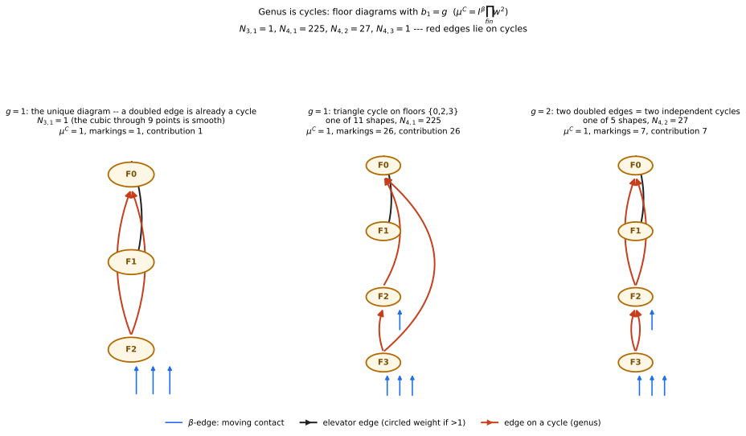
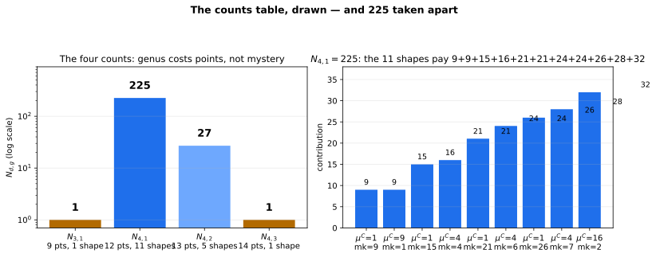

+++
title = "Genus Is Cycles"
description = "Higher-genus floor diagrams: one new ingredient — parallel edges — makes genus a cycle count. N_{3,1}=1, N_{4,1}=225, N_{4,2}=27, N_{4,3}=1, each cross-checked classically."
weight = 6
[extra]
number = 6
part = "Part II — Counting curves by taking them apart"
lead = "Allow one doubled elevator, and genus stops being a hypothesis about the classical curve — it becomes something you can count in the picture."
+++


Chapters 4 and 5 lived under a quiet restriction: genus 0. A genus-0
floor diagram is a *tree* on its floors — `d − 1` elevators, no cycles,
and, quietly doing work the whole time, **no parallel edges**: two
elevators between the same pair of floors would already be a cycle.

This chapter breaks the restriction with exactly one new ingredient.
Allow parallel edges, and the first Betti number of the diagram,

```
b₁ = |E_fin| − d + 1,
```

can be positive — and `b₁` *is* the genus `g` of the curves being
counted. A doubled elevator is the smallest possible cycle. Genus
stops being a hypothesis about the classical curve and becomes
something you can count in the picture.

Prediction, before we compute: everything else should survive —
`d` floors, divergence `in − out = 1` at every floor, no *directed*
cycles, markings as linear extensions up to automorphism, and the
same multiplicity `μ^C = I^β · Π w²` (Dedieu (1.1), whose
correspondence theorem (1.2) is stated for general `g`). The absolute
counts are again the relative type `(0, (1^d))`, and the point count
should grow with the genus: curves of degree `d` and genus `g` are
counted through `3d − 1 + g` points. And each tropical count should
have a classical witness — a nodal-curve formula it has to match.

## 6.1 The one real correction: multisets, not sets

> **Honest Box — the enumeration refused to draw the picture.**
> The study's first attempt reused Chapter 5's enumeration, which
> chose the elevators as a *set* of ordered floor pairs — and found
> **zero** genus-1 diagrams. That is not a theorem; it is the
> enumeration refusing to draw the one picture that matters. On 3
> floors the only 3-edge acyclic *set* is the transitive tournament,
> whose sink always violates divergence 1. The fix is one word:
> enumerate *multisets* of pairs
> (`combinations_with_replacement`), and the genus-1 cubic appears
> immediately — a doubled edge `2→0` plus `0→1`. The automorphism
> count needed the matching fix: floor permutations must preserve
> per-pair weight *multisets*, and parallel edges of equal weight
> contribute swap factors `Π m_{i,j,w}!`. The action on labellings
> stays free, so markings = (linear extensions)/|Aut| still holds
> exactly. The chapter program contains both fixes; its assertions
> check `b₁ = g` on every shape it enumerates.

With that, a genus-`g` diagram is a Chapter 4 diagram with
`|E_fin| = d − 1 + g` finite edges, parallel edges allowed. Nothing
else in the definition moves.

## 6.2 Four counts, each with a classical witness

**`N_{3,1} = 1`** (1 shape, through 9 points). The unique diagram is
the one the Honest Box promised: doubled `2→0` plus `0→1`, with
`μ = 1` and exactly 1 marking. Classically this had to be 1: there
is exactly one cubic through 9 general points, and it is smooth —
genus 1.

**`N_{4,1} = 225`** (11 shapes, through 12 points). Per-shape
contributions, in the order the chapter program prints them sorted:

```
9 + 15 + 21 + 21 + 26 + 16 + 24 + 24 + 28 + 9 + 32 = 225
```

Classical check: genus-1 quartics are 2-nodal quartics, and the node
polynomial `N₂(d) = (3/2)(d−1)(d−2)(3d²−3d−11)` (Vainsencher;
Kleiman–Piene for higher δ) gives 225 at `d = 4`. The formula itself
cross-checks at `d = 3`, where it predicts 21 = C(7,2) — the
reducible line+conic count. The program asserts both evaluations.

**`N_{4,2} = 27`** (5 shapes, contributions `3 + 5 + 7 + 4 + 8`,
through 13 points). Classical: 1-nodal quartics, and Steiner's
`N₁(d) = 3(d−1)²` gives 27 at `d = 4`.

**`N_{4,3} = 1`** (1 shape, through 14 points). The unique diagram —
doubled `0→1`, single `1→2`, tripled `3→0`: three independent
cycles, `μ = 1`, 1 marking — is the unique smooth quartic through
14 points.

| (d, g) | Points (3d−1+g) | Shapes | N_{d,g} | Classical witness |
|---|---|---|---|---|
| (3, 1) | 9 | 1 | **1** | the unique cubic is smooth |
| (4, 1) | 12 | 11 | **225** | node polynomial N₂(4) |
| (4, 2) | 13 | 5 | **27** | Steiner's 3(d−1)² |
| (4, 3) | 14 | 1 | **1** | the unique quartic is smooth |



*Figure 6.1 — Three panels: the unique (3,1) diagram (doubled edge =
the first cycle), a (4,1) diagram whose cycle is a genuine triangle
on floors {0,2,3} (μ = 1, 26 markings — the largest single marking
count in the chapter), and a (4,2) diagram with two doubled edges =
two independent cycles. Cycle edges in red. Every panel was checked
by the chapter program — axioms, `b₁ = g`, multiplicity, markings —
before it was rendered.*



*The table, drawn. Left: the four counts — note that genus 3 costs
two more points than genus 1 and collapses back to a single shape.
Right: 225 taken apart; the biggest bar (32) is the shape with two
weight-2 elevators (`μ^C = 2²·2² = 16`) and only 2 markings, while
the 26-marking triangle shape contributes 26. Markings and
multiplicity trade off all the way down the list.*

> **Honest Box — what the witnesses are.** The node-polynomial
> formulas are *checks*, quoted from Vainsencher and Steiner via
> the Day 5 log — this chapter does not derive them. The chapter's
> claims are the tropical counts; the classical formulas are the
> independent witnesses those counts have to answer to, and the
> program asserts the formulas' values (225, 21 = C(7,2), 27)
> alongside the enumerations.

## 6.3 The whole chapter, as a program

Everything in this chapter is one runnable program: [ch06_genus_floor_diagrams.py](./ch06_genus_floor_diagrams.py) — self-contained: Chapter 5's relative machinery is inlined, then the genus extension (multiset enumeration, multiset-preserving automorphisms). The assertions *are* the chapter's claims — all four totals, every per-shape contribution above, `b₁ = g` on every shape, the classical witnesses as formulas, and a robustness re-run with the finite-edge weight bound raised from `d` to `d+1` for (3,1), (4,1) and (4,2) (no new diagrams; the bound is exhaustive). One honest limitation, stated in the program's header: `N_{4,3}` is not re-run at bound `d+1` — its bound-`d` enumeration already takes about a minute, and the exhaustive-bound argument is the same upward-closed one as Chapters 4–5. Run it, and if it prints its final line, the counts are what we said they are. (This section used to print the listing inline; a screenful of code you can download is just a download with extra scrolling.)

## 6.4 Try It

1. A diagram on 4 floors has 6 finite edges. What is its genus?
2. Why can't a doubled edge appear in a genus-0 diagram? Answer in
   one sentence using `b₁`.
3. How many points does `N_{5,1}` run through, by the formula
   `3d − 1 + g`?

## Answers

- **1.** `g = b₁ = 6 − 4 + 1 =` **3**.
- **2.** A doubled edge already makes `b₁ ≥ 1`, but genus 0 means
  `b₁ = 0` — the finite edges must form a tree, and a tree has no
  parallel edges.
- **3.** `3·5 − 1 + 1 =` **15 points**.

## What we learned

- **Genus is a cycle count.** One formula, `b₁ = |E_fin| − d + 1`,
  turns the genus from a property of an unseen classical curve into
  something visible in the diagram — and the smallest cycle is just
  a doubled elevator.
- **The machinery didn't care.** Divergence, markings, multiplicity
  and the correspondence theorem were already stated for general
  `g`; the only real work was combinatorial honesty — multisets in
  the enumeration, multisets in the automorphisms.
- **Every count has a witness.** 1, 225, 27, 1 each meet an
  independent classical formula or uniqueness fact. Part II's
  counting is now complete in both directions Chapter 4 opened:
  tangency (Chapter 5) and genus (this chapter).

## Next

An interlude for programmers. Chapter 7 leaves curves behind and
looks at the semiring itself as linear algebra: min-plus matrix
powers are shortest walks, the Kleene star is Floyd–Warshall, and
the tropical eigenvalue is a minimum cycle mean — Karp's algorithm
and the assignment problem turn out to be the same subject wearing
different hats.

---

*Source & provenance: Day 5 (2026-10-15) of the tropical geometry
study — code `hidden_files/code/day05_genus.py` (run log
`hidden_files/day05-run.log`, shapes in
`hidden_files/code/day05_shapes.json`), figure
`files/figures/day05-genus-is-cycles.png`, study log Day 5 entry.
Definitions: Dedieu arXiv:2511.21123 (1.1)–(1.2) at general genus;
classical witnesses: Vainsencher node polynomials, Steiner's
`3(d−1)²`. The chapter program was made self-contained and re-run
end-to-end on 2026-11-03 while finishing this chapter: all
assertions passed, including all four totals, the per-shape
breakdowns, `b₁ = g` on every shape, and the weight-bound
robustness re-runs noted in §6.3. Figures regenerated as SVG the
same day: code `hidden_files/code/ch06_extra_figures.py`, which
imports the chapter program and asserts each drawn shape's axioms,
genus, multiplicity and markings — and every bar in the counts
figure against a fresh enumeration — before rendering.*

## Chapter code

The full program behind this chapter, as a download: [ch06_genus_floor_diagrams.py](./ch06_genus_floor_diagrams.py) — the same file §6.3 points at. Its assertions are the chapter's claims; run it.
