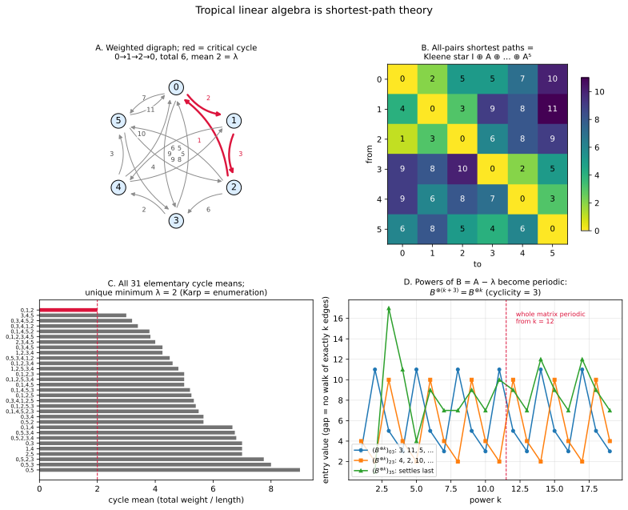
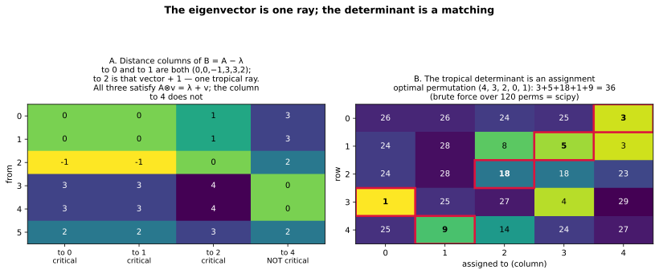

+++
title = "Shortest Paths Are Matrix Multiplication"
description = "An interlude for programmers: min-plus matrix powers are shortest walks, the Kleene star is Floyd–Warshall, the tropical eigenvalue is a minimum cycle mean (Karp), and the tropical determinant is the assignment problem."
weight = 7
[extra]
number = 7
part = "Part III — Interlude for programmers"
lead = "Floyd–Warshall, Karp's algorithm, and the Hungarian algorithm are one subject wearing three hats — and the subject is linear algebra over the tropical semiring."
+++


Six chapters in, a confession: everything so far has quietly been
linear algebra. The tropical semiring — `min` for addition, `+` for
multiplication — has matrices, and matrix multiplication over it is
not an abstraction of shortest paths. It *is* shortest paths, with
the graph algorithms you already know falling out as theorems:
Floyd–Warshall, Karp's minimum-cycle-mean algorithm, and the
Hungarian assignment algorithm are one subject wearing three hats.

This interlude makes that precise on one concrete strongly
connected digraph: 6 nodes, 16 integer-weighted edges, everything
exact (integers and Fractions, no floating point anywhere near a
claim). Prediction, in the book's usual order — guess first, then
compute: if min-plus powers really are walks, then a truncated sum
of powers should be the all-pairs shortest-path matrix; the matrix
should have an eigenvalue, and it should be a property of the
graph's cycles; and its "determinant" should be a matching problem.
All three guesses are theorems, and the chapter program checks each
one on this graph.

## 7.1 Powers are walks

For a min-plus matrix `A` (entry `A_ij` = weight of edge `i→j`,
`∞` = no edge), the tropical power `A^{⊗k}` is the matrix of
exactly-`k`-edge shortest walks: entry `(i,j)` is the cheapest walk
from `i` to `j` using exactly `k` edges. This is just the definition
of matrix multiplication read aloud — `(A ⊗ B)_ij = min_k (A_ik +
B_kj)` says "the cheapest two-leg journey goes through the best
intermediate stop" — and the chapter program checks it against
brute-force walk enumeration for `k = 1, 2, 3`.

> **Honest Box — the sentinel is where min-plus code goes to be
> wrong quietly.** The study's first implementation let the `∞`
> sentinel (`10⁹`) leak through tropical multiplication: `∞ + 2`
> priced a walk that uses a missing edge as merely expensive
> (1,000,000,002) instead of impossible. A missing edge is not a
> costly edge; it is *no* edge, and min-plus needs `∞ + a = ∞`. The
> brute-force check caught the leak; the fix caps any term with an
> `∞` leg. Sentinels are where this code goes wrong — assert against
> brute force.

## 7.2 The Kleene star is Floyd–Warshall

The truncated star `A* = I ⊕ A ⊕ … ⊕ A^{⊗5}` (entrywise min) is the
all-pairs shortest-path matrix. The program asserts equality with an
independent Floyd–Warshall implementation, entry by entry, and that
`A^{⊗6}` improves nothing: with no negative cycles, some shortest
walk is simple, and a simple walk on 6 nodes has at most 5 edges.
The distance matrix — the chapter's central exhibit, drawn as panel
B of Figure 7.1 — is:

```
      to:  0   1   2   3   4   5
from 0  [  0,  2,  5,  5,  7, 10 ]
     1  [  4,  0,  3,  9,  8, 11 ]
     2  [  1,  3,  0,  6,  8,  9 ]
     3  [  9,  8, 10,  0,  2,  5 ]
     4  [  9,  6,  8,  7,  0,  3 ]
     5  [  6,  8,  5,  4,  6,  0 ]
```

Read row 2: from node 2, the cheapest route to node 0 costs 1 (the
direct edge `2→0`), to node 3 costs 6 (direct again), and to node 4
costs 8 — the direct-looking routes lose to detours through the
cheap cycle, which is exactly the kind of fact Floyd–Warshall exists
to find and the Kleene star finds by *adding matrices*.

## 7.3 The eigenvalue is a cycle mean

A strongly connected digraph's adjacency matrix has a unique
tropical eigenvalue `λ`, and `λ` is the **minimum cycle mean**
(Gondran–Minoux / Baccelli et al.; Karp 1978 computes it). On this
chapter's graph: all 31 elementary cycles enumerated, the unique
minimum is `λ = 2` on the critical cycle `0→1→2→0` (total weight 6);
the next best cycle mean is 3 (the `3→4→5` cycle, total 9). Karp's
algorithm returns 2 — and, the robustness check, Karp agrees with
brute-force enumeration on 30 random strongly connected digraphs.

For `B = A − λ`, the distance column to a *critical* node is a
tropical eigenvector: `A ⊗ v = λ + v` exactly. Here is the gem: the
three critical columns (to nodes 0, 1, 2) coincide up to tropical
scaling — `v = (0, 0, −1, 3, 3, 2)`, the same vector again, and that
vector plus 1 — so the eigenspace is a single tropical ray. (Adding
a constant to every entry is tropical scaling: `v` and `v + c`
differ by the scalar `c`, and the eigen equation cannot tell them
apart.) A non-critical column (to node 4) is **not** an eigenvector,
and the program asserts that too: criticality is essential, not
decorative. Panel A of Figure 7.2 draws the four columns.

## 7.4 Powers settle into period 3

Powers of `B` become exactly periodic after a transient:
`B^{⊗(k+3)} = B^{⊗k}` for all `k` in `[12, 33]`, and period 1 fails.
The period is 3 because the critical cycle has length 3 — in
general, take the gcd of the critical cycle lengths within each
strongly connected component of the critical graph, then the lcm
across components; here there is one component and one critical
cycle, so the period is just 3. Panel D
of Figure 7.1 traces three entries: some are periodic from `k = 1`,
one settles only at the transient, but from `k = 12` the whole
matrix repeats every 3 steps, forever. A linear dynamical system
over a semiring, settling into an exact cycle: automata-theory
behaviour from pure matrix powers.

## 7.5 The determinant is an assignment

The tropical determinant (min-plus permanent) of a square matrix is
`min` over permutations `σ` of `Σ_i C_{i,σ(i)}` — which is verbatim
the assignment problem: choose one entry in each row and column at
minimum total cost. For this 5×5 cost matrix (the chapter program's
seeded example, `default_rng(13)`),

```
[ 26, 26, 24, 25,  3 ]
[ 24, 28,  8,  5,  3 ]
[ 24, 28, 18, 18, 23 ]
[  1, 25, 27,  4, 29 ]
[ 25,  9, 14, 24, 27 ]
```

the tropical determinant is **36**: brute force over all 120
permutations and `scipy.optimize.linear_sum_assignment` (the
Hungarian algorithm) agree, with optimal permutation
`(4, 3, 2, 0, 1)` — costs `3 + 5 + 18 + 1 + 9 = 36`. Panel B of
Figure 7.2 draws the matrix with the optimal matching ringed.
Choosing a cheapest perfect matching *is* computing a tropical
determinant; the two literatures just spell it differently.



*Figure 7.1 — Four panels: A. the digraph, critical cycle in red;
B. the APSP heatmap (= the Kleene star of §7.2); C. all 31 cycle
means, unique minimum λ = 2; D. traces of `B^{⊗k}` entries showing
period 3 after the transient at k = 12. Every number in every panel
was asserted by the chapter program before the figure was drawn.*



*Figure 7.2 — The chapter's two tables, drawn. A (§7.3): the columns
of the `B`-distance matrix to nodes 0, 1 and 2 are one tropical ray —
`(0,0,−1,3,3,2)`, itself again, and itself + 1 — and each satisfies
`A ⊗ v = λ + v`; the column to node 4, recomputed independently in
the figure script, does not. B (§7.5): the assignment matrix with
the optimal permutation ringed; the ringed entries sum to the
tropical determinant, 36.*

## 7.6 The whole chapter, as a program

Everything in this chapter is one runnable program: [ch07_tropical_linear_algebra.py](./ch07_tropical_linear_algebra.py) — self-contained apart from numpy/scipy. The assertions *are* the chapter's claims: powers = brute-force walks (`k = 1,2,3`); Kleene star = Floyd–Warshall exactly, with `A^{⊗6}` improving nothing; `λ = 2` by enumeration *and* by Karp, with Karp = enumeration on 30 random digraphs; the critical columns give the eigenvector and coincide up to scaling, while a non-critical column is not an eigenvector; eventual period exactly 3 from transient 12 (and, asserted as the Try It answer key, `B^{⊗20} = B^{⊗17} = B^{⊗14}`); tropical determinant 36 by brute force and by scipy. Run it, and if it prints its final line, the claims are what we said they are. (This section used to print the listing inline; a screenful of code you can download is just a download with extra scrolling.)

## 7.7 Try It

1. A walk uses a missing edge in the buggy first implementation.
   What does it cost, if the sentinel is `10⁹` and the real leg
   costs 2 — and why is "very expensive" the wrong answer?
2. The critical cycle has length 3 and the transient is 12.
   `B^{⊗20}` equals which earlier powers, by the periodicity claim?
3. How many permutations does the brute-force tropical determinant
   of a 5×5 matrix check?

## Answers

- **1.** `10⁹ + 2 = 1,000,000,002`. It is the wrong answer because a
  walk using a missing edge *does not exist* — it should cost `∞`,
  and `∞` must be absorbing (`∞ + a = ∞`), not merely large. A large
  finite sentinel lets nonexistent walks win minimums whenever every
  real alternative is also expensive or absent.
- **2.** `B^{⊗17}`, and subtracting 3 again, `B^{⊗14}` (both
  exponents are ≥ the transient 12, so the period-3 identity
  applies; the chapter program asserts both equalities).
- **3.** `5! =` **120**.

## What we learned

- **Three classic algorithms are one computation.** Floyd–Warshall
  is a Kleene star, Karp's algorithm computes an eigenvalue, and the
  Hungarian algorithm evaluates a determinant — all of them min-plus
  linear algebra read three ways.
- **The eigenvalue lives on the cycles.** `λ` is not found by
  solving anything; it is the cheapest cycle mean, its eigenvectors
  hang off the critical cycle alone, and the eventual period is
  the gcd of the critical cycle lengths within each strongly
  connected component of the critical graph, combined by lcm across
  components (here: one component, one cycle, period 3).
- **Tropical scaling is real scaling.** Eigenvectors are unique only
  up to adding a constant — and here that is the whole story: three
  critical columns, one ray.

## Next

Back to geometry. Part IV starts with Chapter 8, where a *matroid*
— a stripped-down, purely combinatorial notion of linear
independence — turns out to *be* a tropical linear space: its
Bergman fan, built three different ways, with the fan remembering
the matroid that made it.

---

*Source & provenance: Day 13 (2026-10-23) of the tropical geometry
study — code `hidden_files/code/day13_tropical_linear_algebra.py`
(run log `hidden_files/day13-run.log`, summary
`hidden_files/code/day13_summary.json`), figure
`files/figures/day13-min-plus-shortest-paths.png`, study log Day 13
entry. Sources: Gondran–Minoux / Baccelli et al. via
arXiv:1705.09513 (Thms 3.4–3.5, max-plus form, sign-flipped);
Karp 1978; Butkovič, *Max-linear Systems* (Springer 2010), Ch. 3;
Joswig's tropical-shortest-paths notes. The chapter's claims are the
computations on this one graph. The chapter program was re-run
end-to-end on 2026-11-04 while finishing this chapter: all
assertions passed, including the eigenvector columns coinciding up
to scaling and `B^{⊗20} = B^{⊗17} = B^{⊗14}`. Figures regenerated
as SVG the same day: code
`hidden_files/code/ch07_extra_figures.py`, which re-runs the
chapter program, asserts every value it draws (the APSP matrix, all
31 cycle means, the transient, the determinant and its optimal
permutation), and recomputes the eigenvector columns independently
before rendering.*

## Chapter code

The full program behind this chapter, as a download: [ch07_tropical_linear_algebra.py](./ch07_tropical_linear_algebra.py) — the same file §7.6 points at. Its assertions are the chapter's claims; run it.
