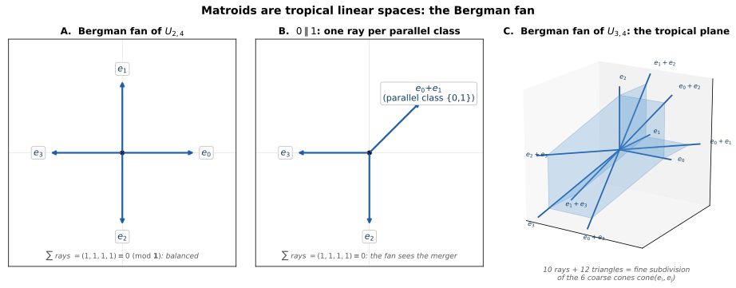
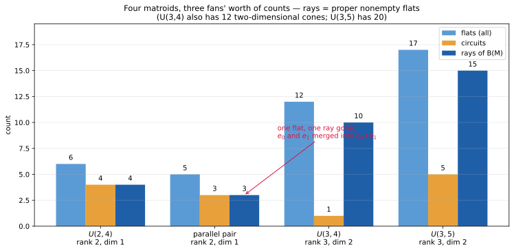

+++
title = "A Matroid Walks Into a Fan"
description = "A matroid is a tropical linear space: its Bergman fan, built three different ways — initial matroids, chains of flats, circuit hyperplanes — with the three descriptions proved equal by computation, and the fan remembering the matroid."
weight = 8
[extra]
number = 8
part = "Part IV — Matroids are linear spaces"
lead = "Take the vectors out of linear algebra and what remains — a matroid — still has a geometry: a fan in which the combinatorics is drawn, ray by ray."
+++

Part II counted curves; the interlude did linear algebra. Part IV
puts the two together: what is a tropical *linear space*? The answer
is one of the cleanest in the subject — a matroid *is* a tropical
linear space, and its picture is a fan, the **Bergman fan** `B(M)`.

A matroid is linear algebra with the vectors removed: a ground set
`E = {0, …, n−1}` and a family of *bases* (the would-be bases of a
vector configuration), governed by the basis-exchange axiom. Its
*flats* are the would-be subspaces (closed sets), its *circuits* the
minimal dependencies. Nothing in the definition mentions coordinates
— which is the point: some matroids come from no vector configuration
at all (a later chapter meets one), and tropical geometry believes
them anyway.

Prediction, in the book's usual order: if a purely combinatorial
object really is a geometric one, then independent definitions of its
geometry, written down by different people for different reasons,
should land on the same set — and the geometry should be able to
*see* the combinatorics. Both predictions are checked below, in code.

## 8.1 Three definitions, one fan

The Bergman fan `B(M) ⊂ R^n / R·1` of a rank-`r` matroid has three
classical descriptions, and the chapter program proves them equal
*by computation* — not on samples, but on **every weight order
there is**:

1. **Initial matroids** (Ardila–Klivans): `w ∈ B(M)`
   iff the matroid `M^w` of `w`-maximal bases is **loop-free** — no
   element is in no maximum-weight basis.
2. **Chains of flats** (Ardila–Klivans again — in their paper the
   fan's fine subdivision *is* the order complex of the lattice of
   flats): to a chain `∅ ⊊ F₁ ⊊ … ⊊ F_k ⊊ E` of flats
   assign the cone generated by the indicator vectors `e_{F_i}`;
   `B(M)` is the union of these cones (mod the line `R·1`).
3. **Circuit hyperplanes** (Nakajima): `w ∈ B(M)` iff on every circuit `C`, the
   **minimum** of `w` over `C` is attained at least twice — `w`
   lies on every tropical hyperplane the circuits define.

> **Honest Box — sign conventions are where fan code goes to be
> wrong quietly.** This book is min-plus throughout (Chapter 1),
> and so is this fan: its circuit condition is Chapter 1's own —
> the **minimum** of `w` over each circuit, attained at least
> twice — and its rays are the positive indicators `e_F`. The
> literature splits between min- and max-weight conventions; they
> are negatives of each other, and each pairs with exactly one
> circuit condition. The one place a *max* appears in this chapter
> is inside description 1: `M^w` is built from **maximum**-weight
> bases. That is bookkeeping, not a change of fan — the study's
> first write-up paired maximum-weight bases with *max*-twice on
> circuits, the assertions killed it, and the pairing the code
> asserts is maximum-weight bases with **min-twice**. Let the
> assertions choose.

And "by computation" means *exhaustive*, not sampled. Whether `w`
lies in the fan — under any of the three descriptions — depends
only on the **weak order** of `w`: which coordinates are equal, and
which are bigger. Each description visibly only ever compares
coordinates (or selects bases by comparing weights), and there are
only finitely many weak orders on `n` elements: 75 for `n = 4`,
541 for `n = 5`. So the program enumerates all of them — each at
two different spacings, asserting the verdicts don't move when the
gaps do — and checks that the three tests agree on every single
one. For `U(3,5)`, exactly 36 of the 541 orders lie in the fan, one
per chain of flats. A confession: the first shipped version of this
chapter sampled random weights instead, and for `U(3,5)` its 150
samples only ever visited 13 of those 36 in-fan orders. Sampling is
a sanity check; enumeration is the proof. (A referee caught the
difference — the enumeration is the fix.)

## 8.2 Three matroids, three fans

**`U(2,4)`** — the uniform matroid (every 2-subset a basis): 6 flats,
4 circuits. Its fan is 4 rays `e_0, …, e_3` in `R⁴/R·1`: a tropical
line with 4 ends — Chapter 1's tripod, with one more leg. Balanced
at the origin: `Σ e_i = (1,1,1,1) ≡ 0 mod 1`.

**The parallel-pair matroid** (rank 2 on 4 elements, with `0 ∥ 1` —
the pair `{0,1}` is a rank-1 flat): the fan has only **3 rays**,
`e_0+e_1`, `e_2`, `e_3`, still balancing to `(1,1,1,1)`. Merging two
parallel elements merged their rays. **The fan remembers the
matroid**: the face poset of the fan is the chain poset of the
flats, so a simple matroid can be read back off its fan's shape.

**`U(3,4)`**: 12 flats, 1 circuit (`{0,1,2,3}`). The fan is pure of
dimension `r − 1 = 2`, with 10 rays — one `e_F` for every proper
nonempty flat (`e_i` and `e_i+e_j`) — and 12 triangular 2-cones
`cone(e_i, e_i+e_j)`: the fine subdivision of the 6 coarse cones
`cone(e_i, e_j)`. Balanced at every ray, checked exactly. This is
the **tropical plane**, and Chapter 9 will do Hodge theory on its
Chow ring.

A fourth matroid, `U(3,5)` (17 flats, 5 circuits), runs as a larger
cross-check: the three descriptions agree there too — on all 541 of
its weight orders — and its fan has
15 rays and 20 two-dimensional cones — the ray count is the number
of proper nonempty flats, as it is for every matroid here, and the
finishing pass read it off the re-run rather than trusting a draft.

| Matroid | rank | flats | circuits | rays of B(M) | dim |
|---|---|---|---|---|---|
| `U(2,4)` | 2 | 6 | 4 | 4 | 1 |
| parallel pair | 2 | 5 | 3 | 3 | 1 |
| `U(3,4)` | 3 | 12 | 1 | 10 | 2 |
| `U(3,5)` | 3 | 17 | 5 | 15 | 2 |

*Figure 8.1 — A: `B(U(2,4))`, four rays; B: the parallel-pair fan,
merged ray `e_0+e_1` labelled; C: `B(U(3,4))` in 3D, 4 singleton
rays + 6 pair rays, 12 triangles = the tropical plane. The ray
vectors drawn are read from the chapter program's own summary, and
every count in every panel was asserted before rendering.*

*Figure 8.2 — The table above, drawn. Rays = proper nonempty flats
in every row (flats minus the empty flat and `E` itself); the
parallel pair, on the same ground set and rank as `U(2,4)`, has
exactly one flat and one ray fewer — the merger, visible as a
missing bar segment.*

## 8.3 The whole chapter, as a program

Everything in this chapter is one runnable program: [ch08_matroids.py](./ch08_matroids.py) — self-contained apart from numpy/scipy. The assertions *are* the chapter's claims: the flat/circuit/ray counts in the table of §8.2 (including `U(3,5)`'s 15 rays and 20 two-cones, and `U(3,4)`'s 12 fine cones subdividing exactly 6 coarse ones); purity `dim = r − 1` for every matroid; triple agreement (chains-of-flats LP membership ⇔ `M^w` loop-free ⇔ circuit min-twice) on every weak order of the ground set — 75 for the `n = 4` matroids, 541 for `U(3,5)` and `U(2,5)`, each at two spacings; balancing at the origin for the rank-2 fans and at every ray for `U(3,4)` and `U(3,5)`; the parallel-pair ray merger (3 rays, the merged one `e_0+e_1`, with `e_0` and `e_1` absent as separate rays); and, asserted as the Try It answer key, `B(U(2,5))` has 5 rays. Run it, and if it prints its final line, the claims are what we said they are. (This section used to print the listing inline; a screenful of code you can download is just a download with extra scrolling.)

## 8.4 Try It

1. How many rays does `B(U(2,5))` have? (Count its proper nonempty
   flats first.)
2. The parallel-pair fan has 3 rays, not 4. What single fact about
   the matroid does the missing ray record?
3. What is the dimension of `B(U(3,4))`, and which formula gives it?

## Answers

- **1.** **5.** `U(2,5)` has 7 flats — the empty set, the whole set,
  and the 5 singletons, which are exactly its proper nonempty
  flats, so the fan has 5 rays (a tropical line with 5 ends). The
  chapter program asserts this, triple agreement included.
- **2.** That `{0,1}` is a single rank-1 flat: 0 and 1 are
  **parallel** — each closes to the same flat, so there is one ray
  `e_0+e_1` where the uniform matroid has two. Here in rank 2 the
  proper nonempty flats *are* the rank-1 flats, so the ray set is
  exactly the rank-1 flats, mergers included — but that is a
  rank-2 accident, not the general rule: in general the rays are
  **all** proper nonempty flats, of every rank. `U(3,4)` above
  makes the point — its 10 rays are the 4 rank-1 singletons *and*
  the 6 rank-2 pairs.
- **3.** **2**, by `dim B(M) = r − 1` with `r = 3`: the fan is pure
  of dimension 2 — a plane's worth of cones, which is why panel C
  of Figure 8.1 is a surface, not a tripod.

## What we learned

- **A matroid is a tropical linear space, three times over.** The
  initial-matroid, chains-of-flats and circuit-hyperplane
  descriptions define the same fan — not as a cited theorem but as
  an exhaustive computation: every weak order of the ground set
  checked three ways, without a single disagreement.
- **The fan remembers the matroid.** Rays are proper nonempty
  flats; merging parallel elements merges rays; the face poset of
  the fan is the chain poset of the flats. Geometry here is not a
  picture *of* the combinatorics — it is the combinatorics, drawn.
- **Fans are balanced.** At the origin for the lines, at every ray
  for the plane: the neighbouring cone generators sum to zero mod
  the ray and the line `R·1` — the same balancing condition as
  Chapter 1's tripod, one dimension up.

## Next

The Bergman fan of `U(3,4)` — the tropical plane of panel C — has a
Chow ring, and on that ring lives the mechanism behind June Huh's
Fields Medal work: Chapter 9 computes `A*(U(3,4))`, recovers its
intersection numbers three independent ways, and verifies the
Hodge–Riemann relations exactly. Hodge theory, with no Hodge theory
underneath.

---

*Source & provenance: Day 6 (2026-10-16) of the tropical geometry
study — code `hidden_files/code/day06_matroids.py` (run log
`hidden_files/day06-run.log`), figure
`files/figures/day06-bergman-fans.png`, study log Day 6 entry.
Sources: the initial-matroid and chains-of-flats descriptions are
Ardila–Klivans, arXiv:math/0311370 (their subdivision of the
Bergman complex is the order complex of the lattice of flats); the
circuit-hyperplane description is Nakajima, arXiv:1901.06893. Two
neighbours, cited for what they actually do: Fry, arXiv:1910.00627,
meets this same fan from the curves side — for a graphic matroid it
is the moduli fan of radially aligned tropical curves; Shaw,
arXiv:1010.3967, builds an intersection product on cycles inside
this fan — part of Chapter 9's story, not a source for any
description here.
Huh hook: the Chow ring of this fan is Chapter 9's subject (Baker,
arXiv:1705.07960). The chapter program was re-run end-to-end on
2026-11-05 while finishing this chapter, and re-run again the same
day after a referee pass replaced its sampled agreement check with
the exhaustive weak-order enumeration of §8.1: all assertions
passed, including the table's counts, the `U(3,5)` ray count of 15,
and the `U(2,5)` Try It count. Figures regenerated as
SVG the same day: code `hidden_files/code/ch08_extra_figures.py`,
which re-runs the chapter program, asserts every value it draws
(the ray vectors themselves are read from the program's summary),
and only then renders.*

## Chapter code

The full program behind this chapter, as a download: [ch08_matroids.py](./ch08_matroids.py) — the same file §8.3 points at. Its assertions are the chapter's claims; run it.
