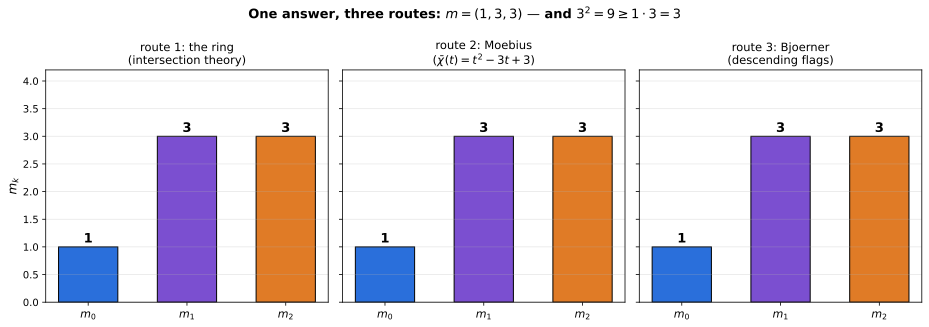
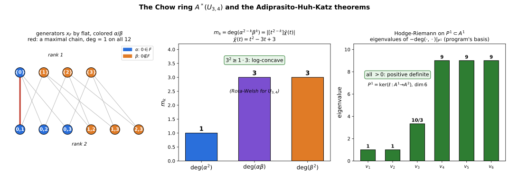

+++
title = "Hodge Theory With No Hodge Theory Underneath"
description = "The Chow ring of U(3,4), built from its flats alone: intersection numbers (1, 3, 3) recovered three independent ways, and the Hodge–Riemann relations verified exactly — fractions, not floats — on the primitive hyperplane."
weight = 9
[extra]
number = 9
part = "Part IV — Matroids are linear spaces"
lead = "Chapter 8's fan has an algebra built from flats alone — no variety, no Hodge theory underneath — and the Kähler package holds on it anyway, exactly, in code."
+++

Chapter 8 ended with a fan: the Bergman fan `B(U(3,4))`, the
tropical plane. Fans have algebra. The **Chow ring** `A*(M)` of a
matroid is built from its flats alone — no fan geometry, no
vectors, no field — and on it, Adiprasito–Huh–Katz proved the
Kähler package (Poincaré duality, Hard Lefschetz, Hodge–Riemann)
that classical geometry gets from Hodge theory on a smooth
projective variety. There is no variety here. There is no Hodge
theory underneath. The relations hold anyway, and this chapter
verifies them *exactly* — fractions, not floats — on the smallest
interesting case, `M = U(3,4)`. This is the mechanism behind June
Huh's Fields Medal work, in miniature, in code.

Prediction, in the book's usual order: if the algebra is really
there, then the same numbers should be reachable by routes that
share nothing — pure ring theory, pure Möbius combinatorics, and
pure flag-counting should collide on one answer. They do, in §9.2.

## 9.1 The ring, from the flats

Presentation (Feichtner–Yuzvinsky, via Baker's survey
arXiv:1705.07960 §4.1): one variable `x_F` per nonempty proper
flat, modulo

- **(CH1)** for all `a, b ∈ E`: `Σ_{F∋a} x_F = Σ_{F∋b} x_F`
  (linear relations);
- **(CH2)** `x_F · x_G = 0` whenever `F, G` are incomparable
  (monomial relations — only chains of flats survive).

For `U(3,4)`: 10 generators, 3 independent linear relations,
graded dimensions **(1, 7, 1)** — degree 2 is one-dimensional, as
Poincaré duality wants. The degree map `deg: A² → ℤ` is pinned by
`deg = 1` on every maximal-chain monomial, and the computation
finds it *constant* on all 12 maximal chains (pre-normalization
value −1, normalized to 1) — the tropical reading: `deg` is the
unique integer weighting making the Bergman fan balanced
(Chapter 8's balancing, returning as algebra).

One subdivision note, so this chapter and Chapter 8 agree: the
presentation above is built from the lattice of flats alone — no
fan, and no subdivision of one, is chosen to define it. When the
ring *is* read as the Chow ring of the Bergman fan, it is the
fan's **fine subdivision** (Chapter 8, description 2) whose rays
are the variables `x_F` — one per nonempty proper flat, 10 here.
The coarsest fan structure on the same set has only 4 rays and 6
cones and carries no such variables. Definition: flats. Fan
reading: fine.

## 9.2 The numbers (1, 3, 3), three ways

With `α = Σ_{F∋0} x_F` and `β = Σ_{F∌0} x_F` (Baker §4.4), set
`m_k = deg(α^{2−k} β^k)`. The chapter computes:

- `deg(α²) = 1`, `deg(α·β) = 3`, `deg(β²) = 3` — by intersection
  theory in the ring;
- the same (1, 3, 3) as the unsigned coefficients of the reduced
  characteristic polynomial `χ̄(t) = t² − 3t + 3`, itself
  Möbius-verified from `χ(t) = t³ − 4t² + 6t − 3` (AHK's theorem,
  Baker Thm 4.2);
- the same (1, 3, 3) a third way, by Björner's count of initial
  descending flags (Baker Prop 4.3) — pure combinatorics, no ring
  at all.

Three routes, one answer. And the point of the numbers:
`3² ≥ 1·3` — log-concavity, an instance of the Rota–Welsh
conjecture, which is what the Hodge–Riemann relations below are
*for*.

| quantity | route 1: ring | route 2: Möbius | route 3: Björner |
|---|---|---|---|
| `m_0` | 1 | 1 | 1 |
| `m_1` | 3 | 3 | 3 |
| `m_2` | 3 | 3 | 3 |

*Figure 9.2 — The table above, drawn. Three computations that
share no machinery land on the same three bars; every bar was
read off the chapter program's own summary, after the program
asserted the three routes pairwise equal.*

## 9.3 Hodge–Riemann, checked

An ample class comes from a strictly submodular function:
`l = Σ_F |F|(4−|F|) x_F`, with `c(S) = |S|(n−|S|)` verified
strictly submodular on all 110 ordered incomparable subset pairs
(55 unordered) by brute force. Then:

- `deg(l²) = 120 > 0` (the `k = 0` relation);
- on the 6-dimensional primitive hyperplane
  `P¹ = ker(l : A¹ → A²)`, the form `−deg(·,·)` is positive
  definite — Sylvester leading minors `97/18, 260/9, 925/6, 435,
  2133/2, 2430`, all positive, exact fractions. Eigenvalues
  (float, for the figure): `1, 1, 10/3, 9, 9, 9`.

> **Honest Box.** The first ample-class candidate,
> `c(F) = rk(F)(3−rk(F))`, is NOT strictly submodular:
> `A = {0,1}`, `B = {0,2,3}` gives equality — both sides are
> exactly 2, re-asserted in the chapter program — caught by the
> brute-force check before it could poison the ample class. The
> fix, `c(S) = |S|(n−|S|)`, works because `|·|` is modular and
> `t(n−t)` is strictly concave — and was verified exactly anyway.
> Trust the check, not the lemma-shaped intuition.

*Figure 9.1 — Three panels: the 10 flats coloured α/β with a
highlighted maximal chain; the intersection numbers (1, 3, 3)
with the log-concavity check; the Hodge–Riemann eigenvalue
spectrum on P¹ — all positive, as the exact Sylvester check in
the text requires. Every value drawn was asserted in the chapter
program before rendering.*

## 9.4 The whole chapter, as a program

Everything in this chapter is one runnable program: [ch09_chow_ring.py](./ch09_chow_ring.py) — self-contained apart from numpy (eigenvalues, display only; every asserted quantity is an exact Fraction). Its assertions *are* the chapter's claims: graded dimensions (1, 7, 1) from 10 generators and 3 independent (CH1) relations; `deg` constant (= −1 before normalization, = 1 after) on all 12 maximal-chain monomials; the Poincaré pairing on `A¹` nondegenerate (Gram rank 7); `m = (1, 3, 3)` by all three routes of §9.2, asserted pairwise equal, with `χ(t)` and `χ̄(t)` Möbius-verified; strict submodularity of `c(S) = |S|(4−|S|)` on all 110 ordered incomparable pairs, and the failed rank-based candidate's equality 2 = 2 at `A = {0,1}`, `B = {0,2,3}` reproduced as the Honest Box's evidence; Hodge–Riemann with `deg(l²) = 120` exactly and `−deg(·,·)` positive definite on the 6-dimensional `P¹`, Sylvester minors asserted as the exact list above; and, asserted as the Try It answer key, the comparable-monomial count (22 survive (CH2), 33 are killed) and the single log-concavity inequality for (1, 4, 6). Run it, and if it prints its final line, the claims are what we said they are. (This section used to print the listing inline; a screenful of code you can download is just a download with extra scrolling.)

## 9.5 Try It

1. `A*(U(3,4))` has 10 generators and graded dimensions (1, 7, 1).
   How many independent linear relations are there in degree 1?
2. Why does `x_F · x_G` vanish when `F` and `G` are incomparable —
   what does a surviving degree-2 monomial look like?
3. The log-concavity instance here is `3² ≥ 1·3`. What is the
   corresponding inequality for the numbers (1, 4, 6) of
   `U(3,5)` (a later computation), and does it hold? (A 3-term
   sequence has exactly one inequality of this shape.)

## Answers

- **1.** **3** — 10 generators minus the 7-dimensional `A¹`.
- **2.** It doesn't vanish *despite* the ring: (CH2) kills it
  precisely because no chain contains both flats in either order.
  A surviving degree-2 monomial is a product `x_F · x_G` with
  `F ⊆ G` or `G ⊆ F` — the maximal ones are the 12 chain monomials
  `x_{ {i} } · x_{ {i,j} }`, and each `x_F²` survives too (a flat
  is comparable with itself). The program counts 22 comparable
  monomials surviving and 33 incomparable ones killed.
- **3.** `4² ≥ 1·6`, i.e. `16 ≥ 6` — and yes, it holds.

## What we learned

- **The Kähler package needs no variety.** Poincaré duality,
  Hard Lefschetz's shadow and the Hodge–Riemann relations hold
  on a ring defined from a finite lattice of flats — verified
  here exactly, Sylvester minor by Sylvester minor, not quoted.
- **Three routes, one answer is evidence, not redundancy.** The
  ring, the characteristic polynomial and the flag count share
  no code path; their agreement on (1, 3, 3) is the chapter's
  real theorem-check, and it is also AHK's theorem (Baker
  Thm 4.2) seen at the smallest size where it says anything.
- **Log-concavity is the corollary that pays.** `3² ≥ 1·3` is
  the Rota–Welsh conjecture for `U(3,4)` — the statement Huh's
  programme proves in general by exactly this mechanism.

## Next

Part IV closes here. Part V asks what a *moduli space* looks like
tropically — and the answer starts with a surprise from
Chapter 1: the tropical Grassmannian `Gr(2,4)`, the space of all
2-planes in 4-space, *is* the space of phylogenetic trees, and
itself a tropical line. Chapter 10 draws it.

---

*Source & provenance: Day 7 (2026-10-17) of the tropical geometry
study — code `hidden_files/code/day07_chow_ring.py` and
`hidden_files/code/day07b_hodge_riemann.py` (eigenvalues in
`hidden_files/day07b-eigenvalues.txt`), figure
`files/figures/day07-chow-ring-huh.png`, study log Day 7 entry.
Sources: M. Baker, "Hodge Theory in Combinatorics"
(arXiv:1705.07960), §§4.1, 4.3, 4.4 (FY presentation, deg, α/β,
Thm 4.2, Thm 4.1, Prop 4.3), re-verified against the ar5iv HTML
during Day 7 itself. The chapter program was merged into one
self-contained file and re-run end-to-end on 2026-11-06 (Phase 2
of this chapter's production cycle), with every claim asserted —
including `deg(l²) = 120` exactly, the Sylvester-minor list, and
the failed candidate's equality — and re-run again by the figure
script on 2026-11-07 before rendering. Figures regenerated as SVG
the same day: code `hidden_files/code/ch09_extra_figures.py`,
which re-runs the chapter program, asserts every value it draws,
and only then renders.*

## Chapter code

The full program behind this chapter, as a download: [ch09_chow_ring.py](./ch09_chow_ring.py) — the same file §9.4 points at. Its assertions are the chapter's claims; run it.
