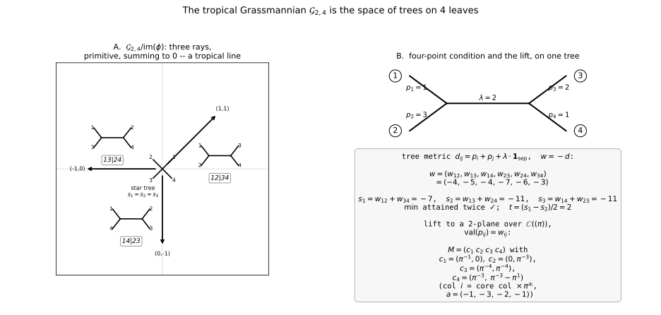
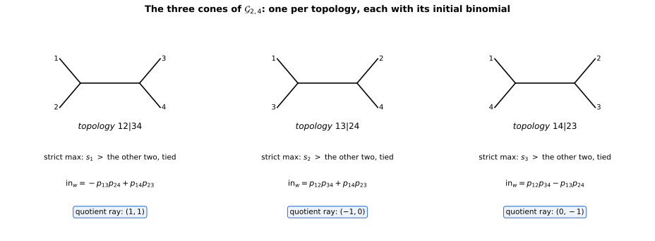

+++
title = "Tree Space, or: the Grassmannian Is a Line"
description = "Speyer–Sturmfels for Gr(2,4), end to end in exact arithmetic: the four-point condition, three cones over one lineality, a quotient fan that is Chapter 1's tropical line, and every fan point lifted back to an actual 2-plane — plus a sign typo in the paper's equation (8), caught by computation."
weight = 10
[extra]
number = 10
part = "Part V — Moduli spaces you can draw"
lead = "The space of all 2-planes in 4-space, tropicalised, is the space of phylogenetic trees on four leaves — and mod its lineality it is the tropical line from Chapter 1, with the star tree at the vertex."
+++


Parts I–IV built objects: curves, counts, matroids. Part V asks
where those objects *live*. A **moduli space** is a space whose
points are themselves geometric objects — here, trees. The
classical object is the **Grassmannian** `Gr(2,4)`: all 2-planes
through the origin in 4-space. A 2-plane is recorded by its six
2×2 minors, the **Plücker coordinates** `p_ij`, which obey one
relation, the Plücker quadric

```
p12·p34 − p13·p24 + p14·p23 = 0.
```

Tropicalise it: replace each `p_ij` by a weight `w_ij ∈ ℝ`
(think: a valuation), and ask which weight vectors can occur.
Speyer–Sturmfels' theorem (arXiv:math/0304218, Thm 3.4) says the
answer for `Gr(2,n)` is **phylogenetic tree space**: the weights
are exactly the (negatives of) tree metrics. This chapter does
the first nontrivial case, `n = 4`, end to end — and finds that
Chapter 1's object was a moduli space all along.

## 10.1 The four-point condition

For a tree on leaves `{1,2,3,4}` with leaf-to-leaf distances
`d_ij`, the three ways of pairing the leaves give three sums

```
s1 = d12 + d34,   s2 = d13 + d24,   s3 = d14 + d23,
```

and a classical fact about trees says: **the two largest of
`s1, s2, s3` are equal** — the pairing that respects the tree's
one internal edge wins twice, the cross pairing loses. With the
book's min-plus sign convention (`w = −d`), that becomes the
paper's **four-point condition** (6):

> `min(s1, s2, s3)` is attained at least twice,
> where now `si` are the sums of the `w`'s.

**Predict first.** Three tree topologies exist for four leaves —
the cherries can be `{1,2}|{3,4}`, `{1,3}|{2,4}`, or
`{1,4}|{2,3}` — plus the degenerate **star tree** (no internal
edge, all three sums equal). So the tropical Grassmannian
should have three maximal cones glued along a common ridge.
The program checks exactly that (§10.2).

## 10.2 Three cones, and the quotient is a tropical line

Two kinds of freedom move `w` without changing the tree's
essential shape. Scaling column `i` of the 2-plane by a constant
shifts `w_ij ↦ w_ij + a_i + a_j`; the map
`φ(a)_ij = a_i + a_j` sweeps out a 4-dimensional subspace
`image(φ) ⊂ ℝ⁶` (rank exactly 4, asserted; note the scalar shift
`(1,…,1)` already lies in it, as `φ(½,½,½,½)` — the lineality is
4-dimensional, not 5). Dimension bookkeeping: a maximal cone is
`image(φ)` plus one ray, so 5-dimensional in `ℝ⁶` — that is the
*affine cone* over the 4-dimensional `Gr(2,4) ⊂ ℙ⁵`; mod out
`ℝ·(1,…,1)` the fan is 4-dimensional, and mod out all of
`image(φ)` it is the 2-dimensional quotient below. Tropically,
`image(φ)` is pendant-edge length: change it and the internal
structure does not move. The internal edge itself contributes
the **cut vector**

```
E_{A,B} = Σ_{i∈A, j∈B} e_ij ,
```

one for each split `A|B`. The chapter program verifies, on 4000
random integer points with exact fractions:

- `w` satisfies the four-point condition **iff** `w` lies in one
  of the three closed cones `image(φ) − ℝ≥0·E_topo`, one per
  topology;
- the decomposition is constructive:
  `w = φ(a) − t·E_topo` with internal edge length
  `t = (s_strict − s_tied)/2 ≥ 0`, recovered uniquely, and
  `t` is `φ`-invariant (500 trials) — pendant edges are exactly
  what the quotient mods out.

Now quotient: `ℝ⁶ / image(φ) ≅ ℝ²` via `(s1−s2, s1−s3)`. The
three cone generators land on the rays

```
(1,1),   (−1,0),   (0,−1)
```

— primitive in `ℤ²`, and `(1,1)+(−1,0)+(0,−1) = 0`. **Balanced.**
The quotient fan is a tropical line (the paper's Ex. 3.2 says so
in words; the program checks the balancing sum). Chapter 1's
tripod returns, one level up: it is the moduli space of
4-leaf trees, i.e. of 2-planes in 4-space, with the star tree
at the vertex and the three resolved topologies on the rays.



*Figure 10.1 — A: the quotient fan (tropical line) with the
three topologies; B: a worked example (tree → `w` → four-point
tie → the lift matrix of §10.3). Every number drawn was
asserted in the chapter program or the figure script before
rendering.*

## 10.3 Initial forms, and lifting back to an actual plane

A weight is in the tropical variety iff the **initial form** of
the Plücker quadric — the terms attaining the minimum weight —
is not a monomial (Thm 2.1(c)). On cone interiors the program
finds the binomial for that topology; off the fan, a monomial;
2000 random points, no exceptions.

| topology | strict max | initial form `in_w` | quotient ray |
|---|---|---|---|
| `12|34` | `s1` | `−p13·p24 + p14·p23` | `(1,1)` |
| `13|24` | `s2` | `p12·p34 + p14·p23` | `(−1,0)` |
| `14|23` | `s3` | `p12·p34 − p13·p24` | `(0,−1)` |



*Figure 10.2 — The table above, drawn. Every cell — the strict
maximum, the tie, the binomial, the ray — was read off the
chapter program by the figure script and asserted before
rendering.*

More: every fan point **lifts**. Corollary 2.2 made
constructive: given `w = φ(a) − t·E_{12,34}` with `t > 0`, the
`2×4` matrix over `ℂ((π))` with columns

```
(1,0),  (0,1),  (π^{−t}, π^{−t}),  (π^{−t}, π^{−t} − π^{t}),
```

column `i` then scaled by `π^{a_i}`, has all six 2×2 minors
with valuations exactly `w_ij` — verified by exact `π`-adic
series arithmetic on 8 test points, including the ridge and
the origin, and the six minors of each lift satisfy the
Plücker relation *exactly*, as series. The tropical point is
not an approximation of a plane; it is the valuation shadow of
one, and the shadow can be reversed.

## 10.4 The combinatorics of T₄

Tree space `T₄` itself: `2³ − 4 − 1 = 3` vertices (the three
splits, as rays), `3!! = 3` facets (the three trivalent trees),
pure of dimension `n − 3 = 1` — a tripod, again. The next
chapter takes `n = 5`, where this graph becomes a famous one.

> **Honest Box — a sign typo in the paper, caught by
> computation.** Equation (8) of Speyer–Sturmfels as printed
> gives the cone generators as `+E_{A,B}`. With the paper's own
> convention "`−w_ij` is the distance" and its four-point
> condition (6), a tree metric `d = t·E_{12,34}` gives
> `w = −t·E`, which satisfies (6) but is **not** in
> `image(φ) + ℝ≥0·E` (writing `−tE = φ(a) + sE`, `s ≥ 0`, forces
> `φ(a) = cE` with `c < 0`, and `a1+a2 = 0`, `a1+a3 = c`,
> `a3+a4 = 0` give `c = 0` — contradiction). The correct
> generators are `−E_{A,B}`. This was confirmed against the
> arXiv TeX source, not just a rendering: the sign in (8) is a
> typo in the paper. The program asserts both directions:
> `−E` lies in the fan's interior for each topology; `+E`
> violates the four-point condition outright.

## 10.5 The whole chapter, as a program

Everything in this chapter is one runnable program: [ch10_grassmannian.py](./ch10_grassmannian.py) — exact Fractions and exact `π`-adic series throughout, no dependencies beyond the standard library. Its assertions *are* the chapter's claims, in ten groups: the sign check on (8) (`−E` in the fan's interior, `+E` out); four-point ⇔ union of the three cones `image(φ) − t·E_topo` on 4000 random integer points, with the decomposition round-tripped; the quotient fan's three rays primitive and summing to zero; initial forms binomial on the fan and monomial off it (2000 points); 8 fan points lifted to `2×4` matrices over `ℂ((π))` with valuations exact; topology and internal edge `t` recovered and `φ`-invariant (500 trials); the `T₄` counts (3 vertices, 3 facets); and — added when the draft was re-verified for the book — the Try It answer key below, `rank(φ) = 4` with `(1,…,1) = φ(½,½,½,½)`, and the lifted minors satisfying the Plücker relation exactly for all three topologies. Run it, and if it prints its final line, the claims are what we said they are. (This section used to print the listing inline; a screenful of code you can download is just a download with extra scrolling.)

## 10.6 Try It

1. Let `w` have pair sums `s1 = 5, s2 = 3, s3 = 3`. Does `w`
   satisfy the four-point condition? If so, which topology,
   and what is the internal edge length `t`?
2. Why does adding `φ(a)` to `w` never change `t` — in tree
   language, what does `φ(a)` move?
3. The quotient rays are `(1,1), (−1,0), (0,−1)`. Verify the
   balancing condition, and say which topology each ray
   carries.

## Answers

- **1.** Yes — the minimum 3 is attained twice. The unique
  strict maximum is `s1`, so the cherries are `{1,2}` and
  `{3,4}` (topology `12|34`), and `t = (5 − 3)/2 = 1`.
- **2.** `φ(a)` shifts every pair sum by the same `Σa` (each
  pair sum adds two disjoint pair-terms covering all four
  indices once), so the differences `s_strict − s_tied` — and
  hence `t` — are unchanged. In tree language `φ(a)` moves
  pendant (leaf) edge lengths only; the internal edge is the
  tree's internal structure, which column scaling cannot touch.
- **3.** `(1,1) + (−1,0) + (0,−1) = (0,0)` — balanced. In the
  program's coordinates: `(1,1)` carries `12|34`, `(−1,0)`
  carries `13|24`, `(0,−1)` carries `14|23`.

## What we learned

- **Chapter 1's tripod is a moduli space.** The tropical line
  is `Gr(2,4)` modulo its lineality: its three rays are the
  three ways to resolve a 4-leaf tree, its vertex is the star
  tree, and its balancing is the balancing of §10.2 — checked,
  not quoted.
- **The tropical point remembers a plane.** Every weight in
  the fan is the valuation vector of an actual 2-plane, by an
  explicit matrix whose minors satisfy the one Plücker
  relation exactly — tropicalisation here loses nothing that
  the valuations were keeping.
- **Trust the check, not the printed formula.** The paper's
  equation (8) has the wrong sign for its own conventions; the
  four-point condition itself, run on `+E`, is what convicts
  it — confirmed against the TeX source before we said so in
  print.

## Next

One rung up, `n = 5`: tree space `T₅` is no longer a tripod but
a graph with 10 vertices and 15 edges — and it is a famous
graph. Chapter 11 proves the Petersen graph is a moduli space:
the tropical Grassmannian `Gr(2,5)`, built from splits.

---

*Source & provenance: Day 10 (2026-10-20) of the tropical
geometry study — code `hidden_files/code/day10_grassmannian.py`,
figure `files/figures/day10-tree-space.png` (generator
`hidden_files/code/day10_figures.py`), study log Day 10 entry,
run log `hidden_files/day10-run.log`. Source: D. Speyer &
B. Sturmfels, "The tropical Grassmannian", arXiv:math/0304218 —
Thm 3.4, four-point condition (6), cone generators (8) with the
sign correction of the Honest Box, Ex. 3.2, Cor. 2.2,
Thm 2.1(c) — verified against the arXiv TeX source on Day 10.
The chapter program was merged into one self-contained file
(Day 10 program + the book cycle's Phase-2 verification script)
and re-run end-to-end on 2026-11-10, all ten assertion groups
passing (run log `hidden_files/ch10-run.log`). Figures
regenerated as SVG the same day: code
`hidden_files/code/ch10_extra_figures.py`, which imports the
chapter program, asserts every value it draws — including every
cell of the §10.3 table — and only then renders. Referee pass
2026-11-09 (Nyx, #minplus-book): the dimension bookkeeping of
§10.2 (lineality 4, maximal cones 5 in `ℝ⁶`, the 4-dimensional
figure being the projective one) is hers as much as ours — her
four sanity anchors were checked one by one, the one
bookkeeping disagreement resolved in her favour on the
substance and stated in §10.2 as above.*

## Chapter code

The full program behind this chapter, as a download: [ch10_grassmannian.py](./ch10_grassmannian.py) — the same file §10.5 points at. Its assertions are the chapter's claims; run it.
