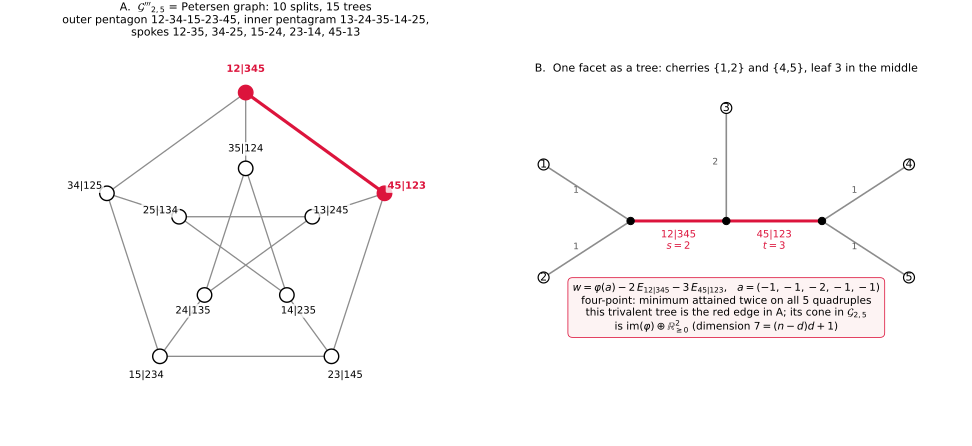
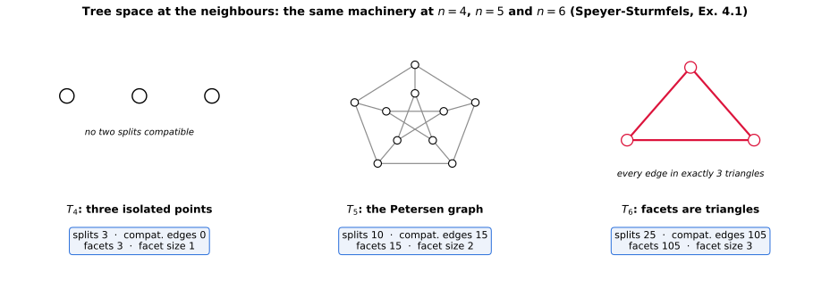

+++
title = "The Petersen Graph Is a Moduli Space"
description = "Speyer–Sturmfels for Gr(2,5), end to end: splits are vertices, compatibility is disjointness (Kneser KG(5,2), the complement of L(K5)), the Petersen invariants are proved by computation — girth 5, hypohamiltonian, cycle rank 6 = (5−2)! — facets are trivalent trees, and balancing at every ray is one closed-form identity."
weight = 11
[extra]
number = 11
part = "Part V — Moduli spaces you can draw"
lead = "The space of trees on five leaves — the tropical Grassmannian Gr(2,5) after its three prime reductions — is the Petersen graph: its vertices are splits, its edges are fully resolved trees."
+++


Chapter 10 ended with a tripod: trop `Gr(2,4)`, modulo its
lineality, is a tropical line, and its three rays are the three
ways to resolve a 4-leaf star tree. This chapter takes one
more leaf. The punchline is stated up front, because it is
hard to believe otherwise:

> **The space of trees on five leaves — the tropical
> Grassmannian `Gr(2,5)` after its three prime reductions —
> is the Petersen graph.**

The Petersen graph is combinatorics' favourite counterexample:
the smallest snark seed, nonplanar, hypohamiltonian, the graph
that breaks naive conjectures. Here it is not a counterexample
to anything. It is a *moduli space*: its vertices are the ways
a 5-leaf tree can begin to resolve, and its edges are the fully
resolved trees themselves. Everything below is Speyer–
Sturmfels, "The tropical Grassmannian" (arXiv:math/0304218),
Example 3.3 and Theorem 3.4, computed end to end.

## 11.1 First, the reductions: why a graph at all?

The full fan `Gr(2,5)` lives in `ℝ^{C(5,2)} = ℝ^{10}`; its
maximal cones have dimension `(n−d)d + 1 = 7`. Speyer–
Sturmfels peel off the uninteresting directions in three steps
(§3 of the paper):

- `G′` = the fan modulo `ℝ·(1,…,1)` — dimension 6;
- `G″` = the fan modulo `image(φ)`, where
  `φ(a)_{ij} = a_i + a_j` is Chapter 10's pendant-edge freedom —
  dimension `(d−1)(n−d−1) = 2`. The bookkeeping, stated once
  with its ambients: `image(φ)` — the fan's lineality — is
  5-dimensional in `ℝ¹⁰` (`φ` is injective for `n ≥ 3`; the
  program asserts rank 5), so a maximal cone splits as
  `7 = 5 + 2`, lineality plus genuine fan. And
  `(1,…,1) = φ(½·(1,…,1))` already lies in `image(φ)`, so the
  `G′` step is redundant inside the `G″` step, not a separate
  direction;
- `G‴` = `G″` intersected with the unit sphere — maximal face
  dimension `nd − n − d² = 1`.

Dimension 1 means: a **graph**. Its vertices are the rays of
`G″`, its edges the 2-dimensional cones. The rest of the
chapter names those rays and cones — and then checks that the
graph they form really is Petersen's, by its invariants, not
by its silhouette.

## 11.2 Splits: the vertices

A **split** of the leaf set `{1,…,5}` is a partition
`A | A^c` with both sides of size at least 2 — one internal
edge of a tree, recording which leaves lie on each side. For
`n = 5` every split is `2|3`, so a split is determined by its
2-side, and there are

```
2^{5−1} − 5 − 1 = 10
```

of them: `12, 13, 14, 15, 23, 24, 25, 34, 35, 45` (each read as
`A | A^c`). Theorem 3.4 says the vertices of tree space `T_n`
are exactly the splits, for every `n`. Ten vertices is the
Petersen graph's first invariant — but ten vertices is also
just a number. The edges decide.

Two splits can occur in one tree exactly when they are
**compatible**: the paper's condition (4) — for splits
`{A, A^c}` and `{B, B^c}`, one of `A ⊆ B`, `A ⊆ B^c`,
`A^c ⊆ B`, `A^c ⊆ B^c` holds. For `2|3` splits the program
checks all 45 pairs and finds condition (4) collapses to
something you can see:

> **Two `2|3` splits are compatible iff their 2-sides are
> disjoint.**

So the compatibility graph has as vertices the 2-subsets of a
5-set, joined when disjoint — which is the definition of the
**Kneser graph** `KG(5,2)`. And `KG(5,2)` is the classical
second construction of the Petersen graph. (A third name for
the same graph, worth one sentence because it is where
`Aut = S₅` comes from: it is the **complement of the line
graph `L(K₅)`** — the vertices of `L(K₅)` are the edges of
`K₅`, i.e. the 2-subsets, adjacent exactly when they share a
vertex, so complement adjacency is exactly disjointness. The
program checks this pair by pair.) The identification
is therefore not an analogy: build the graph from splits and
you have built Petersen's graph, vertex for vertex, edge for
edge. The next section proves the drawing honest by computing
the invariants Petersen is famous for.

## 11.3 Petersen, proved Petersen

**Predict first.** If the compatibility graph is Petersen, it
must be 3-regular with 15 edges (each 2-set is disjoint from
exactly the three 2-subsets of its 3-element complement), have
girth 5 — no triangles (three pairwise disjoint 2-sets would
need six leaves) and no 4-cycles — diameter 2, and be
nonplanar. The program asserts each of these, several of them
twice:

- **10 vertices, 15 edges, 3-regular, connected, diameter 2.**
- **Girth exactly 5**: BFS from every vertex, and independently
  by brute force — 0 triangles, 0 ordered 4-cycles, and an
  explicit 5-cycle `12–34–15–23–45–12`.
- **Chromatic number 3** (backtracking; `> 2` already follows
  from the odd cycle) and **independence number 4**.
- **Nonplanar**, by the girth-5 Euler bound: a planar graph of
  girth at least 5 has `E ≤ (5/3)(V−2) = 13.33…`, but
  `15 > 13.33…`.
- **Symmetry**: `S₅`, permuting the leaves, induces 120 distinct
  automorphisms, transitive on vertices and on edges. (The
  classical statement is `Aut = S₅`; the program verifies
  `S₅ ≤ Aut`, which is the direction the moduli story needs —
  relabelling leaves really is a symmetry of tree space.)
- **Hypohamiltonian**: brute-force search finds **no
  Hamiltonian cycle**, while deleting any one vertex leaves a
  graph that **does** have one — asserted for all ten
  deletions, not just one up to symmetry.

One more number ties the graph back to the theorem.
Theorem 3.4 says `T_n` has the homotopy type of a bouquet of
`(n−2)!` spheres of dimension `n−4`. For `n = 5` those are
circles, and a graph's circle count is its cycle rank — its
first Betti number `b₁`:

```
E − V + 1 = 15 − 10 + 1 = 6 = (5−2)!.
```

Six circles' worth of homotopy, on the nose. The same
Euler-characteristic bookkeeping checks at the neighbours:
`T₄` has `χ = 3 = 1 + 2` (a wedge of two copies of `S⁰` — three
points), and `T₆` has `χ = 25 − 105 + 105 = 25 = 1 + 24`
(a wedge of 24 copies of `S²`; §11.7).

## 11.4 Facets are trees

A **facet** of `T₅` is a maximal compatible family of splits —
a maximal clique of the compatibility graph. The program
finds the maximal cliques are exactly the 15 edges themselves:
no three splits are pairwise compatible (three pairwise
disjoint 2-sets again — six leaves, impossible). So every
facet has size `2 = n − 3`, and:

> **A facet is a pair of disjoint splits, and a pair of
> disjoint splits is a trivalent tree on five leaves** — two
> internal edges, three internal vertices, five pendants.

The count agrees with the theorem's `(2n−5)!! = 5!! = 15`
trivalent trees, and every split lies in exactly 3 trees (its
three disjoint partners — 3-regularity again, read as
incidence). Panel B of Figure 11.1 draws one facet as the tree
it is: cherries `{1,2}` and `{4,5}`, leaf `3` attached at the
middle vertex.



*Figure 11.1 — A: `G‴_{2,5}` in the classic pentagon/pentagram
drawing; vertices are splits `A|A^c`, edges are trivalent
trees. Outer pentagon `12–34–15–23–45–12` (the explicit
5-cycle of §11.3), inner pentagram `13–24–35–14–25`, spokes
`12–35, 34–25, 15–24, 23–14, 45–13`. B: the red edge
`{12|345, 45|123}` as a tree — cherries `{1,2}` and `{4,5}`,
leaf 3 central — with the worked decomposition
`w = φ(a) − 2·E_{12|345} − 3·E_{45|123}`,
`a = (−1,−1,−2,−1,−1)`, re-asserted in the figure script
before rendering.*

So the Petersen graph's *edges* are not glue or decoration.
Each edge **is** a tree — the complete, fully resolved object
of which its two endpoint splits are the two internal edges.

## 11.5 Back at fan level: cones, membership, initial forms

`G‴` is the shadow; the fan `Gr(2,5)` is the substance. Each
split `A` contributes its cut vector
`E_A = Σ_{i∈A, j∉A} e_{ij}` in `ℝ^{10}`, and each facet
`{A, B}` a maximal cone

```
image(φ) − ℝ≥0·E_A − ℝ≥0·E_B .
```

(Note the minus signs — see the Honest Box.) The program
verifies, with exact fractions:

- **Sign check**: `−E_A` lies in the fan for every split (the
  four-point condition holds on all five 4-subsets of the
  leaves); `+E_A` never does.
- **Simplicial cones**: each facet cone has rank
  `7 = (n−d)d + 1` (Corollary 3.1) — dimension 2 once
  `image(φ)` is quotiented out, matching §11.1.
- **Decomposition recovered**: for 600 random interiors,
  `w = φ(a) − s·E_A − t·E_B` with `s, t > 0` is solved back
  uniquely by exact rational linear algebra — the pair of
  internal edge lengths `(s, t)` and the pendant data `a` are
  all read off `w` with no ambiguity.
- **Membership**: on 3000 random integer points, `w` satisfies
  the four-point condition on all five quadruples **iff** `w`
  lies in the union of the 15 closed cones. The tropical
  Grassmannian is exactly the union of its tree cones — no
  more, no less.

The **initial forms** of the five Plücker quadrics (one per
4-subset of leaves) tell the same story algebraically. Recall
from Chapter 10: `w` is in the tropical variety iff no initial
form is a monomial. Here:

- in a maximal cone's interior, **all five** initial forms are
  binomial;
- at a ray point `−E_A`, exactly **3 binomial + 2 trinomial** —
  and the trinomial quadruples are exactly those meeting `A`
  in one leaf (the quadric there does not yet know which way
  the tree will resolve);
- off the fan, some quadric has a monomial initial form
  (2000 random points, no exceptions).

> **Precision note.** The five quadrics generate `I_{2,5}`, and
> Theorem 3.4's proof promotes the quadric check to the full
> initial ideal `J_σ = in_w(I_{2,5})`. What the program checks
> is the quadrics themselves, as computed — the chapter claims
> exactly that, no more.

## 11.6 Balancing at every ray, in closed form

A fan is tropical only if it balances. At a ray `ρ_A` of `G″`,
the neighbouring maximal cones are the facets through `A` —
the three splits `B` disjoint from `A`, i.e. the three
2-subsets of `A^c`. Chapter 10 balanced three rays by adding
three vectors; here the program proves the balancing identity
**in closed form, entrywise, for all ten rays at once**:

```
Σ_{B ∩ A = ∅} E_B  =  E_A + 2·φ( ½·1_{A^c} ).
```

The proof is a three-case entry check the reader can do by
hand: for a pair inside `A`, both sides contribute 0; for a
cross pair `A × A^c`, the left side contributes 2 (the pair is
cut by exactly two of the three neighbouring splits) and the
right side `1 + 2·½ = 2`; for a pair inside `A^c`, the left
side contributes 2 (the pair is cut by the two neighbouring
splits that separate its elements from the third element of
`A^c`) and the right side `0 + 2·1 = 2`. Hence

```
Σ_{B disjoint A} (−E_B) ≡ −E_A ≡ 0   mod span(E_A, image φ),
```

which is balancing at `ρ_A`: the weighted sum of the adjacent
cone generators vanishes in the quotient by the ray's own
span. One subtlety, stated rather than hidden: balancing is
officially about *primitive* lattice generators, and the
`E`-generators differ from primitive ones — but all ten rays
share a single lattice index by `S₅`-symmetry, so the passage
to primitive generators rescales every ray by one uniform
factor and the vanishing is unaffected. (Chapter 10's quotient
coordinates showed the same factor-of-2 phenomenon concretely.)

This is the chapter's gem, and it is worth saying why:
balancing for `T₅` is usually checked cone by cone or quoted
from the general theorem. Here it is a single polynomial-style
identity in the cut vectors, true for a *reason* — the
three-case count above — that a reader can verify with a
pencil.

## 11.7 Corroboration: `n = 4` and `n = 6`

The same machinery, run at the neighbouring values of `n`,
reproduces the paper's Example 4.1 numbers:

| `n` | splits | compat. edges | facets | facet size |
|---|---|---|---|---|
| 4 | 3 | 0 | 3 | 1 |
| 5 | 10 | 15 | 15 | 2 |
| 6 | 25 | 105 | 105 | 3 |



*Figure 11.2 — The table above, drawn. Every cell — splits,
compatibility edges, facets, facet size, and the `n = 6`
split types below — was recomputed by the figure script from
the chapter program and asserted before rendering.*

For `n = 6`: the 25 splits split as 15 of type `2|4` plus 10 of
type `3|3`; every facet is a triangle (tree space is pure of
dimension 2); every edge lies in exactly 3 triangles; and
`105 = 7!!` facets, `25 = 2⁵ − 6 − 1` vertices, as Theorem 3.4
predicts. For `n = 4` the machinery returns Chapter 10's answer
in this language: 3 splits, no two compatible, `G‴_{2,4}` =
three isolated points.

**Predict-first moral.** Nothing in §§11.2–11.6 used the
number 5 except through the combinatorics of its subsets.
That is why the corroboration row matters: a construction that
only works at the value it was built for is a coincidence; one
that reproduces `n = 4` behind it and `n = 6` ahead of it is a
theorem, running.

> **Honest Box — the sign typo, one rung up.** Chapter 10's
> Honest Box recorded that equation (8) of Speyer–Sturmfels
> prints the cone generators as `+E_{A,B}`, where the paper's
> own four-point condition (6) and its convention "`−w_{ij}` is
> the distance" force `−E_{A,B}`. The correction is not an
> `n = 4` accident: this chapter's program re-verifies it at
> `n = 5` for every split — `−E_A` satisfies the four-point
> condition on all five quadruples, `+E_A` satisfies it on
> none of the splits tested (it violates the condition
> outright). When a typo survives a change of dimension, it is
> worth having caught it by computation rather than by eye.

## 11.8 The whole chapter, as a program

Everything in this chapter is one runnable program: [ch11_petersen.py](./ch11_petersen.py) — exact Fractions throughout, no dependencies beyond the standard library. Its assertions *are* the chapter's claims: splits and the compatibility = disjointness check; the Petersen invariants (including hypohamiltonicity and the complement-of-`L(K₅)` identification); maximal cliques = facets; exact cone membership and decomposition over `ℚ`; the lineality rank `rank(image φ) = 5` with `(1,…,1) = φ(½·1)`; initial forms of the five Plücker quadrics; the closed-form balancing identity at all ten rays; the Try It 1 and 3 answers; and the `n = 4 / n = 6` corroboration. Run it, and if it prints its final line, the claims are what we said they are. (This section used to print the listing inline; a screenful of code you can download is just a download with extra scrolling.)

## 11.9 Try It

1. Which splits are compatible with `12|345`? List them, and
   say what each pair `{12, B}` is, geometrically.
2. Compute the cycle rank of the Petersen graph from `V` and
   `E`, and state what Theorem 3.4 predicts it should equal.
   What goes wrong with "three pairwise compatible splits" —
   in leaf-counting terms?
3. At the ray point `w = −E_{12}`, how many of the five
   Plücker quadrics have binomial initial form, how many
   trinomial — and which quadruples give the trinomials?
4. Verify the balancing identity of §11.6 by hand for
   `A = {1,2}` on one pair of each of the three kinds
   (inside `A`, cross, inside `A^c`).

## Answers

- **1.** The 2-subsets of `{3,4,5}`: `34, 35, 45`. Each pair
  `{12, B}` is a facet — a trivalent tree on five leaves
  whose two internal edges are the splits `12|345` and
  `B|B^c`.
- **2.** `E − V + 1 = 15 − 10 + 1 = 6 = (5−2)!` — the bouquet of
  six circles in Theorem 3.4. Three pairwise compatible
  `2|3` splits would need three pairwise disjoint 2-sets:
  six distinct leaves. There are five.
- **3.** 3 binomial, 2 trinomial. The trinomial quadruples are
  exactly those meeting `{1,2}` in one leaf: `1345` and
  `2345`.
- **4.** Neighbours of `12`: `34, 35, 45`. Pair `12` (inside `A`):
  no neighbour cuts it, `E_A` does not cut it, `φ`-term 0 —
  `0 = 0`. Cross pair, say `13`: cut by neighbours `34` and
  `35` (contribution 2); right side: `E_A` cuts it (1) plus
  `2·φ(½·1_{345})` contributes `2·½ = 1` — `2 = 2`. Pair
  inside `A^c`, say `34`: cut by neighbours `35` and `45`
  (2); right side: `E_A` contributes 0, the `φ`-term
  contributes `2·1 = 2` — `2 = 2`.

## What we learned

- **A famous counterexample is a moduli space.** The Petersen
  graph is `T₅`: its vertices are the ten splits of five
  leaves, its edges are the fifteen trivalent trees, and the
  identification is by construction (Kneser `KG(5,2)`, the
  complement of `L(K₅)`), not by resemblance.
- **The invariants are the proof.** Girth 5, diameter 2,
  chromatic number 3, nonplanarity by the Euler bound,
  hypohamiltonicity by brute force over all ten deletions,
  and cycle rank `6 = (5−2)!` matching Theorem 3.4's bouquet
  of circles — each asserted, several twice.
- **Balancing can be one identity.** At every ray the three
  neighbouring cut vectors sum to the ray's own vector plus a
  lineality term, in closed form, for a three-case counting
  reason a reader can check with a pencil.

## Next

Part V closes here. Part VI turns to chip-firing: take the
cycle inside Chapter 3's cubic and fire chips on it — its
sandpile group is `ℤ/6`, and the group law is rotation.
Chapter 12 builds the sandpile group of a donut.

---

*Source & provenance: Day 11 (2026-10-21) of the tropical
geometry study — code `hidden_files/code/day11_petersen.py`,
figure `files/figures/day11-petersen-tree-space.png`
(generator `hidden_files/code/day11_figures.py`), study log
Day 11 entry, run log `hidden_files/day11-run.log`. Source:
D. Speyer & B. Sturmfels, "The tropical Grassmannian",
arXiv:math/0304218 — Ex. 3.3, Thm 3.4, compatibility (4),
four-point condition (6), cone presentation (8) with
Chapter 10's sign correction, Ex. 4.1. The chapter program
was re-run end-to-end from this bundle on 2026-11-13, all
assertion groups passing (run log `hidden_files/ch11-run.log`),
including the Phase-2 additions of 2026-11-12 (complement of
`L(K₅)`, lineality rank, hypohamiltonicity, explicit Try It 1
and 3 answers). Figures regenerated as SVG the same day: code
`hidden_files/code/ch11_extra_figures.py`, which imports the
chapter program, asserts every value it draws — including
every cell of the §11.7 table — and only then renders.
Referee pass (Nyx, #minplus-book): her five anchors were
checked one by one in Phase 2; four held and were folded in,
and the fifth — her `9!! = 105` for the `n = 6` facet count —
was her slip, as she conceded on 2026-11-12 (`9!! = 945`;
`(2·6−5)!! = 7!! = 105` is what §11.7 says and the program
asserts); she confirmed nothing blocks Phase 3. Duet's main
referee pass never posted.*

## Chapter code

The full program behind this chapter, as a download: [ch11_petersen.py](./ch11_petersen.py) — the same file §11.8 points at. Its assertions are the chapter's claims; run it.
