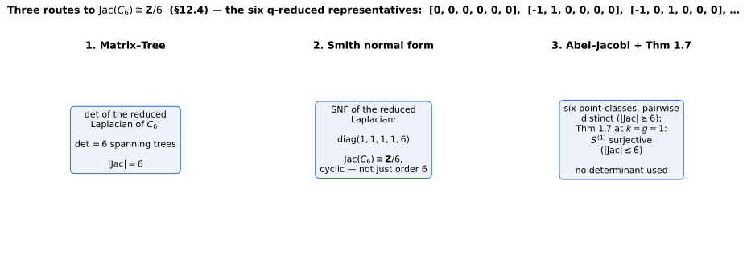
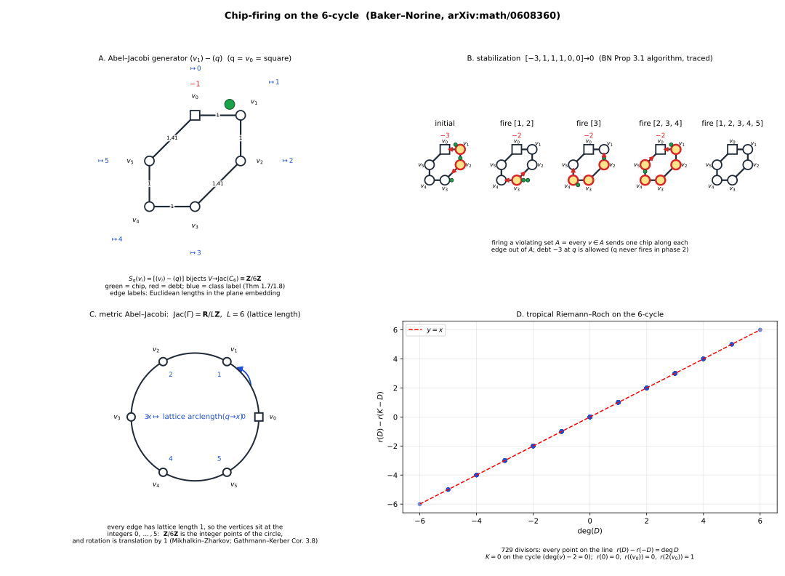

+++
title = "The Sandpile Group of a Donut"
description = "Baker–Norine chip-firing on Chapter 3's 6-cycle: Jac(C6) ≅ Z/6 three independent ways, Abel–Jacobi a bijection, the group law is rotation, Riemann–Roch brute-forced on all 729 divisors — and the metric coda corrected to lattice length: L = 6, the vertices at the integers of R/6Z."
weight = 12
[extra]
number = 12
part = "Part VI — Chip-firing, sandpiles, and Jacobians"
lead = "The cycle inside Chapter 3's cubic is its own Jacobian: its sandpile group is Z/6, Abel–Jacobi is a bijection, and adding points is rotating the hexagon."
+++


Part VI opens where Chapter 3 left a loose end. The smooth
tropical cubic had a cycle inside it — a hexagon, dual to the
star of the interior lattice point — and we called that cycle
the tropical shadow of the elliptic curve's torus, its donut.
Classically, a donut carries a **group law**: points on an
elliptic curve add. This chapter asks what becomes of that
group law tropically, and the answer is the cleanest one in
the book so far:

> **The cycle is its own Jacobian. Its sandpile group is
> `ℤ/6`, Abel–Jacobi is a bijection, and addition of points
> is rotation of the hexagon.**

Everything is Baker–Norine chip-firing theory on a finite
graph (M. Baker & S. Norine, "Riemann–Roch and Abel–Jacobi
theory on a finite graph", arXiv:math/0608360), computed on
the 6-cycle `C₆`. Definitions and the stabilisation algorithm
were taken from the paper — Proposition 3.1, verified against
the text — not from memory.

## 12.1 The graph, and what a divisor is

Work with the cycle on its own: vertices `v₀,…,v₅` in cyclic
order, six edges, genus

```
g = E − V + 1 = 6 − 6 + 1 = 1.
```

A **divisor** is just an integer at every vertex,
`D = Σ D(vᵢ)·(vᵢ)` — read `D(vᵢ)` as a pile of that many
chips at `vᵢ` (negative = debt). Its **degree** is the total
`Σ D(vᵢ)`. **Firing** a vertex sends one chip along each
incident edge to a neighbour; on the cycle, firing `v` is
subtracting the `v`-th column of the **Laplacian** `Q`
(degree on the diagonal, `−1` per edge off it). Divisors
reachable from `0` by firing scripts are **principal**;
degree-0 divisors modulo principal ones form the
**Jacobian** (sandpile / critical group)

```
Jac(G) = Div⁰(G) / Prin(G).
```

**Predict first.** A cycle graph has exactly as many spanning
trees as vertices — delete any one edge — so Kirchhoff's
Matrix-Tree theorem predicts `|Jac(C₆)| = 6` before any group
structure is computed. §12.4 collects that bet three ways.

## 12.2 Stabilisation, done honestly: q-reduced divisors

Fix a base vertex `q = v₀`. A divisor is **q-reduced** if

- (P1) it has no debt away from `q`, and
- (P2) every nonempty set `A ⊆ V ∖ {q}` contains a vertex
  `v` with `D(v) < outdeg_A(v)` — **Dhar's burning
  condition**. Read it as a burn: set fire to `q`; a vertex
  burns once the fire reaches it along more edges than it
  holds chips. Then `D` is q-reduced iff the fire from `q`
  burns the whole graph — a vertex that would survive the
  burn is exactly a vertex of a violating set. (The chapter
  program checks this burning test agrees with P1+P2 on all
  1024 degree-0 divisors with entries in `{-1,0,1,2}` away
  from `q`.)

Baker–Norine Proposition 3.1 says every class has exactly
one q-reduced representative, reached by their algorithm:
first take vertices out of debt, farthest-from-`q` first (a
preceding neighbour fires; fixed vertices only gain chips,
so each is fixed once), then repeatedly fire *violating
sets* — sets `A` where every `v ∈ A` can fire out of `A` —
until none remain. The program implements that algorithm
literally and asserts its postconditions on every call:
the output is q-reduced, the degree is unchanged, and
`D − D_q = Q·f` for the tracked firing script `f`.
Stabilisation is also asserted confluent — same answer for
lexicographic and reversed subset order — on 30 random
degree-0 divisors.

> **Honest Box — "stable" is not "q-reduced".** The first
> implementation of this material (Day 8 of the study) used
> the naive loop everyone writes first: fire a vertex that
> has enough chips, borrow at a vertex in debt. Its outputs
> *look* stable, and the run's own assertions killed it: the
> divisor `[-3, 1, 1, 1, 0, 0]` has no debt away from `q` and
> no vertex away from `q` able to fire alone, yet it fails
> Dhar's condition on `A = {1,2,3}` — one of its three
> violating sets `{1,2}`, `{2,3}`, `{1,2,3}` (each vertex
> of `A` holds exactly its out-degree to `Aᶜ`), so it is not
> q-reduced — and indeed it stabilises, under firing sets,
> all the way to `0`. The eye test is not the definition.
> The counterexample is kept in the program as a regression
> test, and it is the reason this chapter's stabiliser
> fires *sets*, not vertices.

## 12.3 Counting the reduced divisors first

Before computing the group, count its elements a second
way. A q-reduced degree-0 divisor on `C₆` must satisfy
`D(v) ∈ {0,1}` at every `v ≠ q` (P2 with `A = {v}` forces
`D(v) < deg(v) = 2`). Enumerating those `2⁵` candidates and
keeping the ones passing the full burning condition gives
exactly **6** q-reduced degree-0 divisors — the G-parking
functions — matching the Matrix-Tree prediction of §12.1.
One representative per class, six classes: the counting is
already consistent before the group law appears.

## 12.4 The sandpile group is `ℤ/6`, three ways

1. **Matrix-Tree.** `det` of any reduced Laplacian of `C₆`
   is `6` — six spanning trees, so `|Jac| = 6`.
2. **Smith normal form.** The reduced Laplacian's SNF is
   `diag(1, 1, 1, 1, 6)`, so
   `Jac(C₆) ≅ ℤ/1 × ℤ/1 × ℤ/1 × ℤ/1 × ℤ/6 ≅ ℤ/6` —
   cyclic, not just of order 6.
3. **Abel–Jacobi (§12.5).** The six point-classes below are
   pairwise distinct, so `|Jac| ≥ 6`; and Baker–Norine
   Theorem 1.7 says `S^(k)` is surjective iff `k ≥ g` —
   here `k = g = 1`, so every class is a point-class and
   `|Jac| ≤ 6`. This route never touches the determinant:
   the count is forced by the explicit list plus
   surjectivity. (The program checks the surjectivity
   computationally: the Abel–Jacobi image is exactly the
   set of six q-reduced degree-0 divisors.)

Three routes — a determinant, a normal form, an explicit
list — landing on the same group. That redundancy is the
chapter's standard of evidence, inherited from the study.



*Figure 12.2 — §12.4, drawn. Every number in it — the
determinant, the SNF diagonal, the six representatives —
was recomputed by the figure script from the chapter
program and asserted before rendering.*

## 12.5 Abel–Jacobi is a bijection

The **Abel–Jacobi map** sends a vertex to the class of the
degree-0 divisor `(vᵢ) − (q)`; write `S_q(vᵢ)` for its
q-reduced representative. The program computes:

```
v₀ ↦ [ 0, 0, 0, 0, 0, 0]
v₁ ↦ [-1, 1, 0, 0, 0, 0]
v₂ ↦ [-1, 0, 1, 0, 0, 0]
v₃ ↦ [-1, 0, 0, 1, 0, 0]
v₄ ↦ [-1, 0, 0, 0, 1, 0]
v₅ ↦ [-1, 0, 0, 0, 0, 1]
```

Six distinct classes, and by §12.4's third route there
are no others: the map `S^(1) : V → Jac` is a **bijection**
of sets. This is Baker–Norine's Theorems 1.7–1.8 in
miniature: Theorem 1.7 says `S^(k)` is surjective iff
`k ≥ g` (here `g = 1`, so `S^(1)` already surjects), and
Theorem 1.8 says `S^(k)` is injective iff the graph is
`(k+1)`-edge-connected — at `k = 1` that is exactly
2-edge-connected. The program asserts every cut of `C₆`
has at least 2 edges, so the hypothesis is checked, not
assumed. Keep this hypothesis in mind: Chapter 13 breaks
it on purpose, by grafting trees onto the cycle, and
watches injectivity fail in exactly the way the theorem
predicts.

## 12.6 The group law is rotation

Let `g = S_q(v₁)`, the class of the vertex one step round
the cycle. Adding `g` to itself (add representatives,
re-reduce) the program finds `g` has order exactly 6, and
then checks the full multiplication table in one line:

```
S_q(vᵢ) + S_q(vⱼ) = S_q(v_{i+j mod 6})   for all i, j.
```

So under Abel–Jacobi the Jacobian does not merely have the
same *size* as the vertex set — the vertex set, with
addition = rotation of the hexagon, **is** the group. This
is the tropical shadow of the elliptic-curve group law:
classically, points of a smooth cubic add by chord-and-
tangent, and the curve is its own Jacobian; tropically the
cubic has collapsed to its cycle, chord-and-tangent has
degenerated away, and what survives of the group law is
rotation around the loop. The donut remembers it was a
group.



*Figure 12.1 — A: the cycle with its Abel–Jacobi generator
and `ℤ/6` labels (§§12.5–12.6); edge labels are the
Euclidean lengths of the plane embedding. B: the traced
stabilisation of the Honest Box counterexample
`[-3,1,1,1,0,0] → 0`, firing sets `{1,2}`, `{3}`,
`{2,3,4}`, `{1,…,5}` (§12.2). C: the metric Jacobian
`ℝ/6ℤ` with the vertices at the integer points `0,…,5`
(§12.8) — redrawn for this chapter with equal lattice
spacing; the study's original drawing spaced them by
Euclidean arclength. D: Riemann–Roch scatter — all 729
divisors of §12.7 on the line `y = x`.*

## 12.7 Riemann–Roch, brute-forced

For a divisor `D`, the **rank** `r(D)` is the largest `s`
such that `D − E` is equivalent to an effective divisor for
every effective `E` of degree `s` (`−1` if `D` itself is
not). The **canonical divisor** is
`K = Σ (deg(v) − 2)·(v)`; on the 2-regular cycle every term
vanishes, so `K = 0` and `deg K = 0 = 2g − 2`, as it must.
Tropical Riemann–Roch (Baker–Norine Thm 1.12) says

```
r(D) − r(K − D) = deg(D) + 1 − g,
```

which here reads `r(D) − r(−D) = deg(D)`. The program
verifies it **on all `3⁶ = 729` divisors with entries in
`{-1, 0, 1}`**, rank computed from the definition (via the
q-reduced representative, which is effective iff the class
is), after the hand checks `r(0) = 0`, `r((v₀)) = 0`,
`r(2(v₀)) = 1`, and `r(K) = g − 1 = 0`. No sampling: the
finite box is exhausted, and every divisor in it obeys the
theorem. It is worth saying what the box actually tests
once `K = 0`: for `deg D ≥ 1`, `−D` has negative degree so
`r(−D) = −1` and the theorem collapses to
`r(D) = deg D − 1`; at degree 0 it says `D ∼ 0` iff
`−D ∼ 0`. The program asserts both readings separately
(294 divisors of the first kind, 141 of the second).

A remark worth keeping (Baker–Norine Remark 1.13(iii)):
`L(D) ∪ {∞}` is naturally a finitely generated semimodule
over the *tropical semiring* `(ℕ ∪ {∞}, min, +)` — its
addition is pointwise `min` (the program checks `L(D)` is
closed under pointwise min in bounded boxes) — so
Chapter 1's min-plus arithmetic shows up inside divisor
theory itself, not just in the geometry that produced the
graph.

## 12.8 Metric coda: the Jacobian is a circle

Chapter 3's cycle is not abstract: its edges have lengths.
But *which* lengths? Measured with a Euclidean ruler in the
plane, the six edges (in cyclic order) are
`1, 1, √2, 1, 1, √2`, totalling `4 + 2√2 ≈ 6.828` — that is
the number Chapter 3 originally printed. The tropical
metric is not the Euclidean one: an edge's length is its
**lattice length**, the factor by which its displacement
stretches the primitive integer direction along it. The two
diagonal edges have displacement `(1,1)` (resp. `(−1,−1)`)
— exactly `1 ×` the primitive direction `(1,1)` — so their
lattice length is `1`, not `√2`; the four axis edges have
lattice length `1` as well. Every edge has lattice length
1, and the total is

```
L = 6.
```

(The program recomputes this from Chapter 3's vertex
coordinates: Euclidean total `4 + 2√2`, lattice total `6`.
Chapter 3's §3.3, its leaf-stripping caption, and its
"What we learned" originally promised the Euclidean number
as the Jacobian's circumference — the same correction is
applied there in this chapter's ship.)

For the *metric* graph, the Jacobian is the circle
`ℝ / Lℤ = ℝ / 6ℤ`, and the metric Abel–Jacobi map sends a
point at lattice arclength `x` from `q` to `x` around that
circle; the six vertices land at the integers
`0, 1, 2, 3, 4, 5` (Mikhalkin–Zharkov; Gathmann–Kerber
Cor. 3.8 for Riemann–Roch on tropical curves). That is
what makes §12.6's thesis literally true: the combinatorial
group sits inside the metric Jacobian as `ℤ/6 ⊂ ℝ/6ℤ`, the
integer points of the circle, and rotation of the hexagon
*is* translation by 1 — with the Euclidean `4 + 2√2` the
vertices would sit unevenly spaced and the sentence would
fail. Panel C of Figure 12.1 draws exactly that: §12.6's
rotation group, given its metric, *is* the circle group of
the donut — the point where the combinatorial `ℤ/6` of
this chapter and the continuous torus of Chapter 3's
classical postcard meet.

## 12.9 The whole chapter, as a program

Everything in this chapter is one runnable program: [ch12_sandpile.py](./ch12_sandpile.py) — the Baker–Norine Prop. 3.1 stabiliser (out-of-debt phase + firing violating sets) with q-reduced postconditions asserted on every call; confluence on 30 random divisors; the stable-but-not-reduced regression test; the 6 G-parking functions; Matrix-Tree + Smith normal form; the Abel–Jacobi classes and their rotation group law; Riemann–Roch on all 729 divisors; and the verification groups added when the draft was re-verified for the book — the Try It answer key, the three violating sets of §12.2's counterexample, the Dhar-burn ⇔ q-reduced equivalence on 1024 divisors, the surjectivity route to `|Jac| = 6`, the two readings of the Riemann–Roch box, the lattice-length computation of §12.8, and the min-closure of `L(D)`. Run it, and if it prints its final line, the claims are what we said they are.

## 12.10 Try It

1. Which vertex is the identity of `Jac(C₆)` under
   Abel–Jacobi, and what is `S_q(v₃) + S_q(v₄)`?
2. Show by hand that `[-3, 1, 1, 1, 0, 0]` fails Dhar's
   burning condition, naming a violating set.
3. Without running code: how many spanning trees does
   `Cₙ` have, and what does that predict for `|Jac(Cₙ)|`?
   What extra computation decides the *group structure*
   (not just the order) at `n = 6`?
4. On `C₆`, `K = 0`. Compute `r((v₀) + (v₃))` from the
   Riemann–Roch statement of §12.7 and one hand check in
   the text.

## Answers

- **1.** `v₀` itself: `S_q(v₀) = [(v₀) − (q)] = 0`. And
  `S_q(v₃) + S_q(v₄) = S_q(v_{7 mod 6}) = S_q(v₁)`.
- **2.** There are three violating sets: `{1,2}`, `{2,3}`,
  and `{1,2,3}` — any one suffices. Take `A = {1,2,3}`:
  `outdeg_A` is 1 at `v₁` (edge to `v₀`), 0 at `v₂` (both
  neighbours in `A`), 1 at `v₃` (edge to `v₄`), and `D = 1`
  at all three, so `D(v) ≥ outdeg_A(v)` throughout — no
  vertex of `A` satisfies `D(v) < outdeg_A(v)`, and P2
  fails. (In Dhar's language: the fire from `q` never
  reaches `v₂` — it holds 1 chip against 0 edges to the
  burnt set — so the burn stalls.)
- **3.** `n` spanning trees (delete any one edge), so
  `|Jac(Cₙ)| = n`. Order alone does not give the group;
  the Smith normal form `diag(1,1,1,1,6)` is what upgrades
  "order 6" to "`ℤ/6`".
- **4.** `deg = 2`, `g = 1`, `K = 0`: Riemann–Roch gives
  `r(D) − r(−D) = 2`; `−D` has negative degree, so
  `r(−D) = −1` and `r(D) = 1`.

## What we learned

- **The cycle is its own Jacobian.** `Jac(C₆) ≅ ℤ/6` by
  three independent routes, Abel–Jacobi is a bijection of
  the vertex set onto the group, and the group law is
  rotation — the elliptic curve's chord-and-tangent law,
  degenerated to its tropical shadow.
- **Stabilisation is a theorem, not a loop.** The naive
  fire/borrow stabiliser passes the eye test and fails
  Dhar's burning condition; Baker–Norine's set-firing
  algorithm, with its postconditions asserted, is what
  makes every later count in the chapter mean anything.
- **Length means lattice length.** The cycle's Euclidean
  embedding length is `4 + 2√2`, but its tropical metric
  total is `6` — and only with `L = 6` do the vertices sit
  at the integers of `ℝ/6ℤ`, making "rotation is the group
  law" literally true in the metric Jacobian too.

## Next

Chapter 13 — "Trees Are Invisible": graft Chapter 3's
three trees back onto the cycle, and watch the Jacobian
refuse to notice (§12.5's 2-edge-connected hypothesis is
the one that gives).

---

*Source & provenance: Day 8 (2026-10-18) of the tropical
geometry study — code `hidden_files/code/day08_chip_firing.py`,
figure `files/figures/day08-chip-firing.png` (generator
`hidden_files/code/day08_figures.py`), study log Day 8 entry,
run log `hidden_files/day08-run.log`. Sources: M. Baker &
S. Norine, "Riemann–Roch and Abel–Jacobi theory on a finite
graph", arXiv:math/0608360 (divisors and the Laplacian in
§1.3 — (1.3) itself defines `Prin(G)`, and (1.5) the
Jacobian — canonical divisor (1.11), stabilisation
Prop. 3.1, Thms 1.7/1.8/1.12, Remark 1.13(iii));
Mikhalkin–Zharkov, arXiv:math/0612267, and
Gathmann–Kerber, arXiv:math/0612129, Cor. 3.8 for the
metric coda. Cycle geometry from Day 2: Euclidean edge
lengths `1,1,√2,1,1,√2` (total `4 + 2√2`), lattice lengths
all `1` (total `L = 6`) — §12.8. The chapter program was
merged into one self-contained file (Day 8 program + the
book cycle's Phase-2 verification groups) and re-run
end-to-end from this bundle on 2026-11-16, all assertion
groups passing (run log `hidden_files/ch12-run.log`).
Figures regenerated as SVG the same day: code
`hidden_files/code/ch12_extra_figures.py`, which imports
the chapter program, asserts every value it draws —
including the lattice lengths behind Panel C and every
cell of Figure 12.2 — and only then renders. Referee pass
(ClaudeDuet, #minplus-book, 2026-11-14): his independent
checker agreed on every chip-firing number; all five of
his points held up and were folded in during Phase 2 —
headline: §12.8's metric coda now uses lattice length
(`L = 6`), and Chapter 3's matching promise is corrected
in the same ship.*

## Chapter code

The full program behind this chapter, as a download: [ch12_sandpile.py](./ch12_sandpile.py) — the same file §12.9 points at. Its assertions are the chapter's claims; run it.
