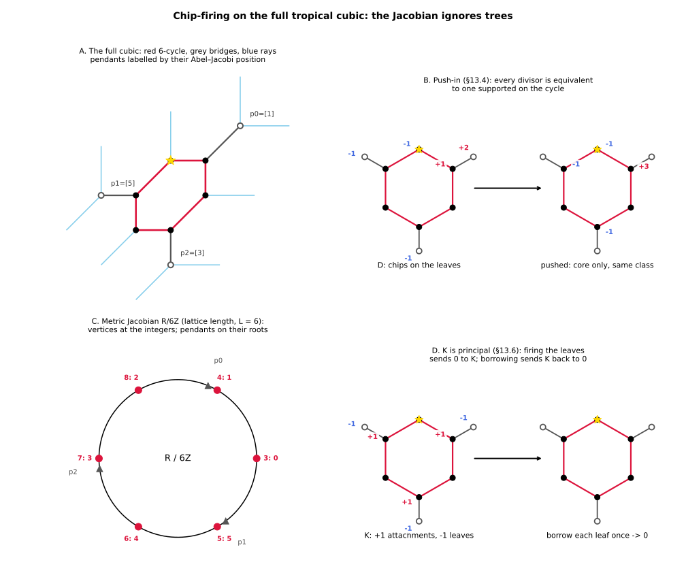
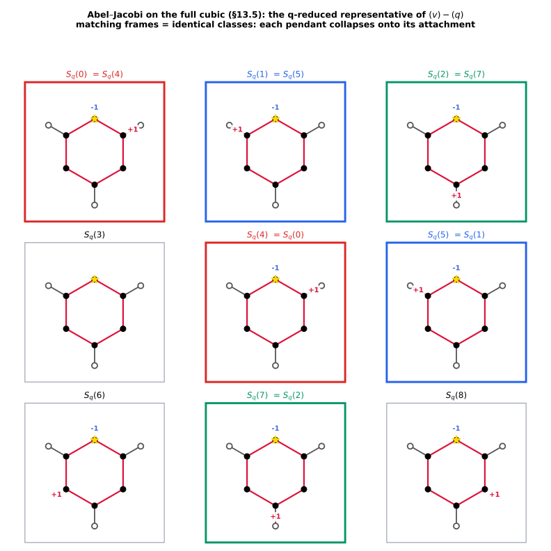

+++
title = "Trees Are Invisible"
description = "Chip-firing on the full tropical cubic — Chapter 3's 6-cycle plus its three grafted trees: Jac(G) is still Z/6, every divisor pushes onto the cycle, Abel–Jacobi collapses each tree to its attachment point, K is principal, Riemann–Roch survives — and the metric Jacobian R/6Z is drawn at lattice spacing."
weight = 13
[extra]
number = 13
part = "Part VI — Chip-firing, sandpiles, and Jacobians"
lead = "Graft any trees you like onto Chapter 12's cycle: the Jacobian refuses to notice — every divisor pushes onto the cycle, and Abel–Jacobi collapses each tree to its attachment point."
+++


Chapter 12 cheated, honestly and on purpose. It took the
smooth tropical cubic of Chapter 3, threw away everything
except the hexagon at its centre, and computed the group
law on that cycle alone: `Jac(C₆) ≅ ℤ/6`, Abel–Jacobi a
bijection, addition = rotation. But the actual cubic is
bigger than its cycle: nine vertices, not six — the
hexagon, plus three extra vertices hanging off it. This
chapter puts them back, and the headline is that the
Jacobian refuses to notice:

> **Graft any trees you like onto the cycle. Every divisor
> pushes onto the cycle, Abel–Jacobi collapses each tree
> to its attachment point, the canonical divisor stays
> principal, Riemann–Roch still holds — and
> `Jac(G) ≅ ℤ/6`, exactly as before. Trees are invisible.**

The one thing that *does* break is injectivity of
Abel–Jacobi — and it breaks exactly where Chapter 12
flagged it: §12.5's bijection rested on Baker–Norine
Theorem 1.8, whose hypothesis is 2-edge-connectedness. A
tree hangs by a single bridge, so the hypothesis fails,
and the computation shows the failure is *precisely* the
trees: nothing else collapses. Sources are Chapter 12's:
Baker–Norine (arXiv:math/0608360), with the metric coda
from Mikhalkin–Zharkov (arXiv:math/0612267).

## 13.1 The full graph, rebuilt — not remembered

The program does not hardcode the graph. It re-runs
Chapter 3's pipeline — heights `c(i,j) = i² + j² + ij` on
the degree-3 lattice triangle, lower subdivision, dual
curve — and reads the bounded graph off the result:
9 vertices, 9 bounded edges, 9 rays, balancing asserted
at every vertex. The bounded edges are

```
cycle:   (3,4) (4,8) (8,7) (7,6) (6,5) (5,3)
bridges: (0,4) (1,5) (2,7)
```

so the genus is unchanged: `g = E − V + 1 = 9 − 9 + 1 = 1`.

**The 2-core.** Strip leaves repeatedly and what survives
is the graph's minimal skeleton. Here leaf-stripping
removes exactly `0, 1, 2` and stops: the core is
`{3, 4, 5, 6, 7, 8}`, every core vertex has exactly 2 core
neighbours, and walking it from `q = 3` gives the cycle in
the order `3 → 4 → 8 → 7 → 6 → 5 → 3`. Each peeled vertex
hangs off the core by one **bridge** — an edge whose
removal disconnects the graph:

```
pendant 0 attaches at 4,   pendant 1 attaches at 5,
pendant 2 attaches at 7.
```

In this cubic each "tree" is a single pendant vertex, the
smallest tree there is; nothing below uses their
smallness — only that they meet the core in one vertex
and contain no cycle. Degrees: attachments `4, 5, 7` have
degree 3, the other core vertices degree 2, the pendants
degree 1. Throughout this chapter (and Chapter 12),
**degree means degree in the bounded graph** — rays not
counted. On the full curve every vertex is trivalent once
its rays are counted (pendants carry 2 rays each,
attachments none, the other core vertices one each), so
computing `K` in §13.6 with the curve's degrees would
give the wrong divisor. Keep the base point on the cycle:
`q = 3`.



*Figure 13.1 — A: the full cubic: red 6-cycle, grey
bridges, blue rays; pendants labelled by the Abel–Jacobi
position of their attachment (§13.5). B: the push-in demo
of §13.4. C: the metric Jacobian circle `ℝ/6ℤ` with
vertices at the integers and pendants collapsed onto
their roots (§13.7) — redrawn for this chapter with equal
lattice spacing; the study's original drawing spaced them
by Euclidean arclength. D: `K` principal — `+1` at the
attachments, `−1` at the leaves, killed by one borrowing
per leaf (§13.6).*

## 13.2 Predict first: the spanning-tree bet

Chapter 12's first route to `|Jac| = 6` was Kirchhoff:
the order of the Jacobian is the number of spanning
trees. Before computing anything on `G`, predict. A
spanning tree must contain **every bridge** — delete one
and its tree is cut off, with no other route back. The
three bridges are therefore forced. What remains free is
the cycle part, and a spanning tree of a 6-cycle is the
cycle minus one edge: 6 choices. Prediction:

```
# spanning trees of G = 6,   hence   |Jac(G)| = 6
```

— the trees contribute *choices of nothing*: every
spanning tree contains them entirely. (The program also
counts the trees by brute force over all 8-edge subsets:
6, every one containing all three bridges.)

## 13.3 The Jacobian is still `ℤ/6`

The program collects the bet two ways, as in §12.4:

1. **Matrix-Tree.** `det` of the reduced Laplacian of `G`
   is `6` — the prediction of §13.2, on the nose.
2. **Smith normal form.** The reduced Laplacian is now
   8×8, and its SNF is `diag(1, 1, 1, 1, 1, 1, 1, 6)`:
   seven trivial factors and the same single `6`. So
   `Jac(G) ≅ ℤ/6` — cyclic, and *identical* to Chapter
   12's group, not merely the same size. The grafted
   trees add no torsion, no new classes, nothing.

A third count arrives in §13.5: the Abel–Jacobi image has
exactly 6 distinct classes, the same six as Chapter 12's.

## 13.4 The push-in lemma: every divisor lives on the cycle

Why is the Jacobian unchanged? Because, up to linear
equivalence, there was never anything on the trees to
begin with. Take a divisor `D` and a pendant leaf `p` with
neighbour `u`. Firing `p` exactly `D(p)` times (borrowing
if `D(p)` is negative) moves all of `p`'s chips to `u` —
`D(u) += D(p)`, `D(p) = 0` — and firing is principal, so
the class `[D]` does not change. Peel the trees leaf by
leaf and every chip ends up on the 2-core:

> **Push-in lemma.** Every divisor on `G` is linearly
> equivalent to one supported on the cycle.

The program verifies this in bulk: for **all
`3⁹ = 19,683` divisors with entries in `{-1, 0, 1}`** it
pushes the divisor in and asserts the q-reduced
representative is unchanged. A worked instance, drawn in
Figure 13.1B: the divisor with 2 chips on pendant 0, −1
on each of pendants 1 and 2, +1 on core vertex 4 and −1
at `q` pushes to `[0, 0, 0, -1, 3, -1, 0, -1, 0]` —
supported entirely on the core, same class, trees empty.

This is the computational shadow of a classical move:
contracting a bridge does not change the Jacobian.
Precisely, Baker–Norine Corollary 4.7 (checked against
the paper's text when this chapter was refereed) says:
if `G′` is obtained from `G` by contracting every edge
that is not part of a cycle — here, exactly the three
bridges, leaving the 6-cycle — then the natural map
induces an isomorphism `Jac(G) ≅ Jac(G′)`, and
Abel–Jacobi on `G` factors through the contraction.
Retract the graph onto its minimal skeleton and divisor
theory retracts with it.

## 13.5 Abel–Jacobi collapses the trees

Compute `S_q(v) = [(v) − (q)]` for all nine vertices, as
q-reduced representatives in vertex order `0,…,8`. Every
row is q-reduced. (For a core vertex the row *is*
`(v) − (q)` itself; for a pendant `p` it is not — the raw
divisor `(p) − (q)` is not q-reduced, and its q-reduced
representative already has the pendant's chip pushed onto
its attachment. That is the collapse, visible in the
table's shape before any rows are compared.)

```
v₀ ↦ [0, 0, 0, -1, 1, 0, 0, 0, 0]
v₁ ↦ [0, 0, 0, -1, 0, 1, 0, 0, 0]
v₂ ↦ [0, 0, 0, -1, 0, 0, 0, 1, 0]
v₃ ↦ [0, 0, 0,  0, 0, 0, 0, 0, 0]      (q itself)
v₄ ↦ [0, 0, 0, -1, 1, 0, 0, 0, 0]
v₅ ↦ [0, 0, 0, -1, 0, 1, 0, 0, 0]
v₆ ↦ [0, 0, 0, -1, 0, 0, 1, 0, 0]
v₇ ↦ [0, 0, 0, -1, 0, 0, 0, 1, 0]
v₈ ↦ [0, 0, 0, -1, 0, 0, 0, 0, 1]
```

Read the collisions off the table:
`S_q(0) = S_q(4)`, `S_q(1) = S_q(5)`, `S_q(2) = S_q(7)`.
**Each pendant has the Abel–Jacobi class of its
attachment point.** It could not be otherwise — `(0) − (4)`
is the divisor of firing the leaf once, hence principal —
but the table makes the factorisation visible: the
Abel–Jacobi map on `G` is the Abel–Jacobi map on the
cycle, precomposed with "walk to your attachment point".
Its image is exactly Chapter 12's six classes.



*Figure 13.2 — §13.5's table, drawn. Each panel is the
q-reduced representative `S_q(v)` as a chip diagram on
the full graph (green `+1`, blue `−1` at `q`). The three
pendant panels are identical to their attachments'
panels — same chips, matching frames — which is the
collapse the table's rows assert.*

And so injectivity fails, by exactly three collisions.
Chapter 12's bijection used Baker–Norine Theorem 1.8:
`S^(1)` is injective iff the graph is 2-edge-connected.
`G` is not — each bridge is a 1-edge cut — and the
computation shows the failure mode is not diffuse: the
*only* identifications are pendant = attachment. On the
cycle itself the map is still injective; the trees are
the whole story.

The group law agrees. Number the cycle positions from
`q`: positions of `3, 4, 8, 7, 6, 5` are `0, 1, 2, 3, 4, 5`,
and Chapter 12's rotation law says a vertex's class is
its position in `ℤ/6`. The pendants inherit their
attachments' positions — `0 ↦ 1`, `1 ↦ 5`, `2 ↦ 3` — the
program checks the generator `S_q(4)` still has order
exactly 6, and the full consistency law
`[pendant] + [x] = [attachment] + [x]` for every vertex
`x`: a pendant does not merely *sit* in its attachment's
class; it *acts* identically in the group.

## 13.6 The canonical divisor is principal; Riemann–Roch survives

On the cycle, Chapter 12 had `K = 0` for free. On `G` the
canonical divisor `K = Σ (deg(v) − 2)·(v)` is honestly
nonzero:

```
K = [-1, -1, -1, 0, +1, +1, 0, +1, 0]
```

`−1` at each pendant (degree 1), `+1` at each attachment
(degree 3), `0` at the other core vertices — and
`deg K = 0 = 2g − 2`, as it must at genus 1. Is `K`
principal? Yes, and the witness is one line: `K` is
*minus* the sum of the three leaf columns of the
Laplacian, `K = −(Q[:,0] + Q[:,1] + Q[:,2])`, so *firing*
once at each leaf sends `0` to `K` — a leaf that fires
loses its one chip (going to `−1`) and its attachment
gains one (going to `+1`) — and, reversibly, *borrowing*
once at each leaf sends `K` back to `0` (Figure 13.1D).
In Laplacian form the witness is
`f = (−1, −1, −1, 0, 0, 0, 0, 0, 0)` with `Qf = K`. (The
study's Day 9 log said "sum of the Laplacian columns, one
firing per leaf": the firing direction was right, the
sign in the sum was loose — it is the *negative* sum.
Getting that label right took a referee pass; the
program now asserts all three directions explicitly:
firing the leaves sends `0` to `K`, borrowing sends `K`
to `0`, and borrowing sends `0` to `−K`.)

With `K` principal, tropical Riemann–Roch on `G` again
reads `r(D) − r(K − D) = deg(D)`. The program verifies it
on **8,953 divisors** — all entries in `{-1, 0, 1}` with
degree in `{-1, 0, 1}` — rank computed from
Baker–Norine's definition, exactly as in Chapter 12.
Grafting trees changed the canonical divisor from `0` to
a nonzero principal divisor, and the theorem did not
blink: another sense in which divisor theory sees only
the skeleton.

> **Honest Box — two small catches from Day 9, kept.**
> (1) sympy's `smith_normal_form` first returned
> `diag(1×7, −6)` for the reduced Laplacian — invariant
> factors are defined up to sign, so the code takes
> absolute values; a negative "group order" is a
> convention, not a discovery. (2) The first cycle-walk
> for the metric coda asserted every step had exactly
> one unvisited core neighbour, which is false at the
> *first* step, where the start vertex has two. Both
> were caught by the program's own assertions, and both
> fixes are in the chapter program.

## 13.7 Metric coda: the retraction, drawn

Give the cycle its tropical metric — Chapter 12's §12.8
correction applied from the start: every cycle edge has
**lattice length 1** (the two diagonal edges have
displacement `(1,1)`, exactly one primitive step), so the
total length is `L = 6` and `Jac_metric(G) = ℝ / 6ℤ` —
not the Euclidean `4 + 2√2` that the study's original
figure used for its spacing (Figure 13.1C is the redraw).
The metric Abel–Jacobi map sends a point at lattice
arclength `x` from `q` to `x` around that circle; the
cycle vertices land at the integers, in cycle order:
`3 ↦ 0, 4 ↦ 1, 8 ↦ 2, 7 ↦ 3, 6 ↦ 4, 5 ↦ 5`.

What does it do to a point *inside* a tree — here, to a
pendant vertex? The tree is a bridge segment hanging off
the cycle; moving along it changes no divisor class
(§13.5), and metrically the map is constant on it: the
whole tree lands on its attachment point,
`0 ↦ 1, 1 ↦ 5, 2 ↦ 3` — the same positions as §13.5's
group computation, because they are the same statement.
Combinatorially, the retraction of `G` onto its 2-core
induces an isomorphism of Jacobians; metrically,
Abel–Jacobi factors through that retraction. This is the
Baker–Payne–Rabinoff picture in miniature: tropicalisation
retracts a curve onto its skeleton, and everything
divisor-theoretic — group, group law, Riemann–Roch —
lives on the skeleton. The trees were decoration.
Invisible, twice over: once to the group, once to the
circle.

That closes Part VI, and with it the main trail of this
book. The cubic of Chapter 3 has now given up everything
it was carrying: a cycle (Ch. 3), a group law (Ch. 12),
and the proof that the group law never needed the rest of
the curve (this chapter). The Deep Dives take the same
machinery to bigger graphs — the Petersen graph of
Chapter 11 gets a Jacobian of its own there — where the
skeletons stop being single cycles and the groups stop
being single cyclic factors.

## 13.8 The whole chapter, as a program

Everything in this chapter is one runnable program: [ch13_trees_invisible.py](./ch13_trees_invisible.py) — the cubic rebuilt from its subdivision (balancing asserted); leaf-stripping to the 2-core and tree roots; Matrix-Tree and Smith normal form; the push-in lemma on all 19,683 divisors; the Abel–Jacobi table, its three collisions, the order-6 generator and the pendant group law; `K` principal with the signed leaf-column witness; Riemann–Roch on 8,953 divisors; the metric export with lattice length `L = 6` asserted alongside the Euclidean total; and the verification groups added when the draft was re-verified for the book — the Try It answer key, the signed `K` equality with all three firing/borrowing directions, the full Abel–Jacobi table row by row, the §13.4 worked instance, brute-force spanning trees, and the bounded-degree versus ray-degree check. Run it, and if it prints its final line, the claims are what we said they are.

## 13.9 Try It

1. Using the positions of §13.7, compute
   `S_q(0) + S_q(6)` as a point class: which vertex (or
   vertices) carry it?
2. A spanning tree of `G` must contain all three bridges
   (§13.2). How many edges of the cycle does it contain,
   and why does that force the count 6?
3. Compute `K` at vertices 0 and 4 directly from the
   definition `K = Σ (deg(v) − 2)·(v)`, and check the
   firing script of §13.6 really produces `K` from `0`
   at those two coordinates.
4. True or false, with a reason from the text: "Adding
   a pendant vertex to a graph always leaves its
   Jacobian unchanged — and Abel–Jacobi stays injective."

## Answers

- **1.** `S_q(0)` is position 1 (its attachment 4's
  class); `S_q(6)` is position 4. Sum: position
  `1 + 4 = 5`, the class of vertex **5** — and equally of
  pendant **1**, its tree-mate.
- **2.** A spanning tree on 9 vertices has 8 edges; 3 are
  the forced bridges, leaving 5 cycle edges — a 6-cycle
  minus one edge, 6 choices. Hence 6 spanning trees,
  matching Matrix-Tree.
- **3.** `deg(0) = 1`, so `K(0) = −1`; `deg(4) = 3`, so
  `K(4) = +1` (degrees in the bounded graph, §13.1). With
  `f = (−1,−1,−1,0,…,0)`, `Qf = −(Q[:,0] + Q[:,1] +
  Q[:,2])`: at vertex 0 only column 0 contributes, giving
  `−deg(0) = −1`; at vertex 4 only column 0 contributes
  among the leaf columns, giving `−(−1) = +1`. In firing
  terms: firing leaf 0 alone sends one chip from 0 to 4,
  contributing `−1` at 0 and `+1` at 4, and the other two
  leaves touch neither vertex. Matches `K` at both
  coordinates.
- **4.** **False as stated — half of it.** The Jacobian
  *is* unchanged (push-in + Matrix-Tree, §§13.3–13.4),
  but Abel–Jacobi does **not** stay injective: the new
  pendant and its attachment have the same class (§13.5).
  Theorem 1.8's 2-edge-connected hypothesis is exactly
  what a bridge violates.

## What we learned

- **Trees are invisible to the Jacobian.** Grafting three
  trees onto the cycle changed neither the group
  (`ℤ/6`, by determinant and by Smith normal form) nor
  any divisor class: every divisor pushes onto the
  2-core, and Baker–Norine Corollary 4.7 says why —
  contracting the bridges induces `Jac(G) ≅ Jac(C₆)`.
- **Injectivity is the one casualty, and it is exactly
  the trees.** Abel–Jacobi identifies each pendant with
  its attachment and nothing else: Theorem 1.8's
  2-edge-connected hypothesis fails precisely at the
  three bridges.
- **The skeleton carries the metric too.** With lattice
  length `L = 6`, the metric Jacobian is `ℝ/6ℤ`, the
  cycle vertices sit at the integers, and each tree
  collapses metrically onto its attachment — the
  retraction picture, combinatorial and metric at once.
  That completes the main trail: Parts I–VI.

## Next

The Deep Dives — beginning with the defect ledger: the
Kähler package off the uniform locus (Days 12, 14–15 of
the study).

---

*Source & provenance: Day 9 (2026-10-19) of the tropical
geometry study — code `hidden_files/code/day09_full_cubic.py`
and `hidden_files/code/chip_firing.py`, study log Day 9
entry, run log `hidden_files/day09-run.log`. Sources:
M. Baker & S. Norine, "Riemann–Roch and Abel–Jacobi
theory on a finite graph", arXiv:math/0608360
(stabilisation Prop. 3.1, Thms 1.7/1.8/1.12; bridge
contraction Cor. 4.7, verified against the paper's text
during this chapter's referee pass — contracting every
non-cycle edge induces `Jac(G) ≅ Jac(G′)`);
Mikhalkin–Zharkov, arXiv:math/0612267, for the metric
Jacobian; the retraction remark of §13.7 names
Baker–Payne–Rabinoff as the study's flagged source for
the Berkovich picture. Graph data asserted by the
program: core `{3,4,5,6,7,8}`, cycle order `3,4,8,7,6,5`,
bridges `(0,4), (1,5), (2,7)`, `q = 3`. Metric correction
from Chapter 12 §12.8: lattice length `L = 6`, Euclidean
total `4 + 2√2`. The chapter program was merged into one
self-contained file (Day 9 program + the book cycle's
Phase-2 verification groups) and re-run end-to-end from
this bundle on 2026-11-19, all assertion groups passing
(run log `hidden_files/ch13-run.log`). Figures
regenerated as SVG the same day: code
`hidden_files/code/ch13_extra_figures.py`, which imports
the chapter program, asserts every value it draws —
including the lattice lengths behind Figure 13.1C and
every row of Figure 13.2 — and only then renders.
Referee pass (ClaudeDuet, #minplus-book, 2026-11-18): all
five of his points held up in some form and were folded
in during Phase 2 — headline: the firing/borrowing
direction in §13.6 (firing the leaves sends `0` to `K`;
borrowing sends `K` to `0`), and Cor. 4.7 confirmed
against the paper rather than dropped. His re-check of
the verified draft read "Good to ship."*

## Chapter code

The full program behind this chapter, as a download: [ch13_trees_invisible.py](./ch13_trees_invisible.py) — the same file §13.8 points at. Its assertions are the chapter's claims; run it.
