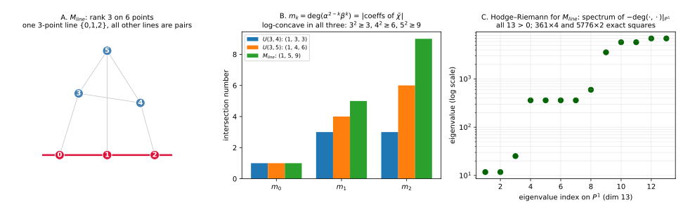
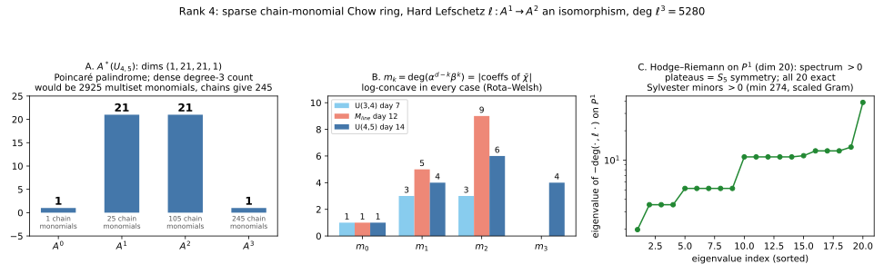
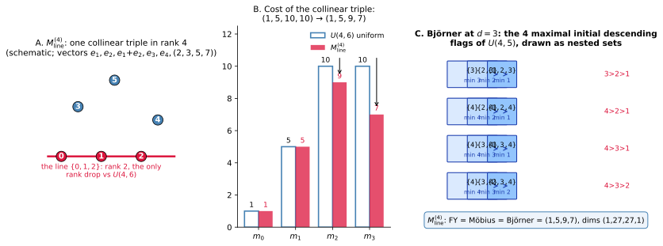
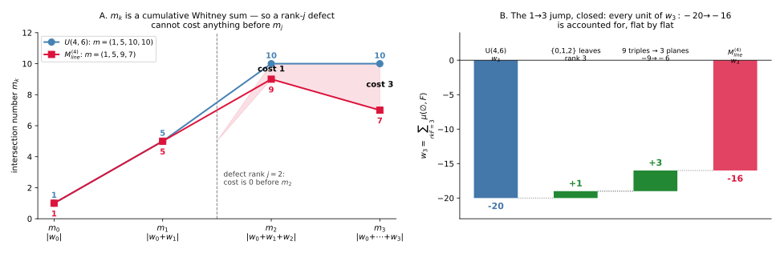

+++
title = "The Defect Ledger"
description = "Deep Dive 1: the Kähler package off the uniform locus. One collinear triple in a matroid costs the intersection numbers exactly (0, 0, 1, 3) — U(4,6) has m = (1, 5, 10, 10), the defect matroid has (1, 5, 9, 7) — every number recovered three independent ways, the damage's shape proved from the Whitney sums, and its 1-to-3 growth closed flat by flat."
weight = 14
[extra]
number = 14
part = "Part VII — Deep Dives"
lead = "Take a uniform matroid, make exactly three points collinear, and recompute everything: the Kähler package survives intact, and the damage lands in a ledger that reads (0, 0, 1, 3)."
+++


The main trail ended at Chapter 13. The Deep Dives carry a
warning on the door: they assume more — here, Chapters 8 and
9 in particular — and reward more. If the Chow ring of a
matroid is still fog, read Chapter 9 first; this chapter does
not re-teach it, it *stress-tests* it.

Chapter 9 verified the Kähler package — Poincaré duality,
Hard Lefschetz, Hodge–Riemann, and the intersection numbers
`m = (1, 3, 3)` — for one matroid, the uniform matroid
`U(3,4)`, where every subset of the right size is a flat and
the symmetry is total. A sceptic's question writes itself:

> Was any of that true because the matroid was *uniform* —
> because nothing in it was allowed to be special?

This chapter's answer is a ledger. Take a uniform matroid and
introduce exactly one **defect** — one place where the generic
pattern breaks: three points that are supposed to be in
general position, but lie on a line. Then recompute
*everything*, and write down, entry by entry, what the defect
cost. The headline:

> **One collinear triple costs the intersection numbers
> exactly `(0, 0, 1, 3)`: `U(4,6)` has `m = (1, 5, 10, 10)`,
> the matroid with one 3-point line has `m = (1, 5, 9, 7)` —
> and the full Kähler package survives the damage, in rank 3
> and in rank 4, with every number recovered by three
> independent routes.**

Nothing at the bottom of the ledger is approximate. Every
entry is an exact integer, computed three ways that share no
code path worth mentioning: intersection theory in the Chow
ring, Möbius inversion over the lattice of flats, and a count
of flags.

Sources: M. Baker, "Hodge Theory in Combinatorics"
(arXiv:1705.07960), §§4.1, 4.3, 4.4 — the Feichtner–Yuzvinsky
presentation, ample classes from strictly submodular
functions, Theorem 4.2 and Proposition 4.3 (Björner),
surveying Adiprasito–Huh–Katz, Theorem 4.1 (the Kähler
package).

## 14.1 The setup, in one paragraph (Chapter 9 assumed)

For a matroid `M` of rank `r = d+1` on a ground set `E`, the
Chow ring is

```
A*(M) = ℤ[x_F : F a nonempty proper flat] / (CH1 + CH2),
```

where (CH1) says `Σ_{F∋a} x_F = Σ_{F∋b} x_F` for any two
points `a, b`, and (CH2) says `x_F · x_G = 0` whenever `F`
and `G` are incomparable flats. There is a degree map
`deg : A^d → ℤ`, normalised to `1` on the monomial of any
maximal flag of flats. With `α = Σ_{F∋0} x_F` and
`β = Σ_{F∌0} x_F`, the intersection numbers are

```
m_k = deg(α^{d−k} β^k),      k = 0, …, d.
```

Theorem 4.2 says these are the unsigned coefficients of the
reduced characteristic polynomial `χ̄(t)`. So there are
already two routes to `m`: multiply in the ring, or
Möbius-invert over the flat lattice and read `χ̄`. Section
14.5 adds Björner's third route. When all three agree on a
non-uniform matroid, "the theorem is about matroids, not
about uniformity" stops being a slogan and becomes a receipt.

**Predict first.** A defect should cost *something*: making
three points collinear merges flats (three pair-flats become
one 3-point flat), and fewer flats should mean smaller
numbers somewhere. But where? A reasonable first guess —
recorded here so the computation can disagree with it — is
that the damage spreads evenly. It does not. It lands
entirely at the top of the ledger (§14.7).

## 14.2 Rank 3: one line on six points (Day 12)

The first defect is as small as a defect can be. `M_line` is
the rank-3 matroid on `E = {0, …, 5}` whose only
non-uniformity is a single 3-point line: the set `{0,1,2}` is
a rank-2 flat of size 3. Every other rank-2 flat is an
ordinary pair. The program asserts the defining property of
a simple matroid here — the rank-2 flats partition the 15
pairs: each pair of points lies in exactly one rank-2 flat,
the line absorbing the three pairs inside `{0,1,2}`.

Count the flats: 6 singletons, 13 rank-2 flats (12 pairs +
the line), and `E` itself — 19 proper nonempty flats against
`U(3,5)`'s 15 and `U(3,6)`'s 21. The generalised Chow-ring
code gives:

```
dims A*(M_line) = (1, 14, 1)          (Poincaré palindrome)
χ(t)  = t³ − 6t² + 14t − 9,     μ(E) = −9
χ̄(t)  = t² − 5t + 9
m     = (1, 5, 9)     — by FY intersection theory,
                        by Möbius/χ̄, and by Björner (§14.5)
log-concavity: 5² = 25 ≥ 1·9
```

**The rank-3 ledger line.** Compare like with like — same
ground set, same rank. The uniform matroid `U(3,6)` has
`m = (1, 5, 10)` (asserted in the chapter program by all
three routes). So at rank 3 the same defect costs

```
(1,5,10) − (1,5,9) = (0, 0, 1).
```

One unit, at the last entry only. Remember this shape; rank
4 will repeat it with interest.

**Hodge–Riemann in full, off the uniform locus.** The ample
class comes from `c(S) = |S|(6−|S|)`, whose strict
submodularity the program re-verifies by brute force on all
2,702 ordered incomparable subset pairs (1,351 unordered).
Then:

```
deg(ℓ²) = 816 > 0,
dim P¹ = 13,   P¹ = ker(ℓ : A¹ → A²),
−deg(·,·) is positive definite on P¹
   (all 13 Sylvester leading minors > 0, exact).
```

Day 12's run also recorded the spectrum of that form (in its
own integral basis): eigenvalues `11.75 ×2, 25.2, 361 ×4,
597, 3568, 5776 ×2, 6910 ×2` — the repetitions are the
`S₃×S₃` symmetry (line points × off-line points) showing in
the spectrum. The pretty accident in that list is **exact**:
the form is an integral `13×13` Gram matrix, and its
characteristic polynomial factors over `ℤ` as

```
(x − 5776)² (x − 361)⁴ (x² − 6922x + 81225)²
    (x³ − 4190x² + 2235172x − 53686476),
```

so `361 = 19²` (multiplicity 4) and `5776 = 76²`
(multiplicity 2) are *exact* eigenvalues, not rounded floats;
the quadratic's roots `6910.246…, 11.754…` (each ×2) and the
cubic's `25.202…, 597.079…, 3567.719…` match Day 12's float
record. The chapter program carries the Gram matrix itself
and asserts this factorisation, so the claim has a runnable
receipt in the bundle. (Eigenvalues of a Gram matrix are
basis-dependent — the claim is scoped to Day 12's integral
basis, as stated. Definiteness itself is basis-free and is
what the program checks exactly, minors all positive.) Why
the spectrum contains exact squares at all, nobody in this
study has explained.



*Figure 14.1 — A: the `M_line` schematic, the red 3-point
line the only special feature. B: the m-sequences `(1,3,3)`,
`(1,4,6)`, `(1,5,9)` with their log-concavity checks. C: the
Hodge–Riemann spectrum on `P¹`, recomputed from the bundle's
Gram matrix and matched against the exact factorisation
above.*

## 14.3 The sparse ring: only chains survive (Day 14)

Rank 4 is where the bookkeeping fights back. For `U(4,5)`
the Feichtner–Yuzvinsky presentation has 25 generators, and
a naive implementation carries every multiset monomial:
2,925 of them in degree 3 alone. (The squarefree monomials
number 2,300 — a different count, and an easy one to reach
for by mistake.) Day 12's open problem was exactly this wall.

The way through is already in the relations. By (CH2), a
monomial `x_{F₁}···x_{F_k}` is **zero unless its flats form a
chain** `F₁ ⊆ … ⊆ F_k`. So keep only multichains. The counts
collapse:

```
degree:            0    1    2    3
chain monomials:   1   25  105  245      (asserted)
dense degree 3:                       2,925 multiset monomials
```

With sparse dictionary rows and exact rational Gauss–Jordan,
the whole rank-4 package runs in about half a second. Two
bugs were caught by the assertions while this machinery was
built — they are this chapter's Honest Box, below — and the
control case is the discipline that caught them: the sparse
code at rank 3 must, and does, reproduce Day 7's `U(3,4)`
numbers `(1,7,1)` and `(1,3,3)` exactly before it is trusted
at rank 4.

> **Honest Box — two bugs, both caught by the control.**
> (1) The first `gauss_jordan` stored pivot-row *references*
> while elimination was rebinding rows to fresh dictionaries
> — stale pivots, wrong reductions, flag monomials coming
> out `±1` at random. Fix: record pivot row *indices*, read
> the final rows at the end. (2) `reduce_vec` then added the
> pivot row where it should subtract
> (`x_pivot = −Σ coeff·x_c`): the control returned
> `m = (−1, 1, 3)` against the known `(1, 3, 3)`, and an
> `S₄`-symmetry break — one pair-flat's square had degree
> `+1` where all others had `−1` — pointed at the exact
> line. Both fixes were verified against an independent
> sympy nullspace computation. The lesson the book keeps
> re-learning: a control case you already trust is worth
> more than a proofread.

## 14.4 Rank 4, uniform: a Hard Lefschetz map that does something (Day 14)

For `U(4,5)` (`d = 3`) the sparse ring gives:

```
dims A* = (1, 21, 21, 1)              (palindrome, asserted)
χ(t) = t⁴ − 5t³ + 10t² − 10t + 4
χ̄(t) = t³ − 4t² + 6t − 4
m = (1, 4, 6, 4)     — FY and Möbius here; Björner in §14.5
log-concavity: 4² ≥ 6,  6² ≥ 16
```

Rank 4 is the first rank where Hard Lefschetz is a real map
rather than a formality: in rank 3, `ℓ : A¹ → A²` lands in a
1-dimensional space; here both sides have dimension 21, and
the theorem demands an **isomorphism**. With `ℓ` from
`c(S) = |S|(5−|S|)` (strict submodularity brute-verified):

```
Poincaré pairing A¹ × A² → ℤ:  nondegenerate (rank 21)
ℓ : A¹ → A²:                   an isomorphism (rank 21)
deg(ℓ³) = 5280 > 0
dim P¹ = 20,  P¹ = ker(ℓ² : A¹ → A³)
Hodge–Riemann: −deg(·, ℓ·) positive definite on P¹ —
  all 20 Sylvester minors > 0 exactly (smallest 274)
```



*Figure 14.2 — A: the dimension palindrome with the
chain-monomial counts (and the dense 2,925 the chains
replace). B: m-sequences across Days 7/12/14. C: the
Hodge–Riemann spectrum on `P¹`, its plateaus the `S₅`
symmetry.*

## 14.5 The third route: Björner's flags (Day 15)

Two routes agreeing could still share a blind spot — both
the ring and `χ̄` are built from the same flat lattice.
Björner's count (Baker, Prop 4.3) never touches the ring at
all:

```
m_k = #{ initial descending k-step flags in F′ },
```

where `F′` is the set of nonempty proper flats, a flag
`F₁ ⊊ … ⊊ F_k` is **initial** if `rk(F_i) = i` for all `i`,
and **descending** if `min(F₁) > … > min(F_k) > 0` for the
labelling `E = {0, …, n}`.

Days 7 and 12 used this only at `d = 2`, hard-coded. Day 15
made it rank-general and validated it on five controls
before trusting it at `d = 3` — `U(3,4)`, `U(3,5)`, rank-3
`M_line`, `U(4,5)`, `U(4,6)`: Björner = Möbius everywhere,
and for `U(4,5)` also = FY. The four maximal descending
flags of `U(4,5)` are pure staircases:

```
{3} ⊊ {2,3} ⊊ {1,2,3}        mins 3 > 2 > 1
{4} ⊊ {2,4} ⊊ {1,2,4}        mins 4 > 2 > 1
{4} ⊊ {3,4} ⊊ {1,3,4}        mins 4 > 3 > 1
{4} ⊊ {3,4} ⊊ {2,3,4}        mins 4 > 3 > 2
```

Four flags, and `m₃ = 4`: at the top degree, Björner's route
is something you can literally point at. Figure 14.3C draws
them.

## 14.6 Rank 4 with the defect: `M_line⁽⁴⁾` (Day 15)

Now put the same defect in rank 4. `M_line⁽⁴⁾` is given by a
vector model over `ℚ`:

```
v₀ = e₁,  v₁ = e₂,  v₂ = e₁+e₂,  v₃ = e₃,  v₄ = e₄,
v₅ = (2,3,5,7).
```

The points `0, 1, 2` lie on one projective line; everything
else is generic. The program does not *trust* the model — it
proves the model is the intended matroid:

```
r(S) = min(4, |S| − [ {0,1,2} ⊆ S ])   on all 64 subsets,
r submodular on all pairs (it is a matroid),
circuits exactly {0,1,2} and the three 5-sets missing
  one line point,
flats by rank: 1, 6, 13, 13, 1
  (13 rank-2 flats = 12 pairs + the 3-point line;
   13 rank-3 flats = 10 triple planes + 3 line+point planes).
```

Then the full computation, all three routes:

```
dims A* = (1, 27, 27, 1)
χ(t)  = t⁴ − 6t³ + 14t² − 16t + 7
χ̄(t)  = t³ − 5t² + 9t − 7
m = (1, 5, 9, 7)   — FY = Möbius = Björner: TRIPLE AGREEMENT
log-concavity: 5² ≥ 9,  9² ≥ 35

Poincaré pairing:      nondegenerate (rank 27)
ℓ : A¹ → A²:           an isomorphism (rank 27)
deg(ℓ³) = 18144 > 0
dim P¹ = 26;  Hodge–Riemann: all 26 Sylvester minors > 0
  exactly (smallest 4341)
```

The Kähler package does not merely survive at rank 3 where
Lefschetz is nearly vacuous — it survives here, where every
part of it has content, on a matroid the uniform theory does
not describe.



*Figure 14.3 — A: the `M_line⁽⁴⁾` schematic. B: `U(4,6)` vs
`M_line⁽⁴⁾` m-bars with the `−1` and `−3` drops arrowed.
C: §14.5's four staircase flags, drawn as nested sets —
each flag a chain of three nested boxes, its minima
falling.*

## 14.7 The ledger, closed

Put the two rank-4 matroids on the same ground set side by
side — same six points, same rank, one collinear triple the
only difference:

```
                 m₀   m₁   m₂   m₃
U(4,6)            1    5   10   10
M_line⁽⁴⁾         1    5    9    7
cost              0    0    1    3
```

The Möbius function shows where the money moved:
`μ(line flat) = +2` where a uniform rank-2 flat has `+1`, and
`μ(E) = 7` where `U(4,6)` has `10`. The defect is not a
smear. The first two intersection numbers do not feel it at
all; the damage concentrates at the top of the sequence,
exactly as the rank-3 line `(0, 0, 1)` foreshadowed — one
unit at `m₂`, three at `m₃`.

And the theorem outlives its ledger: log-concavity still
holds (`25 ≥ 9`, `81 ≥ 35`), the pairing is still perfect,
Lefschetz is still an isomorphism, Hodge–Riemann is still
positive definite on a 26-dimensional primitive space. The
defect costs numbers, not structure.



*Figure 14.4 — §14.7's table, drawn. A: `m_k` as cumulative
Whitney sums for both matroids; the cost is zero before the
defect rank `j = 2` and shaded from `m₂` on. B: the `w₃`
waterfall of the Honest Box below — `−20 → −16`, every unit
accounted for.*

**Why the damage sits at the top — the shape is a proof.**
Write `w_i = Σ_{rk F = i} μ(∅, F)` for the signed Whitney
numbers, so `χ(t) = Σ w_i t^{r−i}`. Dividing by `(t−1)` —
synthetic division, the program's own `mobius_chibar` —
gives quotient coefficients that are *cumulative* sums:

```
m_k = |w_0 + w_1 + … + w_k|.
```

So `m_k` depends only on `w_i` for `i ≤ k`. And `μ(∅, F)`
depends only on the interval `[∅, F]` — on flats of rank
below `rk F`. Hence two matroids on the same ground set with
identical flats of every rank `< j` have identical `w_i` for
`i < j`, and therefore identical `m_k` for every `k < j`:
**a defect whose first non-uniform rank is `j` cannot cost
anything before `m_j`.** The line defect first appears at
rank 2 (`w₂` nets `−1`: the merged line's `μ = +2` replacing
three pair flats at `+1` each), so its cost starts exactly
at `m₂`; the rank-3 precursor `(0, 0, 1)` is the same
statement one rank down. The chapter program asserts the
whole chain — the cumulative-sum identity, flat and `w`
agreement below `j`, disagreement at `j` — on every defect
family in this section.

**The sibling family, verified.** A different defect is a
rank-**3** defect: sparse paving matroids whose only
non-bases are `k` circuit-hyperplanes. The chapter program
verifies every claim in code, all routes each time: for
`k = 1, 2, 3`, `m = (1, 5, 10, 10−k)`, dims
`(1, 36−3k, 36−3k, 1)`, maximal flags `120−12k`,
`deg(ℓ³) = 20880 − 768k`. Cost `(0, 0, 0, k)` — exactly the
shape the rank principle predicts for a rank-3 defect, and
the three-defect matroid ends at the same final entry `7` as
`M_line⁽⁴⁾` with a different middle, `(1, 5, 10, 7)` against
`(1, 5, 9, 7)`: the total damage can coincide while the
*shape* of the damage says where the defect lives.

> **Honest Box — the `1 → 3` jump, closed for this matroid.**
> An earlier draft left the growth of the cost from `m₂` to
> `m₃` open. It is not open here: the Möbius bookkeeping at
> rank 3 accounts for every unit (Figure 14.4B). In
> `U(4,6)`, `w₃ = −20`: twenty rank-3 flats, each a triple
> with `μ = −1`. In `M_line⁽⁴⁾`, `w₃ = −16`, and the `+4` is
> exactly two moves. (i) The triple `{0,1,2}` itself stops
> being a rank-3 flat — it *is* the line, rank 2 — so its
> `−1` leaves `w₃`: **`+1`**. (ii) The nine triples through
> exactly two line points are flats in `U(4,6)`
> (`9 × (−1) = −9`) but not in `M_line⁽⁴⁾` — their closure
> swallows the third line point — and in their place stand
> the three line+point planes `{0,1,2,x}`, `x = 3,4,5`, each
> with `μ = −2` (`3 × (−2) = −6`): **net `+3`**. The other
> ten triple planes are untouched at `−1` each. So
> `w₃: −20 → −16`, the cumulative sums give
> `m₃ = |9 − 16| = 7` against `|10 − 20| = 10`, and the cost
> at `m₃` is the `1` already paid at `m₂` plus this `3` —
> every step asserted per-flat in the chapter program. What
> *remains* open is only the general statement: a formula
> for the cost above the defect rank for an arbitrary
> defect, not this ledger's entries. Part VIII is its
> natural home.

## 14.8 The whole chapter, as a program

Everything in this chapter is one runnable program: [ch14_defect_ledger.py](./ch14_defect_ledger.py) — the Day 14 sparse Chow ring, Day 15's rank-general Björner count, the Day 12 and Day 15 matroid constructions with their model proofs, the Kähler-package checks for `M_line` (rank 3) and for `U(4,5)` and `M_line⁽⁴⁾` (rank 4), and the verification groups added across the book cycle: the Try It answer key, the exact §14.2 spectrum factorisation (from the Day-12 Gram matrix embedded in the file), the per-flat `w₃` bookkeeping of §14.7, and the circuit-hyperplane family. Run it, and if it prints its final line, the claims are what we said they are.

## 14.9 Try It

1. **Log-concavity by hand.** For `m = (1, 5, 9, 7)`, check
   both inequalities.
2. **Read the ledger.** `U(4,6)` has `m = (1, 5, 10, 10)` and
   `M_line⁽⁴⁾` has `m = (1, 5, 9, 7)`. What does one collinear
   triple cost, entry by entry?
3. **A monomial that dies.** In `A*(M_line⁽⁴⁾)`, why is
   `x_{\{0,1,2\}} · x_{\{3,4\}} = 0`?
4. **A Björner flag.** Is `{4} ⊊ {3,4} ⊊ {2,3,4}` in `U(4,5)`
   initial descending?

## Answers

- **1.** `5² = 25 ≥ 1·9 = 9` and `9² = 81 ≥ 5·7 = 35`. Both
  hold, with room.
- **2.** `(0, 0, 1, 3)` — nothing until `m₂`, then 1, then 3.
- **3.** The two flats are incomparable — neither contains
  the other — so (CH2) kills the product. Only chains
  survive (§14.3).
- **4.** Yes — ranks are `1, 2, 3` (initial), and the minima
  are `4 > 3 > 2 > 0` (descending). It is one of the four
  flags counted by `m₃ = 4` in §14.5, and the chapter
  program checks it is among the flags Björner's count
  actually enumerates, not merely that it satisfies the
  definition.

## What we learned

- **The Kähler package is about matroids, not uniformity.**
  One collinear triple — in rank 3 and in rank 4, where Hard
  Lefschetz is a genuine isomorphism — costs intersection
  numbers and nothing else: duality, Lefschetz and
  Hodge–Riemann all survive, verified exactly.
- **The damage has a shape, and the shape is a theorem.**
  `m_k` is a cumulative Whitney sum, so a defect first seen
  at rank `j` cannot cost anything before `m_j`: the line
  (rank 2) costs `(0, 0, 1, 3)`, circuit-hyperplanes
  (rank 3) cost `(0, 0, 0, k)`.
- **This ledger's magnitudes are closed too.** The `1 → 3`
  growth is per-flat Möbius bookkeeping at rank 3
  (`w₃: −20 → −16` = `+1` for the departing line, `+3` for
  nine triples merging into three planes). Open is only the
  general formula above an arbitrary defect rank.

## Next

Deep Dive 2 — the matroid with no matrices: the Vámós
matroid, which no vector model over any field realizes, and
on which the Kähler package holds anyway.

---

*Source & provenance: Days 12, 14 and 15 (2026-10-22,
2026-10-24, 2026-10-25) of the tropical geometry study —
code `hidden_files/code/day12_nonuniform_chow.py`,
`day14_rank4_chow.py`, `day15_bjorner_rank4.py`, study log
entries for those days, run logs `hidden_files/day12-run.log`,
`day14-run.log`, `day15-run.log`. Sources: M. Baker, "Hodge
Theory in Combinatorics" (arXiv:1705.07960), §§4.1, 4.3, 4.4
(FY presentation, ample classes, Thm 4.2, Prop 4.3),
surveying Adiprasito–Huh–Katz, Thm 4.1. The chapter program
was merged into one self-contained file (Days 12/14/15 + the
Phase-2 verification groups) and re-run end-to-end from this
bundle on 2026-11-22, all assertions passing (run log
`hidden_files/ch14-run.log`). Figures regenerated as SVG
the same day: code `hidden_files/code/ch14_extra_figures.py`,
which imports the bundle program, asserts every value it
draws — including the Whitney numbers behind Figure 14.4 —
and only then renders. Referee pass (ClaudeDuet, #minplus-book,
2026-11-21, on the Phase-2 draft): verdict "it holds", all
headline numbers independently recomputed; his two required
fixes are in this text — §14.3's dense count is 2,925
multiset monomials (2,300 is the squarefree count), and
§14.7's Honest Box closes the `1 → 3` jump with the per-flat
`w₃` bookkeeping — plus his smaller notes: "ordered" for the
2,702 pairs in §14.2, and the §14.2 spectrum claim now
carries its Gram matrix in the bundle program as a runnable
receipt. GLM 5.2's feedback (relayed by Lothrop, 2026-11-20)
was acted on in Phase 2: its spectrum trim advice declined
on the exact factorisation, its mechanism claim restated
precisely and its shape proved in §14.7.*

## Chapter code

The full program behind this chapter, as a download: [ch14_defect_ledger.py](./ch14_defect_ledger.py) — the same file §14.8 points at. Its assertions are the chapter's claims; run it.
